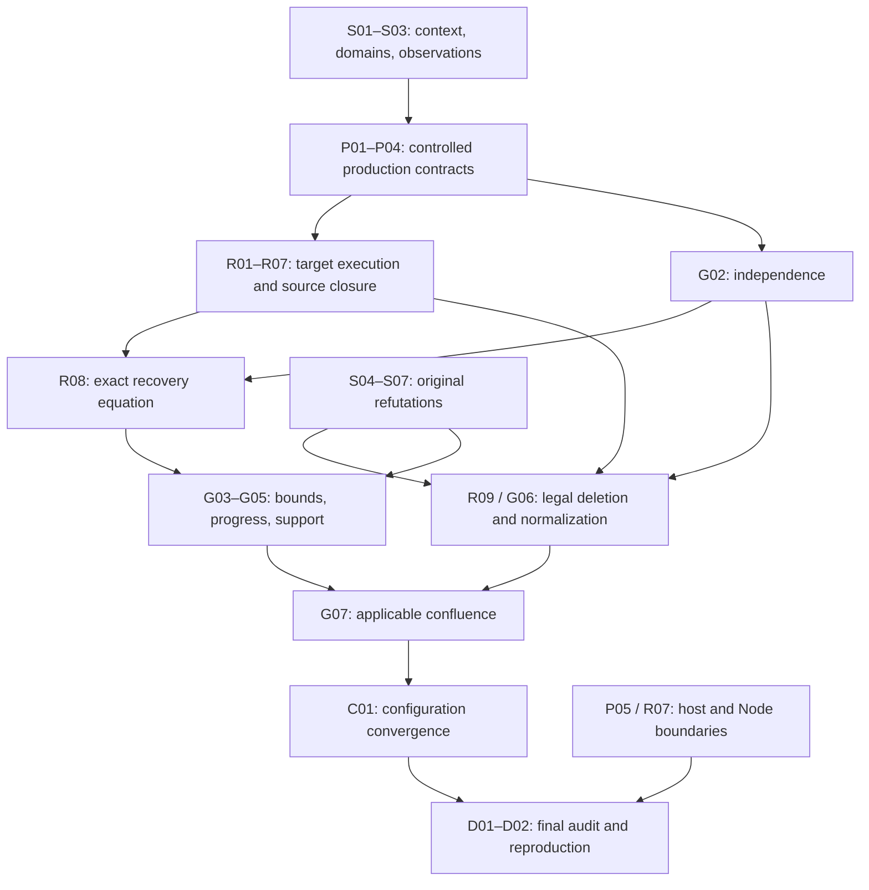

# Paper-to-code remaining-obligation inventory

[中文](paper-mapping-inventory.zh-CN.md) · [JSON](paper-mapping-inventory.json) · [Original ledger](paper-coverage.md) · [Milestones](paper-refinement-roadmap.md)

Generated from the inventory JSON and the existing ledger/plan. Edit the JSON, then run the checker; do not promote paper statuses in this view.

**Baseline `2026-10-20.v1`** — An inventory of remaining end-state obligations, not a new proof, a completion percentage, or a replacement for the original-paper gate.

This is a complete allocation of the reviewed scope, not a promise that no further research issue can arise. R1–R4 remain technical classifications; stable obligation IDs measure closure. R1/R2's scoped completion is retained.

## Current position

- Original audit: 42 formalized definitions, 17 proved claims, 18 partial entries, 4 refuted claims; 4 integration obligations remain open.
- This remaining-work baseline has **31 closure units**, **31 still open**. Their existing proofs and runtime paths are recorded below. This is not a zero-percent project: the list intentionally excludes already closed local work.
- The 18 partial original entries are: 28, 47, 55, 56, 57, 60, 61, 64, 65, 66, 67, 68, 69, 70, 73, 78, 79, 80.
- Refuted original entries: 62, 71, 75, 77. Corrected-contract acceptance cannot make the original-proof gate pass.
- Remaining stages: acceptance 2, composition 20, integration 4, specification 5.

Stages describe the main remaining work: specification = settle a precise statement; composition = derive the combined theorem from actual sources; integration = connect/enforce the production path; acceptance = review and reproduce the completed chain. They are not percentages.

No defensible whole-project percentage or iteration count yet. The 31 units are remaining closure obligations of unequal size, not 31 coding rounds. First close the high-risk semantic/access/target-state questions, then estimate implementation and acceptance work separately.

The old development report belongs to its recorded tree. This inventory adds no Verus run and does not refresh that report. Review-input hashes below detect changed audit inputs; they are not proof evidence. Release/platform installation is tracked separately from semantic completion.

## Completion targets and preserved work

- **`original-audit`**: Audit every original statement under its actual hypotheses. Preserve refutations and unresolved original interpretations. The existing original-proof gate remains unchanged.
- **`implementation-mapping`**: Complete production mapping for explicitly stated original or revised contracts across the required surfaces. Each revision must identify changed clauses and downstream consequences; it cannot silently narrow the original target.

Close a unit only after its stated conclusions and acceptance conditions are satisfied. Documenting a boundary, selecting a revision or adding a helper lemma is not by itself closure. Any unresolved subgoal must remain assigned to an open unit. Revised implementation theorems and original-paper audit outcomes remain distinct.

- **R1 / `finite-strict-context/v1`**: Completed scoped semantics; S01–S03 track whole-paper interpretation consequences, not a rewrite of R1. [Scope](r1-semantics.md)
- **R2 / `managed-production/v1`**: Completed scoped production refinement; P04 reuses it for the strengthened final carrier. [Scope](r2-acceptance.md)

## Closure order and highest uncertainty

Dependencies are closure prerequisites, not a ban on parallel implementation using already established local contracts.

Resolve or sharply bound these risks first: [S01](#s01), [S02](#s02), [P01](#p01), [R01](#r01), [R08](#r08), [G02](#g02), [G04](#g04), [G07](#g07).

The first implementation sequence is the context/domain audit and controlled-access boundary (S01/S02/P01), then actual target-state correspondence (R01). In parallel, check the source-frozen-map versus target-reexecution bridge (R08) and independence (G02) early; do not wait for the full scheduler to discover a semantic mismatch. General progress and confluence (G04/G07) remain separate high-risk conclusions, not presumed consequences of local tests.



This diagram is a summary; the exact acyclic closure dependencies are in each unit and JSON.

## Stable remaining units

S/P/R/G/C/D are inventory unit prefixes. For example, R01 is a recovery obligation, not the existing R1 milestone. The category totals are 7 semantics/audit, 5 production/boundary, 9 recovery, 7 global, 1 configuration and 2 final-audit/reproduction units.

| ID | Obligation | Current stage / risk | Closure prerequisites |
| --- | --- | --- | --- |
| [S01](#s01) | Resolve the context model and propagate the interpretation | specification / high | — |
| [S02](#s02) | Close strict domains, confinement and the Child exception | specification / high | [S01](#s01) |
| [S03](#s03) | Connect full function observations and name transport | composition / high | [S01](#s01), [S02](#s02) |
| [S04](#s04) | Close the disposition of vestigial-entry Lemma 62 | composition / medium | — |
| [S05](#s05) | Close the completion clause of Theorem 71 | specification / medium | — |
| [S06](#s06) | Close support well-foundedness Lemma 75 | specification / medium | — |
| [S07](#s07) | Close quiescent support Lemma 77 | specification / medium | — |
| [P01](#p01) | Enforce the complete controlled-effect boundary | integration / high | [S02](#s02) |
| [P02](#p02) | Compose the complete admitted component carrier | composition / high | [S02](#s02), [P01](#p01) |
| [P03](#p03) | Close aliases, dynamic bindings and value observations | composition / high | [S02](#s02), [P01](#p01) |
| [P04](#p04) | Close production-step composition for the final scope | composition / medium | [S03](#s03), [P02](#p02), [P03](#p03) |
| [P05](#p05) | Audit and enforce host and external-resource contracts | integration / high | [P01](#p01) |
| [R01](#r01) | Derive the shared target heap and cross-call inputs | composition / high | [P01](#p01), [P03](#p03), [S03](#s03) |
| [R02](#r02) | Execute the complete surviving native lifecycle | integration / high | [R01](#r01), [P02](#p02), [P04](#p04) |
| [R03](#r03) | Derive complete selection from producer ownership | composition / high | [P01](#p01), [P04](#p04) |
| [R04](#r04) | Compose Child, consumers and repeated episodes | composition / high | [R02](#r02), [R03](#r03), [S04](#s04) |
| [R05](#r05) | Transport selected episodes through Mixed and Fresh | composition / medium | [S03](#s03), [S04](#s04), [R03](#r03) |
| [R06](#r06) | Connect admitted async landing and interval cleanup | composition / high | [R02](#r02), [R03](#r03), [P05](#p05) |
| [R07](#r07) | Prove recovery for the separate Node protocol | integration / high | [P03](#p03), [P05](#p05), [R03](#r03) |
| [R08](#r08) | Compose the exact recovery expression at every cut | composition / high | [R01](#r01), [R02](#r02), [R03](#r03), [R04](#r04), [R05](#r05), [R06](#r06), [R07](#r07), [G02](#g02) |
| [R09](#r09) | Close legal episode deletion separately from recovery | composition / high | [R02](#r02), [R04](#r04), [R05](#r05), [S04](#s04), [G02](#g02) |
| [G01](#g01) | Compose preservation and lifecycle ordering | composition / medium | [P04](#p04), [S02](#s02) |
| [G02](#g02) | Derive general independence from actual effect contracts | composition / high | [P01](#p01), [P02](#p02), [P03](#p03), [S03](#s03) |
| [G03](#g03) | Produce total-provision and finiteness certificates | composition / high | [P02](#p02), [G01](#g01) |
| [G04](#g04) | Prove dynamic progress and separate host liveness | composition / high | [G03](#g03), [G01](#g01), [R08](#r08), [S05](#s05), [R06](#r06) |
| [G05](#g05) | Compose corrected support with actual quiet states | composition / medium | [S06](#s06), [S07](#s07), [G03](#g03) |
| [G06](#g06) | Construct general legal transpositions and normalization | composition / high | [S03](#s03), [S04](#s04), [G01](#g01), [G02](#g02), [R09](#r09) |
| [G07](#g07) | Close canonical form and applicable confluence | composition / high | [G04](#g04), [G05](#g05), [G06](#g06) |
| [C01](#c01) | Connect reconciliation and HMR to the final configuration | composition / high | [P04](#p04), [P05](#p05), [R08](#r08), [G05](#g05), [G07](#g07) |
| [D01](#d01) | Audit every final theorem's production premises | acceptance / medium | [S01](#s01), [S02](#s02), [S03](#s03), [S04](#s04), [S05](#s05), [S06](#s06), [S07](#s07), [P01](#p01), [P02](#p02), [P03](#p03), [P04](#p04), [P05](#p05), [R08](#r08), [R09](#r09), [G01](#g01), [G07](#g07), [C01](#c01) |
| [D02](#d02) | Freeze and independently reproduce the complete mapping | acceptance / medium | [D01](#d01) |

## Execution surfaces, including unnumbered claims

Numbered-item coverage alone misses §4.4 asynchronous/failure/isolation/configuration arguments and §5 reconciliation/HMR claims. These surfaces are required by this inventory; opaque internals remain explicitly audited obligations, not implicit proof coverage.

| Surface | Paper location | Obligations |
| --- | --- | --- |
| Definitions and original claims | §3–4; all 81 numbered entries | [S01](#s01), [S02](#s02), [S03](#s03), [S04](#s04), [S05](#s05), [S06](#s06), [S07](#s07), [G02](#g02), [G05](#g05), [G07](#g07), [D01](#d01), [D02](#d02) |
| Native managed production | §4.2–4.3; §5.1 | [S02](#s02), [S03](#s03), [S04](#s04), [S06](#s06), [S07](#s07), [P01](#p01), [P02](#p02), [P03](#p03), [P04](#p04), [R01](#r01), [R02](#r02), [R03](#r03), [R04](#r04), [R06](#r06), [R08](#r08), [R09](#r09), [G01](#g01), [G02](#g02), [G03](#g03), [G04](#g04), [G05](#g05), [G06](#g06), [G07](#g07), [D01](#d01), [D02](#d02) |
| Mixed fixed-name interpreter | §4.2–4.3 | [S02](#s02), [S03](#s03), [S04](#s04), [P02](#p02), [R05](#r05), [R08](#r08), [R09](#r09), [G01](#g01), [G02](#g02), [G03](#g03), [G04](#g04), [G06](#g06), [G07](#g07), [D01](#d01), [D02](#d02) |
| Fresh dynamic-name interpreter | §4.2–4.3 | [S02](#s02), [S03](#s03), [S04](#s04), [S06](#s06), [P02](#p02), [R05](#r05), [R08](#r08), [R09](#r09), [G01](#g01), [G02](#g02), [G03](#g03), [G04](#g04), [G06](#g06), [G07](#g07), [D01](#d01), [D02](#d02) |
| Admitted async and split cleanup | §4.4 Asynchrony / Failure | [S05](#s05), [P05](#p05), [R06](#r06), [R08](#r08), [G01](#g01), [G04](#g04), [D01](#d01), [D02](#d02) |
| Node protocol and reference bridge | Implementation realization; §4.4 / §5.1, not a separate numbered theorem | [P03](#p03), [P04](#p04), [P05](#p05), [R07](#r07), [R08](#r08), [G01](#g01), [C01](#c01), [D01](#d01), [D02](#d02) |
| Loader, configuration, isolation and HMR | §4.4 Isolation / Configuration; §5.2; Definition 81 | [S07](#s07), [P03](#p03), [P04](#p04), [P05](#p05), [G05](#g05), [C01](#c01), [D01](#d01), [D02](#d02) |
| Ordinary adapters and external-resource boundaries | §4.4; §5.1; acquisition/emission distinction | [P01](#p01), [P04](#p04), [P05](#p05), [R02](#r02), [R03](#r03), [R04](#r04), [R06](#r06), [R07](#r07), [G04](#g04), [C01](#c01), [D01](#d01), [D02](#d02) |

## Every numbered paper item

Original statuses and source symbols are read from the original ledger. The first evidence link is an audit entry point; it does not claim that the entire entry is discharged by that symbol. Each row has substantive remaining units in addition to D01/D02.

| # / original statement | Original audit | Implementation connection still to close | Units |
| --- | --- | --- | --- |
| Definition 1: Twisted composition | `formalized` | Composition order and real inverse order must agree. [foundations.rs::compose](../crates/cordis-kernel/src/foundations.rs) | [P01](#p01) |
| Definition 2: Effect context | `formalized` | Instantiate the abstract state with the shared runtime interpretation. [foundations.rs::Tracked](../crates/cordis-kernel/src/foundations.rs) | [P01](#p01) |
| Definition 3: Tracking | `formalized` | Connect tracking to actual issued and retained effects. [foundations.rs::track](../crates/cordis-kernel/src/foundations.rs) | [P01](#p01) |
| Theorem 4: Tracking projection | `proved` | Reuse the projection theorem at real execution boundaries. [foundations.rs::track_projection](../crates/cordis-kernel/src/foundations.rs) | [P01](#p01) |
| Theorem 5: Tracking monoid homomorphism | `proved` | Instantiate the homomorphism on complete actual histories. [foundations.rs::track_monoid](../crates/cordis-kernel/src/foundations.rs) | [P01](#p01) |
| Definition 6: Recovery | `formalized` | Fix the observation and inverse-definedness meaning of recovery. [foundations.rs::recover](../crates/cordis-kernel/src/foundations.rs) | [P01](#p01), [R08](#r08) |
| Theorem 7: Tracking preserves recovery | `proved` | Compose the tracked recovery theorem with actual cleanup results. [foundations.rs::tracking_preserves_recovery](../crates/cordis-kernel/src/foundations.rs) | [P01](#p01), [R08](#r08) |
| Definition 8: Witnessed effect | `formalized` | Every admitted effect must supply its actual returned inverse law. [foundations.rs::witnessed](../crates/cordis-kernel/src/foundations.rs) | [P01](#p01), [P05](#p05), [R03](#r03), [R08](#r08) |
| Definition 9: Effect composition | `formalized` | Use the real heterogeneous inverse order and retained payloads. [foundations.rs::diamond](../crates/cordis-kernel/src/foundations.rs) | [P01](#p01), [R03](#r03), [R08](#r08) |
| Theorem 10: Effect monoid | `proved` | Reuse the algebra; production instantiation remains distinct. [foundations.rs::effect_monoid](../crates/cordis-kernel/src/foundations.rs) | [P01](#p01), [R08](#r08) |
| Theorem 11: Witness composition | `proved` | Derive composed witnesses from actual successive returns. [foundations.rs::witness_composition](../crates/cordis-kernel/src/foundations.rs) | [P01](#p01), [R08](#r08) |
| Definition 12: Effect lifting | `formalized` | Lift the same real state and accumulator, not a parallel model. [foundations.rs::effect](../crates/cordis-kernel/src/foundations.rs) | [P01](#p01), [R08](#r08) |
| Theorem 13: Lift preserves composition | `proved` | Connect lifted composition to the actual sequence of calls. [foundations.rs::effect_homomorphism](../crates/cordis-kernel/src/foundations.rs) | [P01](#p01), [R08](#r08) |
| Theorem 14: Lifted forward projection | `proved` | Retain the projection relation after failures and retries. [foundations.rs::effect_projection](../crates/cordis-kernel/src/foundations.rs) | [P01](#p01), [R08](#r08) |
| Theorem 15: Lifted recovery | `proved` | Audit accumulated-map recovery, not merely an empty queue. [foundations.rs::lifted_recovery](../crates/cordis-kernel/src/foundations.rs) | [P01](#p01), [R08](#r08) |
| Theorem 16: Finite local temporal composability | `proved` | Instantiate finite composition over actual interleavings. [foundations.rs::local_temporal_sequence](../crates/cordis-kernel/src/foundations.rs) | [P01](#p01), [R03](#r03), [R08](#r08) |
| Definition 17: Witnessed iterators | `formalized` | Cover the whole admitted iterator carrier and its continuations. [history.rs::IteratorStep](../crates/cordis-kernel/src/history.rs) | [P01](#p01), [P02](#p02), [P05](#p05), [R06](#r06), [G03](#g03), [G04](#g04) |
| Definition 18: Iterator lifting | `formalized` | Separate finite iterator denotation from opaque Future termination. [canonical.rs::advance](../crates/cordis-kernel/src/canonical.rs) | [P01](#p01), [P02](#p02), [P05](#p05), [R06](#r06), [G03](#g03), [G04](#g04) |
| Definition 19: Dependent coeffect context | `formalized` | Connect dependent values to actual provider slots and payload kinds. [contexts.rs::typed](../crates/cordis-kernel/src/contexts.rs) | [P03](#p03), [C01](#c01) |
| Definition 20: Get and set | `formalized` | Preserve exact absent-key and revoke domains in real operations. [contexts.rs::get](../crates/cordis-kernel/src/contexts.rs) | [P03](#p03) |
| Definition 21: Coeffect specification | `formalized` | Relate declarations to actual realm-resolved dependencies. [observation.rs::related_satisfaction](../crates/cordis-kernel/src/observation.rs) | [P03](#p03) |
| Definition 22: Coeffect satisfaction | `formalized` | Establish actual availability without substituting payload equality. [observation.rs::related_satisfaction](../crates/cordis-kernel/src/observation.rs) | [P03](#p03) |
| Definition 23: Effect realizations | `formalized` | Map both derived scopes and in-place aliasing to their actual heaps. [contexts.rs::derive_scope](../crates/cordis-kernel/src/contexts.rs) | [P03](#p03), [P05](#p05), [R01](#r01), [R07](#r07) |
| Definition 24: Isolated coeffect context | `formalized` | Transport fixed realm interpretation through actual registration. [contexts.rs::Isolated](../crates/cordis-kernel/src/contexts.rs) | [P03](#p03), [C01](#c01) |
| Definition 25: Get, set and isolate | `formalized` | Check isolation/provision effects against the same resolved keys. [contexts.rs::isolate](../crates/cordis-kernel/src/contexts.rs) | [P03](#p03) |
| Definition 26: Interception context | `formalized` | Connect metadata interpretation to stored schema/interception inputs. [contexts.rs::Metadata](../crates/cordis-kernel/src/contexts.rs) | [P03](#p03), [C01](#c01) |
| Definition 27: Get, set and intercept | `formalized` | Preserve interception composition and real binding ownership. [contexts.rs::intercepted_get](../crates/cordis-kernel/src/contexts.rs) | [P03](#p03) |
| Definition 28: Combined recursive context | `partial` | Resolve the recursive-model reading; retain the R1-CONTEXT distinction. [contexts.rs::FiniteLayer](../crates/cordis-kernel/src/contexts.rs) | [S01](#s01) |
| Definition 29: Operations and outcomes | `formalized` | Use real operands, outcomes, domains and captured inverses. [mediated.rs::ValueYield](../crates/cordis-kernel/src/mediated.rs) | [S02](#s02), [P01](#p01), [P02](#p02), [P05](#p05), [R01](#r01), [R06](#r06) |
| Definition 30: Context-mediated iterator grammar | `formalized` | Cover all admitted constructors and dependent continuations. [mediated.rs::Node](../crates/cordis-kernel/src/mediated.rs) | [S02](#s02), [P01](#p01), [P02](#p02), [R01](#r01), [R05](#r05) |
| Definition 31: Observation tests | `formalized` | State exactly which actual observations and failures are compared. [observation.rs::test](../crates/cordis-kernel/src/observation.rs) | [S03](#s03) |
| Lemma 32: Coarsest observational equivalence | `proved` | Reuse the equivalence theorem without changing its test family. [observation.rs::observational_equivalence](../crates/cordis-kernel/src/observation.rs) | [S03](#s03) |
| Definition 33: Context equivalence | `formalized` | Separate service observation, admission and full-state equivalence. [observation.rs::context_equal](../crates/cordis-kernel/src/observation.rs) | [S02](#s02), [S03](#s03), [P03](#p03) |
| Definition 34: Lifting relations | `formalized` | Relate outputs, inverse maps and continuations, not only values. [observation.rs::related_maps](../crates/cordis-kernel/src/observation.rs) | [S02](#s02), [S03](#s03), [G06](#g06), [G07](#g07) |
| Lemma 35: Partial equivalence of maps and iterators | `proved` | Instantiate the partial-equivalence laws on the selected carrier. [observation.rs::map_partial_equivalence](../crates/cordis-kernel/src/observation.rs) | [S02](#s02), [S03](#s03) |
| Definition 36: Observational effect witness | `formalized` | Discharge each primitive's observational recovery witness. [observation.rs::witnessed_effect](../crates/cordis-kernel/src/observation.rs) | [S02](#s02), [P01](#p01), [G02](#g02) |
| Definition 37: Observational iterator witness | `formalized` | Derive full-carrier iterator witness membership. [quotient.rs::bisimulation](../crates/cordis-kernel/src/quotient.rs) | [S02](#s02), [S03](#s03), [P01](#p01), [P02](#p02), [G02](#g02) |
| Lemma 38: Transport of effect laws to observations | `proved` | Transport concrete laws to the same production observation. [observation.rs::witnessed_effect_composition](../crates/cordis-kernel/src/observation.rs) | [S02](#s02), [P01](#p01), [G02](#g02) |
| Lemma 39: Context-mediated admissibility | `proved` | Connect grammar admissibility to actual admitted programs. [mediated.rs::restricted_admissibility](../crates/cordis-kernel/src/mediated.rs) | [S02](#s02), [P01](#p01), [P02](#p02), [G02](#g02) |
| Definition 40: Reachable iterators and monoids | `formalized` | Include every semantically reachable stage, not only executed ones. [monoid.rs::reach](../crates/cordis-kernel/src/monoid.rs) | [S02](#s02), [P01](#p01), [P02](#p02), [G02](#g02) |
| Lemma 41: Generator closure laws | `proved` | Use generator closure for actual supported operation families. [monoid.rs::generator_commutation](../crates/cordis-kernel/src/monoid.rs) | [S02](#s02), [P01](#p01), [P02](#p02), [G02](#g02) |
| Definition 42: Iterator independence | `formalized` | Prove inverse-domain and continuation stability in both directions. [history.rs::independent_stages](../crates/cordis-kernel/src/history.rs) | [S02](#s02), [G02](#g02), [G06](#g06) |
| Theorem 43: Recovery in any inverse permutation | `proved` | Establish permutation premises before applying inverse recovery. [permutation.rs::arbitrary_inverse_recovery](../crates/cordis-kernel/src/permutation.rs) | [S02](#s02), [R08](#r08), [G02](#g02) |
| Definition 44: Operation independence | `formalized` | Derive shared-key commutation from actual operation laws. [partial_independence.rs::value_independent](../crates/cordis-kernel/src/partial_independence.rs) | [S02](#s02), [P01](#p01), [P03](#p03), [G02](#g02) |
| Theorem 45: Distinct-key independence | `proved` | Distinct names are insufficient when they alias one allocation. [partial_independence.rs::distinct_nodes](../crates/cordis-kernel/src/partial_independence.rs) | [S02](#s02), [P01](#p01), [P03](#p03), [G02](#g02) |
| Definition 46: Witnessed coeffect | `formalized` | Supply the appropriate witnessed operation library per value kind. [partial_independence.rs::witnessed_keys](../crates/cordis-kernel/src/partial_independence.rs) | [S02](#s02), [P01](#p01), [P03](#p03), [G02](#g02) |
| Theorem 47: Interface compatibility implies independence | `partial` | Keep strict-domain independence separate from the original total claim. [partial_independence.rs::reachable_independence](../crates/cordis-kernel/src/partial_independence.rs) | [S02](#s02), [P03](#p03), [G02](#g02), [G06](#g06) |
| Definition 48: Components | `formalized` | Prove actual parent/root/Child membership for the final carrier. [program.rs::ProgramEpisode](../crates/cordis-kernel/src/program.rs) | [S01](#s01), [P02](#p02), [P04](#p04), [P05](#p05), [R03](#r03), [R04](#r04), [R07](#r07), [G03](#g03), [C01](#c01) |
| Definition 49: Fibers | `formalized` | Interpret real roots, current code, tables and inverse functions. [refinement.rs::Fiber](../crates/cordis-kernel/src/refinement.rs) | [S01](#s01), [S03](#s03), [P02](#p02), [P04](#p04), [R01](#r01), [R02](#r02), [G01](#g01), [G07](#g07) |
| Definition 50: Registry and publication | `formalized` | Preserve publication, reservations and registration identities. [semantics.rs::publishes](../crates/cordis-kernel/src/semantics.rs) | [S01](#s01), [P03](#p03), [P04](#p04), [R01](#r01), [R02](#r02), [R07](#r07), [G01](#g01) |
| Definition 51: All-fiber key-restricted projection | `formalized` | Observe every registered table, including non-Active owners. [projection.rs::project](../crates/cordis-kernel/src/projection.rs) | [P03](#p03), [P04](#p04), [R01](#r01), [R07](#r07), [G01](#g01) |
| Definition 52: Child creation inverse | `formalized` | The inverse retires its actual captured child; retirement is not removal. [child_history.rs::retained](../crates/cordis-kernel/src/child_history.rs) | [S02](#s02), [S04](#s04), [S07](#s07), [P02](#p02), [R02](#r02), [R03](#r03), [R04](#r04), [R05](#r05), [R09](#r09), [G01](#g01), [G05](#g05), [C01](#c01) |
| Definition 53: Target and quiescence | `formalized` | Keep actual target identity distinct from committed identity. [semantics.rs::target](../crates/cordis-kernel/src/semantics.rs) | [P03](#p03), [P04](#p04), [R02](#r02), [R07](#r07), [G01](#g01), [G04](#g04) |
| Definition 54: Reliance | `formalized` | Derive retained consumer bindings and the real provider release guard. [refinement.rs::relied](../crates/cordis-kernel/src/refinement.rs) | [P04](#p04), [P05](#p05), [R02](#r02), [R03](#r03), [R04](#r04), [R06](#r06), [R07](#r07), [G01](#g01) |
| Definition 55: Confinement | `partial` | Complete Writes and Reads, including strict domains and Child exceptions. [semantics.rs::confined_write](../crates/cordis-kernel/src/semantics.rs) | [S01](#s01), [S02](#s02), [P01](#p01), [P02](#p02), [P03](#p03), [P05](#p05), [G02](#g02) |
| Definition 56: Context lift | `partial` | Connect the lifted language's denotation to the chosen context model. [semantics.rs::child_lands](../crates/cordis-kernel/src/semantics.rs) | [S01](#s01), [S02](#s02), [P01](#p01), [P02](#p02), [P03](#p03), [G02](#g02) |
| Lemma 57: Lifted admissibility | `partial` | Use full-carrier membership, not only successful-prefix safety. [preservation.rs::forward_preservation](../crates/cordis-kernel/src/preservation.rs) | [S01](#s01), [S02](#s02), [P01](#p01), [P02](#p02), [R06](#r06), [G02](#g02), [G03](#g03), [G04](#g04) |
| Definition 58: Execution and episode observations | `formalized` | Preserve exact episodes, frozen maps and full function observations. [child_history.rs::history](../crates/cordis-kernel/src/child_history.rs) | [S01](#s01), [S03](#s03), [S05](#s05), [P04](#p04), [P05](#p05), [R01](#r01), [R02](#r02), [R03](#r03), [R04](#r04), [R05](#r05), [R06](#r06), [R07](#r07), [R08](#r08), [R09](#r09), [G01](#g01), [G04](#g04), [G06](#g06), [G07](#g07) |
| Lemma 59: Rule frame facts | `proved` | Compose existing frame facts at every included production transition. [preservation.rs::installation_frame](../crates/cordis-kernel/src/preservation.rs) | [P04](#p04), [R02](#r02), [G01](#g01) |
| Lemma 60: Observational rule invariance | `partial` | Prove rule transport for the selected full observation relation. [quotient.rs::step_simulates](../crates/cordis-kernel/src/quotient.rs) | [S03](#s03), [G06](#g06), [G07](#g07) |
| Lemma 61: Name equivariance | `partial` | Rename inputs, stored references and historical identities together. [alpha.rs::full_step_equivariant](../crates/cordis-kernel/src/alpha.rs) | [S03](#s03), [P03](#p03), [R01](#r01), [R05](#r05), [G06](#g06), [G07](#g07) |
| Lemma 62: Vestigial entries | `refuted` | Keep the original refutation and connect guarded replacement uses. [semantics.rs::vestigial_parent_counterexample](../crates/cordis-kernel/src/semantics.rs) | [S04](#s04), [R04](#r04), [R09](#r09), [G06](#g06) |
| Definition 63: Well-formed registries | `formalized` | Tie well-formedness to actual source and successor states. [preservation.rs::well_formed](../crates/cordis-kernel/src/preservation.rs) | [P04](#p04), [G01](#g01) |
| Theorem 64: Preservation | `partial` | Compose preservation for complete interpreted components and extensions. [preservation.rs::full_preservation](../crates/cordis-kernel/src/preservation.rs) | [P04](#p04), [G01](#g01) |
| Definition 65: Independence and entanglement | `partial` | Audit all historical component pairs and actual shared operations. [canonical.rs::independent](../crates/cordis-kernel/src/canonical.rs) | [G02](#g02), [G06](#g06) |
| Lemma 66: Pairwise independence | `partial` | Derive pairwise independence rather than infer it from declarations. [partial_independence.rs::reachable_independence](../crates/cordis-kernel/src/partial_independence.rs) | [G02](#g02), [G06](#g06) |
| Lemma 67: Entangled steps | `partial` | Close entangled effects and strict inverse domains across interleavings. [global.rs::control_no_deadlock](../crates/cordis-kernel/src/global.rs) | [R03](#r03), [R04](#r04), [R08](#r08), [G02](#g02), [G06](#g06) |
| Theorem 68: Global recovery exactness | `partial` | Prove Equation (55) for source-frozen maps at every admissible cut. [canonical.rs::erase_execution](../crates/cordis-kernel/src/canonical.rs) | [P05](#p05), [R01](#r01), [R02](#r02), [R03](#r03), [R04](#r04), [R05](#r05), [R06](#r06), [R07](#r07), [R08](#r08), [R09](#r09), [G02](#g02) |
| Corollary 69: Terminal recovery | `partial` | Connect Equation (56) and empty owner tables to actual Unload. [canonical.rs::closed_owner_deletion](../crates/cordis-kernel/src/canonical.rs) | [S05](#s05), [P05](#p05), [R01](#r01), [R02](#r02), [R03](#r03), [R04](#r04), [R05](#r05), [R06](#r06), [R07](#r07), [R08](#r08), [R09](#r09), [G04](#g04) |
| Theorem 70: Lifecycle ordering | `partial` | Derive episode containment and provider lifetime from actual traces. [preservation.rs::execution_resource_safety](../crates/cordis-kernel/src/preservation.rs) | [P04](#p04), [P05](#p05), [R02](#r02), [R04](#r04), [R06](#r06), [R07](#r07), [G01](#g01) |
| Theorem 71: Resolution coherence | `refuted` | Preserve coherence, correct the false unconditional completion clause. [program_trace.rs::local_refinement](../crates/cordis-kernel/src/program_trace.rs) | [S05](#s05), [P04](#p04), [R06](#r06), [G04](#g04) |
| Definition 72: Provider precedence | `formalized` | Source acyclicity/ranking; allocation order is not provider order. [global.rs::predecessor](../crates/cordis-kernel/src/global.rs) | [S06](#s06), [G03](#g03), [G04](#g04), [G05](#g05) |
| Theorem 73: Progress and termination | `partial` | Derive dynamic no-deadlock and termination under sourced conditions. [termination.rs::finite_lifecycle_bound](../crates/cordis-kernel/src/termination.rs) | [S05](#s05), [P05](#p05), [R06](#r06), [G03](#g03), [G04](#g04), [G07](#g07) |
| Definition 74: Support equation | `formalized` | Use an origin-aware support interpretation consistent with the code. [global.rs::support_clause](../crates/cordis-kernel/src/global.rs) | [S06](#s06), [S07](#s07), [G05](#g05), [G07](#g07), [C01](#c01) |
| Lemma 75: Support well-foundedness | `refuted` | Retain the counterexample; audit union-rank and uniqueness separately. [global.rs::replacement_support_cycle](../crates/cordis-kernel/src/global.rs) | [S06](#s06), [G05](#g05), [G07](#g07) |
| Definition 76: Total provision | `formalized` | Component total provision is stronger than a checked Active snapshot. [semantics.rs::total_active](../crates/cordis-kernel/src/semantics.rs) | [S07](#s07), [P02](#p02), [R09](#r09), [G03](#g03), [G05](#g05), [G07](#g07), [C01](#c01) |
| Lemma 77: Support at quiescence | `refuted` | Retain the external-child counterexample and corrected origin rules. [child_history.rs::external_parent_support_counterexample](../crates/cordis-kernel/src/child_history.rs) | [S07](#s07), [G05](#g05), [G07](#g07), [C01](#c01) |
| Lemma 78: Transposition | `partial` | Construct legal exchanges and suffixes with all input dependencies. [paper_counterexamples.rs::transposition_parent_counterexample](../crates/cordis-kernel/src/paper_counterexamples.rs) | [S03](#s03), [S04](#s04), [R05](#r05), [G02](#g02), [G06](#g06), [G07](#g07) |
| Lemma 79: Episode deletion | `partial` | Audit original deletion premises separately from broader recovery goals. [canonical.rs::closed_owner_deletion](../crates/cordis-kernel/src/canonical.rs) | [S04](#s04), [R01](#r01), [R02](#r02), [R03](#r03), [R04](#r04), [R05](#r05), [R07](#r07), [R09](#r09), [G06](#g06), [G07](#g07) |
| Theorem 80: Canonical form and confluence | `partial` | Compose canonical execution and arbitrary eligible schedule equivalence. [paper_counterexamples.rs::canonical_counterexample_quiet](../crates/cordis-kernel/src/paper_counterexamples.rs) | [S03](#s03), [S04](#s04), [S06](#s06), [S07](#s07), [R09](#r09), [G02](#g02), [G03](#g03), [G05](#g05), [G06](#g06), [G07](#g07), [C01](#c01) |
| Definition 81: Configuration entries | `formalized` | Separate the six-field record from reconciliation/HMR convergence claims. [configuration_entry.rs::Entry](../crates/cordis-kernel/src/configuration_entry.rs) | [S07](#s07), [P04](#p04), [P05](#p05), [G05](#g05), [C01](#c01) |

## Four whole-project integration obligations

These stay open in the original ledger. Completing a scoped R1/R2 milestone does not automatically close them.

| Obligation | Closure condition | Units |
| --- | --- | --- |
| `whole-lifecycle` (open) | Use one stated interpretation for actual recovery, ordering, progress and applicable confluence, with sourced premises for every included path. | [P02](#p02), [P04](#p04), [R01](#r01), [R02](#r02), [R03](#r03), [R04](#r04), [R05](#r05), [R06](#r06), [R07](#r07), [R08](#r08), [R09](#r09), [G01](#g01), [G02](#g02), [G03](#g03), [G04](#g04), [G05](#g05), [G06](#g06), [G07](#g07), [D01](#d01), [D02](#d02) |
| `corrected-specification` (open) | Publish an original-item disposition and an explicit, consistently propagated implementation contract for every revision; preserve original refutations. | [S01](#s01), [S02](#s02), [S03](#s03), [S04](#s04), [S05](#s05), [S06](#s06), [S07](#s07), [G05](#g05), [G06](#g06), [G07](#g07), [D01](#d01) |
| `executable-simulation` (open) | Every claimed operation and transformed execution is produced by the original executable path under proved caller premises. | [P01](#p01), [P02](#p02), [P03](#p03), [P04](#p04), [R01](#r01), [R02](#r02), [R05](#r05), [R06](#r06), [R07](#r07), [R08](#r08), [R09](#r09), [D01](#d01), [D02](#d02) |
| `host-boundary` (open) | Enumerate and enforce all host boundaries; prove the internal protocol and resource contracts actually claimed, with explicit remaining environmental obligations. | [P03](#p03), [P04](#p04), [P05](#p05), [R06](#r06), [R07](#r07), [G04](#g04), [C01](#c01), [D01](#d01), [D02](#d02) |

## Existing R3 acceptance packages

The fixed R3-A/B/C/D exits remain unchanged. Additional semantic, production and independence prerequisites are visible in the dependency graph.

- **R3-A**: [R01](#r01), [R02](#r02)
- **R3-B**: [R03](#r03), [R04](#r04)
- **R3-C**: [R05](#r05), [R06](#r06), [R07](#r07)
- **R3-D**: [R08](#r08), [R09](#r09), [D01](#d01), [D02](#d02)

## Premise sources

`code_contract` means an existing bounded contract, not that every final caller already establishes it. `undischarged` remains a proof obligation. Environment sources do not absorb missing internal semantic proofs.

| ID | Premise / source | Kind | Review |
| --- | --- | --- | --- |
| <a id="m01"></a>M01 | **One consistent context and failure interpretation** — R1 proves finite-strict-context/v1; its three revisions do not establish the original unrestricted Gamma. | `specification` | [context.rs::reified_representation](../crates/cordis-kernel/src/mixed_driver/context.rs); [typed_child_domain.rs::no_single_recovery_and_admission_relation](../crates/cordis-kernel/src/typed_child_domain.rs) |
| <a id="m02"></a>M02 | **Primitive recovery and declared access** — Built-in scalar and typed replacement laws exist. Complete admitted-effect coverage and prevention of hidden shared writes are still required. | `code_contract` | [effect.rs::commit_calculation](../crates/cordis-kernel/src/reversible_value/effect.rs); [semantics.rs::primitive_theory](../crates/cordis-kernel/src/reversible_value/managed/semantics.rs) |
| <a id="m03"></a>M03 | **Authentic source and ownership history** — Recorded owners retain actual calls, registrations, releases and producer evidence; general closed selection must be derived from them. | `code_contract` | [chain.rs::inverse_source](../crates/cordis-kernel/src/lifecycle_state/native/runtime/control_source/chain.rs); [producer_recovery.rs::recorded_census](../crates/cordis-kernel/src/reversible_value/managed/interleaving/history/lifecycle/producer_recovery.rs) |
| <a id="m04"></a>M04 | **Target identity and current-state correspondence** — Actual allocation receipts establish an injective Bank map. Guarded scalar primitives check actual versioned selections before writing; typed cursors derive capacity and fresh head transport, including later calls after real restoration. Ownership preserving the full current heap throughout automatic root/Child execution, general bindings and complete reference transport remain undischarged. | `undischarged` | [bank.rs::bind](../crates/cordis-kernel/src/reversible_value/managed/replay/bank.rs); [transport.rs::pair_step](../crates/cordis-kernel/src/reversible_value/managed/replay/transport.rs); [selection.rs::check_scalar_replay](../crates/cordis-kernel/src/reversible_value/managed/replay/selection.rs) |
| <a id="m05"></a>M05 | **Independence includes domains and continuations** — Strict grammar results require concrete shared-key laws; declarations alone do not prove commutation or callback purity. | `undischarged` | [dependent_independence.rs::grammar_independence](../crates/cordis-kernel/src/dependent_independence.rs); [paper_trace_independence.rs::strict_source_commutative_key](../crates/cordis-kernel/src/paper_trace_independence.rs) |
| <a id="m06"></a>M06 | **Foreign producers and original Child obligations close** — Actual census and terminal evidence exist; complete closure across selected episodes is still a theorem obligation. | `undischarged` | [foreign.rs::closed_from_owners](../crates/cordis-kernel/src/reversible_value/managed/interleaving/history/lifecycle/recovery/cut/foreign.rs); [completion.rs::native_child_endpoint](../crates/cordis-kernel/src/reversible_value/managed/interleaving/history/lifecycle/children/completion.rs) |
| <a id="m07"></a>M07 | **Admission is distinct from eventual completion** — Tickets bind real admissions and reject stale landings. Intervening calls may invalidate an operation domain; completion is not implied by issuance. | `code_contract` | [typed_child_domain.rs::no_single_recovery_and_admission_relation](../crates/cordis-kernel/src/typed_child_domain.rs); [landing.rs::land_result](../crates/cordis-kernel/src/cleanup_queue/landing.rs) |
| <a id="m08"></a>M08 | **Quiescence hypotheses have producers** — Acyclic precedence, finite names, iterator bounds and total provision need code certificates or exact application obligations. | `undischarged` | [global.rs::precedence_ranking](../crates/cordis-kernel/src/global.rs); [paper_invariants.rs::totality_is_not_a_current_state_test](../crates/cordis-kernel/src/paper_invariants.rs); [global.rs::control_no_deadlock](../crates/cordis-kernel/src/global.rs) |
| <a id="m09"></a>M09 | **Host scheduling and eventual responses** — Fair scheduling and termination of opaque futures are not kernel invariants. State them only for conclusions that need them. | `environment` | [configuration_future.rs::poll_apply](../crates/cordis-kernel/src/configuration_future.rs); [completion.rs::complete_future](../crates/cordis-kernel/src/cleanup_queue/completion.rs); [attempt.rs::start](../crates/cordis/src/runtime/cleanup/attempt.rs); [attempt.rs::poll](../crates/cordis/src/runtime/cleanup/attempt.rs) |
| <a id="m10"></a>M10 | **External effects and host representation truth** — JS/Rust callback effects, mutable payload interiors, FFI conversions and filesystem truth need resource-specific contracts; an acknowledgement is not such a proof. | `environment` | [loader.rs::as_paper_entry](../crates/cordis/src/loader.rs); [cleanup_queue.rs::complete](../crates/cordis-kernel/src/cleanup_queue.rs) |
| <a id="m11"></a>M11 | **Complete frozen function-field observations** — Real receipts have denotations. Token equality or a stronger control-sensitive relation cannot silently replace the paper's all-input observation. | `undischarged` | [context.rs::function_correspondence](../crates/cordis-kernel/src/mixed_driver/context.rs); [strict_partial_quotient_boundary.rs::pure_table_self_relation_fails](../crates/cordis-kernel/src/strict_partial_quotient_boundary.rs) |
| <a id="m12"></a>M12 | **Full inputs and historical names are transported** — Fresh closed programs have structural naturality; arbitrary callbacks and literal external names do not inherit it. | `undischarged` | [external_inputs.rs::natural_execution_inputs](../crates/cordis-kernel/src/external_inputs.rs); [compaction.rs::compact](../crates/cordis-kernel/src/mixed_driver/fresh/compaction.rs) |
| <a id="m13"></a>M13 | **Failure and capacity are explicit domains** — Overflow, exhausted identities, failed prefixes and cleanup retries remain observable outcomes; successful admission is not totality. | `code_contract` | [managed.rs::failed_report](../crates/cordis-kernel/src/reversible_value/managed.rs); [replay.rs::instantiate_controlled](../crates/cordis-kernel/src/reversible_value/managed/replay.rs) |
| <a id="m14"></a>M14 | **Support uses the actual origin discipline** — External insertion and lifecycle-created children differ; provider acyclicity does not imply the parent/provider union is well founded. | `undischarged` | [orchestration_support_cycle.rs::actual_execution](../crates/cordis-kernel/src/orchestration_support_cycle.rs); [child_history.rs::retained_protocol_quiet_support](../crates/cordis-kernel/src/child_history.rs) |
| <a id="m15"></a>M15 | **Evidence is bound to the checked scope and source** — Inventory consistency is not verification. Existing development and selected-negative records cannot be relabeled as fresh or paper-wide passes. | `acceptance` | [inspected.rs::run_inspected](../crates/cordis-kernel/src/mixed_driver/fresh/inspected.rs) |

## Per-unit closure contracts

<a id="s01"></a>

### S01 · Resolve the context model and propagate the interpretation

**State:** `open` · `specification` · **Risk:** `high`

**Already available:** R1 has a nontrivial finite code/receipt model and a checked obstruction to the unrestricted set/function reading.

**Remaining conclusion:** The original model question and the downstream effect of choosing the strict revision are not closed for the whole paper.

**Closes only when:**

1. State the exact context, carriers and observation relations used by every final theorem, with no assumed recursive type equation.
2. For item 28, give a precise audited disposition under each claimed reading; list revised downstream statements separately from original claims.

**Validation required:** Review the diagonal obstruction and an inhabited implementation model; reject a model that equates arbitrary function fields with tokens.

**Premise sources:** [M01](#m01), [M11](#m11). **Closure dependencies:** —.

**Existing review path:** [recursive_context.rs::unrestricted_accumulator_obstruction](../crates/cordis-kernel/src/recursive_context.rs); [context.rs::reified_representation](../crates/cordis-kernel/src/mixed_driver/context.rs)

<a id="s02"></a>

### S02 · Close strict domains, confinement and the Child exception

**State:** `open` · `specification` · **Risk:** `high`

**Already available:** R1 proves parent/Child/continuation membership under separate admission and recovery observations; the two observations cannot generally be collapsed. The native operation audit lists the real read/write/restore entry points, observations and boundary obligations: [operation contracts](native-operation-contracts.md).

**Remaining conclusion:** Original total-domain independence and Reads, including absent foreign names and guarded Child insertion, need explicit disposition and replacement statements.

**Closes only when:**

1. Specify both forward and inverse domains on the entire stated carrier, including rejection, not only successful prefixes.
2. Carry the revised read/write and Child rules into every recovery and reordering theorem without an implicit partial-to-total conversion.

**Validation required:** Keep the equal-table/different-Child-domain witness and check the actual insertion guard against the selected interpretation.

**Premise sources:** [M01](#m01), [M02](#m02), [M05](#m05), [M13](#m13). **Closure dependencies:** [S01](#s01).

**Existing review path:** [typed_child_domain.rs::no_single_recovery_and_admission_relation](../crates/cordis-kernel/src/typed_child_domain.rs); [guarded_components.rs::member_is_component](../crates/cordis-kernel/src/guarded_components.rs)

<a id="s03"></a>

### S03 · Connect full function observations and name transport

**State:** `open` · `composition` · **Risk:** `high`

**Already available:** Closed-data paper contracts now relate real root/current data functions at arbitrary paired inputs and strict data inverse words; immutable stored/historical/future references use an injective allocation projection. The source/target sealed component word work is not yet a full parent/Child function theorem.

**Remaining conclusion:** Compose whole parent/Child control and inverse functions, including all admission/failure domains, and propagate the explicit strict Equation (54) revision. Original refutations and S01/S02 obligations remain.

**Closes only when:**

1. Relate actual roots, current continuations and accumulated inverses at arbitrary admissible test inputs, including failures.
2. Construct name/reference transport for stored values, retired identities and future inputs; audit precisely whether Equation (54) or a revision is obtained.

**Validation required:** Use different real inverse words with related observations; reject literal-name reuse that changes a future input.

**Premise sources:** [M11](#m11), [M12](#m12). **Closure dependencies:** [S01](#s01), [S02](#s02).

**Existing review path:** [context.rs::function_correspondence](../crates/cordis-kernel/src/mixed_driver/context.rs); [strict_partial_quotient_boundary.rs::pure_table_self_relation_fails](../crates/cordis-kernel/src/strict_partial_quotient_boundary.rs); [external_inputs.rs::natural_execution_inputs](../crates/cordis-kernel/src/external_inputs.rs)

<a id="s04"></a>

### S04 · Close the disposition of vestigial-entry Lemma 62

**State:** `open` · `composition` · **Risk:** `medium`

**Already available:** The original lemma is refuted; guarded erasure and retained-entry results already exist.

**Remaining conclusion:** A downstream-wide replacement has not been audited and connected to every deletion/normalization caller.

**Closes only when:**

1. Enumerate the parent, provision reservation, historical inverse and freshness exceptions in the replacement statement.
2. Remove reliance on the false unconditional rule from final proofs, while keeping item 62 refuted.

**Validation required:** Retain the reachable counterexample and a nonempty suffix transport through the actual retention guard.

**Premise sources:** [M12](#m12), [M14](#m14). **Closure dependencies:** —.

**Existing review path:** [deletion.rs::child_retirement_erases](../crates/cordis-kernel/src/deletion.rs); [typed_child_domain.rs::kernel_domain](../crates/cordis-kernel/src/typed_child_domain.rs)

<a id="s05"></a>

### S05 · Close the completion clause of Theorem 71

**State:** `open` · `specification` · **Risk:** `medium`

**Already available:** A total Unit component gives a finite-prefix counterexample to unconditional episode closure.

**Remaining conclusion:** The replacement must separate an actual closing event, extendibility and eventual closure under additional conditions.

**Closes only when:**

1. Preserve the proved coherence clauses and state exactly which completion clause changes.
2. Trace every eventual-completion use to the progress and host-response premises rather than a finite-prefix theorem.

**Validation required:** Keep the four-step counterexample and arbitrary legal delay; distinguish successful future extension from closure of the given trace.

**Premise sources:** [M07](#m07), [M09](#m09). **Closure dependencies:** —.

**Existing review path:** [resolution_completion_counterexample.rs::actual_counterexample](../crates/cordis-kernel/src/resolution_completion_counterexample.rs); [resolution_completion_counterexample.rs::arbitrary_delay](../crates/cordis-kernel/src/resolution_completion_counterexample.rs)

<a id="s06"></a>

### S06 · Close support well-foundedness Lemma 75

**State:** `open` · `specification` · **Risk:** `medium`

**Already available:** A reachable total Unit example has acyclic provider precedence and a cyclic parent/provider union.

**Remaining conclusion:** Choose and justify a corrected support theorem without assuming that provider rank also ranks parent edges.

**Closes only when:**

1. State whether the needed result is a support solution, uniqueness or a genuine union ranking; prove the exact claim under sourced premises.
2. Audit canonical-form uses of the invalid well-foundedness inference while preserving the original counterexample.

**Validation required:** Check the original total-component witness and exercise the corrected theorem on a nontrivial reachable registry.

**Premise sources:** [M08](#m08), [M14](#m14). **Closure dependencies:** —.

**Existing review path:** [orchestration_support_cycle.rs::actual_execution](../crates/cordis-kernel/src/orchestration_support_cycle.rs); [global.rs::quiet_active_unique_by_precedence](../crates/cordis-kernel/src/global.rs)

<a id="s07"></a>

### S07 · Close quiescent support Lemma 77

**State:** `open` · `specification` · **Risk:** `medium`

**Already available:** An externally inserted child under a retired parent refutes the original claim; origin-aware corrections exist.

**Remaining conclusion:** The general support/configuration theorem must use the actual origin distinction rather than silently banning legal external insertion.

**Closes only when:**

1. State the support equation for external and lifecycle-created fibers and establish actual source classification.
2. Connect the corrected quiet/Active statement to parent, provider and configuration observations.

**Validation required:** Retain the five-step counterexample and test the actual external-insert versus Child paths.

**Premise sources:** [M14](#m14). **Closure dependencies:** —.

**Existing review path:** [child_history.rs::retained_protocol_quiet_support](../crates/cordis-kernel/src/child_history.rs); [completion.rs::native_child_endpoint](../crates/cordis-kernel/src/reversible_value/managed/interleaving/history/lifecycle/children/completion.rs)

<a id="p01"></a>

### P01 · Enforce the complete controlled-effect boundary

**State:** `open` · `integration` · **Risk:** `high`

**Already available:** The original protected interpreter supports mixed closed scalar/typed operations. closed::Value rejects hidden payload effects and all callback instructions. Sealed owners retain native Child and data inverses; ordinary Arc<T> and callbacks remain explicit compatibility boundaries.

**Remaining conclusion:** Whole admitted component access, verified public namespace producers and the all-entry footprint/domain audit remain required. The update-recovery case validates selected managed primitives and protocol safety without claiming this complete boundary.

**Closes only when:**

1. Enumerate every read/write/restore entry for admitted resources and ensure each has the selected footprint, exact domain and real inverse law.
2. Prevent or explicitly reject untracked aliases and hidden effects on the guaranteed path; require a checked extension mechanism for new primitives.

**Validation required:** Use the existing hidden-write fixture; add bypass/alias and inverse-substitution controls only after the complete interface is connected.

**Premise sources:** [M02](#m02), [M13](#m13). **Closure dependencies:** [S02](#s02).

**Existing review path:** [effect.rs::commit_calculation](../crates/cordis-kernel/src/reversible_value/effect.rs); [controlled.rs::apply_controlled_effect](../crates/cordis-kernel/src/reversible_value/controlled.rs); [managed.rs::controlled_execution](../crates/cordis-kernel/src/reversible_value/managed.rs); [observation.rs::is_scalar_program](../crates/cordis-kernel/src/reversible_value/managed/replay/observation.rs); [effect.rs::prepare_instruction_observed](../crates/cordis-kernel/src/reversible_value/effect.rs); [typed.rs::apply](../crates/cordis-kernel/src/reversible_value/managed/replay/typed.rs)

<a id="p02"></a>

### P02 · Compose the complete admitted component carrier

**State:** `open` · `composition` · **Risk:** `high`

**Already available:** R1 covers closed parents/children; managed functions cover heterogeneous scalar/replacement bodies with actual results and queue interpretation.

**Remaining conclusion:** One admitted carrier must compose provision, Child, real continuations and all supported effects across arbitrary admissible inputs.

**Closes only when:**

1. Derive root, continuation and dynamically created Child membership from the installed body and primitive library, not caller-supplied membership.
2. Connect body execution, publication completeness and returned inverse ownership to the same carrier; preserve exact failure domains.

**Validation required:** Exercise a parent with a real Child, mixed values, provision and a failure prefix; reject a wrong continuation or inverse.

**Premise sources:** [M01](#m01), [M02](#m02), [M11](#m11), [M13](#m13). **Closure dependencies:** [S02](#s02), [P01](#p01).

**Existing review path:** [semantics.rs::component](../crates/cordis-kernel/src/reversible_value/managed/semantics.rs); [managed.rs::execute_call](../crates/cordis-kernel/src/reversible_value/managed.rs); [context.rs::root_component](../crates/cordis-kernel/src/mixed_driver/context.rs)

<a id="p03"></a>

### P03 · Close aliases, dynamic bindings and value observations

**State:** `open` · `composition` · **Risk:** `high`

**Already available:** Closed replay includes actual slot alias tracking, compare-and-swap replacement, declared but unvisited slots, early/late provision and grouped multi-service publication ownership. Begin-captured providers remain distinct from current targets.

**Remaining conclusion:** Complete the general shared read/write/recovery interpretation and whole-component proof composition; retain exact named-key premises and the explicit alias-aware extension.

**Closes only when:**

1. Track actual allocation identity through alias creation, slot replacement, revoke/reprovide and multi-version publication.
2. Derive the exact named-key projection when its premises hold; specify the alias-aware extension otherwise, without imposing an unstated alias ban.

**Validation required:** Use shared aliases and same-value/new-allocation replacements; reject duplicated target storage or stale version acceptance.

**Premise sources:** [M02](#m02), [M04](#m04), [M05](#m05), [M12](#m12). **Closure dependencies:** [S02](#s02), [P01](#p01).

**Existing review path:** [semantics.rs::alias_frame](../crates/cordis-kernel/src/reversible_value/managed/semantics.rs); [semantics.rs::single_key_projection](../crates/cordis-kernel/src/reversible_value/managed/semantics.rs); [history.rs::publication_retained](../crates/cordis-kernel/src/lifecycle_state/native/runtime/history.rs); [slot.rs::initial_selection](../crates/cordis-kernel/src/reversible_value/slot.rs); [host.rs::provide](../crates/cordis-kernel/src/reversible_value/managed/interleaving/history/lifecycle/host.rs); [execution.rs::provide](../crates/cordis-kernel/src/execution.rs); [binding.rs::prepare_mapped_scalar](../crates/cordis-kernel/src/reversible_value/managed/replay/binding.rs)

<a id="p04"></a>

### P04 · Close production-step composition for the final scope

**State:** `open` · `composition` · **Risk:** `medium`

**Already available:** R2 managed-production/v1 is accepted: actual arguments, returns, queue origins, native/configuration history and Node protocol steps are interpreted.

**Remaining conclusion:** The strengthened controlled APIs and all final recovery/scheduling paths must instantiate that interpretation together, including failure and extension steps.

**Closes only when:**

1. Audit every mutating public path and state field against its owner and classified transition; identify the exact path coverage without restarting R2's completed work.
2. Construct the complete applicable production trajectory from actual calls; no supplied expected outputs, fabricated stutters or artificial global order across independent Journals.

**Validation required:** Extend the existing R2 source-bound acceptance only where the guaranteed carrier changes; check missing producer and false-stutter mutations.

**Premise sources:** [M03](#m03), [M07](#m07), [M11](#m11), [M13](#m13). **Closure dependencies:** [S03](#s03), [P02](#p02), [P03](#p03).

**Existing review path:** [classification.rs::classify_history](../crates/cordis-kernel/src/reversible_value/joint/classification.rs); [function.rs::run_function](../crates/cordis-kernel/src/reversible_value/managed/interleaving/history/lifecycle/function.rs); [configuration_source_history.rs::complete_projection](../crates/cordis-kernel/src/configuration_source_history.rs)

<a id="p05"></a>

### P05 · Audit and enforce host and external-resource contracts

**State:** `open` · `integration` · **Risk:** `high`

**Already available:** The cleanup protocol proves retention, fresh retries and stale rejection; adapters test callbacks, FFI, reference handling and persistence.

**Remaining conclusion:** A complete boundary inventory and resource-specific evidence must distinguish external restoration from an accepted host report.

**Closes only when:**

1. List every trusted conversion, callback, mutable payload interior, destructor and external effect relevant to a claimed guarantee, with its actual caller and required contract.
2. Enforce verified/opaque path boundaries; prove internal obligations rather than moving target success or ownership closure into environment assumptions.

**Validation required:** Keep FnOnce consumed failure, retained FnMut retry and Node acknowledgement distinct; demonstrate one real resource adapter and its limits.

**Premise sources:** [M09](#m09), [M10](#m10). **Closure dependencies:** [P01](#p01).

**Existing review path:** [cleanup_queue.rs::complete](../crates/cordis-kernel/src/cleanup_queue.rs); [completion.rs::complete_future](../crates/cordis-kernel/src/cleanup_queue/completion.rs); [loader.rs::as_paper_entry](../crates/cordis/src/loader.rs)

<a id="r01"></a>

### R01 · Derive the shared target heap and cross-call inputs

**State:** `open` · `composition` · **Risk:** `high`

**Already available:** Closed-data Session now combines real mixed scalar/typed root execution, historical restore/resume, shared allocation and head mappings, declaration aliases, publication finalization and repeated source plugin identities. The sealed component captures the original data/Child inverse word. General whole-function composition and public source-namespace production remain open. The separately scoped provider-consumer-one-child delivery does not close R01.

**Remaining conclusion:** Complete whole-component root/current/inverse correspondence, automatic namespace provenance, registration-failure identity retention, and the unchanged P01/P03/S03 dependencies. Generality is deferred behind the named update-recovery delivery; no acceptance criterion is removed.

**Closes only when:**

1. Construct one injective source/target allocation map and first-input selection from actual provenance, retaining aliases and historical references.
2. Maintain scalar value/depth and typed value/head/revision correspondence by actual execution; derive each retained successful operation's target domain.

**Validation required:** Use repeated calls, alias changes, outstanding inverses and version restoration; reject invented depth, copied source revisions and assumed target success.

**Premise sources:** [M03](#m03), [M04](#m04), [M12](#m12), [M13](#m13). **Closure dependencies:** [P01](#p01), [P03](#p03), [S03](#s03).

**Existing review path:** [bank.rs::bind](../crates/cordis-kernel/src/reversible_value/managed/replay/bank.rs); [batch.rs::run_controlled](../crates/cordis-kernel/src/reversible_value/managed/replay/batch.rs); [transport.rs::pair_step](../crates/cordis-kernel/src/reversible_value/managed/replay/transport.rs); [bank.rs::mapping_injective](../crates/cordis-kernel/src/reversible_value/managed/replay/bank.rs); [inputs.rs::seed_following](../crates/cordis-kernel/src/reversible_value/managed/replay/inputs.rs); [joint.rs::allocate_following](../crates/cordis-kernel/src/reversible_value/joint.rs); [reversible_value.rs::new_in_following](../crates/cordis-kernel/src/reversible_value.rs); [payload.rs::new_in_following](../crates/cordis-kernel/src/reversible_value/payload.rs); [continuity.rs::check](../crates/cordis-kernel/src/reversible_value/managed/replay/continuity.rs); [inputs.rs::continues](../crates/cordis-kernel/src/reversible_value/managed/replay/inputs.rs); [payload_history.rs::continues_payload](../crates/cordis-kernel/src/reversible_value/managed/replay/inputs/payload_history.rs); [observation.rs::check_scalar_observations](../crates/cordis-kernel/src/reversible_value/managed/replay/observation.rs); [batch.rs::run_checked_scalar](../crates/cordis-kernel/src/reversible_value/managed/replay/batch.rs); [replay.rs::instantiate](../crates/cordis-kernel/src/reversible_value/managed/replay.rs); [selection.rs::check_scalar_replay](../crates/cordis-kernel/src/reversible_value/managed/replay/selection.rs); [bank.rs::find](../crates/cordis-kernel/src/reversible_value/managed/replay/bank.rs); [batch.rs::scalar_aliases](../crates/cordis-kernel/src/reversible_value/managed/replay/batch.rs); [binding.rs::prepare_mapped_scalar](../crates/cordis-kernel/src/reversible_value/managed/replay/binding.rs); [typed.rs::apply](../crates/cordis-kernel/src/reversible_value/managed/replay/typed.rs); [scalar.rs::land](../crates/cordis-kernel/src/reversible_value/managed/replay/scalar.rs); [effect.rs::prepare_instruction_observed](../crates/cordis-kernel/src/reversible_value/effect.rs); [native_effect.rs::prepare_instruction_at](../crates/cordis-kernel/src/reversible_value/native_effect.rs); [native_payload.rs::land](../crates/cordis-kernel/src/reversible_value/native_payload.rs); [payload.rs::apply_payload_captured_following](../crates/cordis-kernel/src/cleanup_groups/payload.rs); [restoration.rs::apply_captured_following](../crates/cordis-kernel/src/reversible_value/payload/restoration.rs); [payload.rs::same_head](../crates/cordis-kernel/src/reversible_value/payload.rs); [slot.rs::same_revision](../crates/cordis-kernel/src/reversible_value/slot.rs); [inputs.rs::duplicate](../crates/cordis-kernel/src/reversible_value/managed/replay/inputs.rs); [payload_history.rs::same_payload_before](../crates/cordis-kernel/src/reversible_value/managed/replay/inputs/payload_history.rs); [bank.rs::first_input](../crates/cordis-kernel/src/reversible_value/managed/replay/bank.rs); [selection.rs::check_payload_capture](../crates/cordis-kernel/src/reversible_value/managed/replay/selection.rs); [replay.rs::input_spec](../crates/cordis-kernel/src/reversible_value/managed/replay.rs); [protected.rs::acquire_exclusive](../crates/cordis-kernel/src/reversible_value/protected.rs); [protected.rs::acquire_exclusive](../crates/cordis-kernel/src/reversible_value/slot/protected.rs); [protected.rs::execution](../crates/cordis-kernel/src/reversible_value/managed/protected.rs); [protected.rs::check_source](../crates/cordis-kernel/src/reversible_value/managed/replay/protected.rs); [protected.rs::instantiate_protected](../crates/cordis-kernel/src/reversible_value/managed/replay/protected.rs); [batch.rs::run_exclusive](../crates/cordis-kernel/src/reversible_value/managed/replay/batch.rs); [batch.rs::exclusive_prefix](../crates/cordis-kernel/src/reversible_value/managed/replay/batch.rs); [managed.rs::run_function_with](../crates/cordis-kernel/src/reversible_value/managed.rs); [effect.rs::commit_calculation_in](../crates/cordis-kernel/src/reversible_value/effect.rs); [protected.rs::apply](../crates/cordis-kernel/src/reversible_value/payload/protected.rs); [protected_typed.rs::apply](../crates/cordis-kernel/src/reversible_value/managed/protected_typed.rs); [typed_protected.rs::check_initial_entry](../crates/cordis-kernel/src/reversible_value/managed/replay/typed_protected.rs); [batch.rs::run_exclusive_typed](../crates/cordis-kernel/src/reversible_value/managed/replay/batch.rs); [managed.rs::run_function_in](../crates/cordis-kernel/src/reversible_value/managed.rs); [restoration.rs::apply_captured_in](../crates/cordis-kernel/src/reversible_value/payload/restoration.rs); [typed_tracker.rs::prepare](../crates/cordis-kernel/src/reversible_value/managed/replay/typed_tracker.rs); [typed_tracker.rs::advance](../crates/cordis-kernel/src/reversible_value/managed/replay/typed_tracker.rs); [typed_correspondence.rs::compose](../crates/cordis-kernel/src/reversible_value/managed/replay/typed_correspondence.rs); [typed_correspondence.rs::certify](../crates/cordis-kernel/src/reversible_value/managed/replay/typed_correspondence.rs); [typed_correspondence.rs::inverse](../crates/cordis-kernel/src/reversible_value/managed/replay/typed_correspondence.rs); [batch.rs::typed_replay_matches](../crates/cordis-kernel/src/reversible_value/managed/replay/batch.rs); [batch.rs::typed_aliases](../crates/cordis-kernel/src/reversible_value/managed/replay/batch.rs)

<a id="r02"></a>

### R02 · Execute the complete surviving native lifecycle

**State:** `open` · `integration` · **Risk:** `high`

**Already available:** Kernel control replay and real retained-root invocations exist, with separate target ticket domains and real cleanup owners. Checked scalar replay shares run_ordered with ordinary batch execution; observation failure returns the actual report and cleanup owner before starting a later call. Existing publication entries now provably survive actual Finish calls through every native host layer. The original root execution retains Begin value-state capture, and instantiate exports that connection to the checked batch. Selection rejection keeps the executed call and its cleanup owner.

**Remaining conclusion:** Registration, Begin, calls, Finish, departure, cleanup/retry and Unload are not yet one complete producer-derived target execution.

**Closes only when:**

1. Schedule all retained events through the original public executor and reconstruct actual publication payloads.
2. Derive action, work, Journal and inverse maps from target returns, including rejection, capacity and successful-prefix ownership.

**Validation required:** Run an update with cleanup failure/retry and an interior Unload; a control-only replay or a precomputed expected target trace cannot satisfy this task.

**Premise sources:** [M03](#m03), [M04](#m04), [M07](#m07), [M13](#m13). **Closure dependencies:** [R01](#r01), [P02](#p02), [P04](#p04).

**Existing review path:** [kernel_replay.rs::from_registration](../crates/cordis-kernel/src/kernel_replay.rs); [replay.rs::instantiate_controlled](../crates/cordis-kernel/src/reversible_value/managed/replay.rs); [cleanup.rs::unload_at](../crates/cordis-kernel/src/lifecycle_state/native/runtime/control_source/cleanup.rs); [batch.rs::run_ordered](../crates/cordis-kernel/src/reversible_value/managed/replay/batch.rs); [services.rs::finish_native_execution](../crates/cordis-kernel/src/lifecycle_state/services.rs); [native.rs::finish_native_execution](../crates/cordis-kernel/src/lifecycle_state/native.rs); [managed.rs::finish_managed_execution](../crates/cordis-kernel/src/lifecycle_state/native/managed.rs); [runtime.rs::finish_managed_execution](../crates/cordis-kernel/src/lifecycle_state/native/runtime.rs); [native.rs::finish](../crates/cordis-kernel/src/reversible_value/managed/interleaving/history/lifecycle/native.rs); [native.rs::run_recorded_root](../crates/cordis-kernel/src/reversible_value/managed/interleaving/history/lifecycle/native.rs); [selection.rs::preserve_providers](../crates/cordis-kernel/src/reversible_value/managed/replay/selection.rs)

<a id="r03"></a>

### R03 · Derive complete selection from producer ownership

**State:** `open` · `composition` · **Risk:** `high`

**Already available:** Producer histories, census, before-interval inverse obligations and matching real release evidence are available.

**Remaining conclusion:** General multi-owner closed selection still needs automatic coverage of all foreign effects, later producers and unique inverse consumption.

**Closes only when:**

1. Derive the selected effect set and every outstanding pre-interval obligation from actual ownership history, including retired and destructive producers.
2. Prove complete creation/consumption coverage without a caller-provided complete census or expected restored state.

**Validation required:** Use destructive and retired producers, failed prefixes and duplicate replies; reject omission of a required producer or double consumption.

**Premise sources:** [M03](#m03), [M06](#m06). **Closure dependencies:** [P01](#p01), [P04](#p04).

**Existing review path:** [producer_recovery.rs::recorded_census](../crates/cordis-kernel/src/reversible_value/managed/interleaving/history/lifecycle/producer_recovery.rs); [origins.rs::available](../crates/cordis-kernel/src/reversible_value/managed/interleaving/sources/origins.rs); [foreign.rs::closed_from_owners](../crates/cordis-kernel/src/reversible_value/managed/interleaving/history/lifecycle/recovery/cut/foreign.rs)

<a id="r04"></a>

### R04 · Compose Child, consumers and repeated episodes

**State:** `open` · `composition` · **Risk:** `high`

**Already available:** Actual Child birth, retirement and own Unload witnesses join managed recovery at common cuts; restricted closed-region examples include consumers.

**Remaining conclusion:** The same general executable selected interval must support owner-created children, real consumers, reactivation and interior owner Unload together.

**Closes only when:**

1. Derive child/consumer closure for every original inverse and preserve surviving owners and later episodes.
2. Use the Child's actual terminal evidence, not parent drainage or a service dependency mistaken for ownership.

**Validation required:** Combine dynamic Child, consumer cleanup failure, later reactivation and an independent survivor in one execution.

**Premise sources:** [M03](#m03), [M06](#m06), [M14](#m14). **Closure dependencies:** [R02](#r02), [R03](#r03), [S04](#s04).

**Existing review path:** [completion.rs::native_child_endpoint](../crates/cordis-kernel/src/reversible_value/managed/interleaving/history/lifecycle/children/completion.rs); [cut.rs::unload_recovers_with_children](../crates/cordis-kernel/src/reversible_value/managed/interleaving/history/lifecycle/recovery/cut.rs); [unload_census.rs::unload_census](../crates/cordis-kernel/src/reversible_value/managed/interleaving/history/lifecycle/unload_census.rs)

<a id="r05"></a>

### R05 · Transport selected episodes through Mixed and Fresh

**State:** `open` · `composition` · **Risk:** `medium`

**Already available:** Closed synchronous regions and Fresh compacted-script completeness are proved; actual replay examples are available.

**Remaining conclusion:** Episode-specific selection, Mixed fixed-name code transport and more general cross-region sharing still need composition.

**Closes only when:**

1. Derive the selected episode plan from actual script history and transport full code/input/name support.
2. Have the original executor run the plan with derived acceptance and preserved real inverse words.

**Validation required:** Cover reused logical names, removed historical records, provision consumers and a retained failing prefix.

**Premise sources:** [M03](#m03), [M06](#m06), [M12](#m12). **Closure dependencies:** [S03](#s03), [S04](#s04), [R03](#r03).

**Existing review path:** [compaction.rs::compact](../crates/cordis-kernel/src/mixed_driver/fresh/compaction.rs); [replay.rs::establish_replay](../crates/cordis-kernel/src/mixed_driver/fresh/replay.rs); [execution.rs::step](../crates/cordis-kernel/src/closed_region_deletion/execution.rs)

<a id="r06"></a>

### R06 · Connect admitted async landing and interval cleanup

**State:** `open` · `composition` · **Risk:** `high`

**Already available:** Actual admission/result tickets, landing Divert and stale rejection are checked; finite cleanup histories preserve failed work.

**Remaining conclusion:** All admitted asynchronous paths and allowed simultaneous admissions need recovery transport across intervening operations.

**Closes only when:**

1. Bind actual yielded results and inverses to the selected source/target call; derive domain preservation or explicitly modeled rejection.
2. Prove that split inverse execution over an interval has the claimed recovery observation; state eventual completion separately.

**Validation required:** Cover target changes while pending, cancellation, stale replies, partial cleanup and retry without assuming a future returns.

**Premise sources:** [M02](#m02), [M07](#m07), [M09](#m09), [M13](#m13). **Closure dependencies:** [R02](#r02), [R03](#r03), [P05](#p05).

**Existing review path:** [landing.rs::land_result](../crates/cordis-kernel/src/cleanup_queue/landing.rs); [async_completion.rs::await_completion](../crates/cordis-kernel/src/async_completion.rs); [completion.rs::complete_future](../crates/cordis-kernel/src/cleanup_queue/completion.rs)

<a id="r07"></a>

### R07 · Prove recovery for the separate Node protocol

**State:** `open` · `integration` · **Risk:** `high`

**Already available:** Node protocol/reference trajectories, lease manifests, failed-cleanup retention and stale reply tests exist.

**Remaining conclusion:** The independent Node history needs its own surviving-execution and recovery proof; native scalar recovery does not establish it.

**Closes only when:**

1. Construct actual protocol/reference recovery for dynamic publications, aliases, child consumers and reload generations.
2. Keep JS object interiors and external callback effects under their exact contracts; do not infer external restoration from Succeeded alone.

**Validation required:** Use the real addon/Bridge path with replacement, cleanup failure, fresh retry and old reply rejection; verify the protocol theorem separately from JS behavior tests.

**Premise sources:** [M03](#m03), [M06](#m06), [M07](#m07), [M10](#m10). **Closure dependencies:** [P03](#p03), [P05](#p05), [R03](#r03).

**Existing review path:** [node_runtime.rs::snapshot](../crates/cordis-kernel/src/node_runtime.rs); [node_runtime.rs::replace](../crates/cordis-kernel/src/node_runtime.rs); [node_runtime.rs::apply_episode_command](../crates/cordis-kernel/src/node_runtime.rs)

<a id="r08"></a>

### R08 · Compose the exact recovery expression at every cut

**State:** `open` · `composition` · **Risk:** `high`

**Already available:** Real history recovery, intermediate native observations and common final cuts are established in stated profiles. The actual Bank map now supports strict scalar forward/inverse transport on arbitrary related heaps; the relation at later real cuts is still a premise. Captured-source transport uses the actual retained instruction, branch and output. Checked source continuity now constructs a finite composable source word and its inverse-domain proof. Matching actual scalar reports also derive equality of their strict inverse states; this does not yet compose the general Equation (55). mapped_inverse couples the checked actual target allocation with the actual strict scalar inverse state. This is still a local completed-call result, not the general recovery equation.

**Remaining conclusion:** One end theorem must connect actual inverse definedness and observations to the source-frozen maps of Equation (55), then actual Unload to (56).

**Closes only when:**

1. For every admissible selected checkpoint, derive the real accumulator domain and the exact foreign-map composition at the opening state.
2. Prove equality/observational correspondence to actual cleanup results; explicitly justify any equivalence between recomputed target calls and source-frozen maps.

**Validation required:** Check intermediate cuts and terminal Unload in the same actual Journal; reject a theorem that assumes inverse success or merely compares expected snapshots.

**Premise sources:** [M01](#m01), [M02](#m02), [M03](#m03), [M04](#m04), [M05](#m05), [M06](#m06), [M11](#m11). **Closure dependencies:** [R01](#r01), [R02](#r02), [R03](#r03), [R04](#r04), [R05](#r05), [R06](#r06), [R07](#r07), [G02](#g02).

**Existing review path:** [episode_replay.rs::restored_observation_from_source](../crates/cordis-kernel/src/mixed_driver/episode_replay.rs); [cut.rs::unload_recovers_from_source_history](../crates/cordis-kernel/src/reversible_value/managed/interleaving/history/lifecycle/recovery/cut.rs); [episode_replay.rs::recover_cut](../crates/cordis-kernel/src/mixed_driver/fresh/episode_replay.rs); [heap.rs::scalar_contract](../crates/cordis-kernel/src/reversible_value/managed/replay/bank/heap.rs); [heap.rs::captured_scalar_contract](../crates/cordis-kernel/src/reversible_value/managed/replay/bank/heap.rs); [continuity.rs::recovery](../crates/cordis-kernel/src/reversible_value/managed/replay/continuity.rs); [observation.rs::scalar_inverse](../crates/cordis-kernel/src/reversible_value/managed/replay/observation.rs); [selection.rs::mapped_inverse](../crates/cordis-kernel/src/reversible_value/managed/replay/selection.rs); [typed.rs::apply](../crates/cordis-kernel/src/reversible_value/managed/replay/typed.rs)

<a id="r09"></a>

### R09 · Close legal episode deletion separately from recovery

**State:** `open` · `composition` · **Risk:** `high`

**Already available:** Several legal restricted deletions and real control replays exist; original Lemma 79 remains partial.

**Remaining conclusion:** The original theorem's total-provision, consumer and no-child-episode conditions must be audited separately from broader closed-region recovery goals.

**Closes only when:**

1. Construct every surviving step and full suffix through the original executor under the exact selected deletion conditions.
2. State precisely which names, observations and episodes are removed/preserved. Prove the original statement or an explicitly justified revised deletion theorem connected to the implementation; merely recording a gap does not close this unit.

**Validation required:** Use nonempty child/consumer and historical-name examples; do not identify a frozen-map equation with a legal lifecycle trace.

**Premise sources:** [M03](#m03), [M04](#m04), [M06](#m06), [M12](#m12). **Closure dependencies:** [R02](#r02), [R04](#r04), [R05](#r05), [S04](#s04), [G02](#g02).

**Existing review path:** [deletion.rs::transport](../crates/cordis-kernel/src/lifecycle_state/native/runtime/history/deletion.rs); [execution.rs::step](../crates/cordis-kernel/src/closed_region_deletion/execution.rs); [foreign_child_deletion_example.rs::actual_closed_deletion](../crates/cordis-kernel/src/foreign_child_deletion_example.rs)

<a id="g01"></a>

### G01 · Compose preservation and lifecycle ordering

**State:** `open` · `composition` · **Risk:** `medium`

**Already available:** The Kernel and scoped mixed/native trajectories preserve invariants, commitments and provider retention.

**Remaining conclusion:** The complete final component interpretation and all included extensions need one preservation/ordering composition.

**Closes only when:**

1. Prove well-formedness and read/write frame invariants for every included actual transition and its source interpretation.
2. Derive fixed provider commitments, containing-episode order and guarded release from actual history, preserving target/committed differences.

**Validation required:** Check changed targets, retired registered children and multi-version resources; reject early provider release.

**Premise sources:** [M03](#m03), [M07](#m07), [M13](#m13). **Closure dependencies:** [P04](#p04), [S02](#s02).

**Existing review path:** [lifecycle_ordering.rs::committed_prefix](../crates/cordis-kernel/src/lifecycle_ordering.rs); [script.rs::run_script](../crates/cordis-kernel/src/mixed_driver/fresh/admitted/script.rs); [history.rs::owner_retained](../crates/cordis-kernel/src/lifecycle_state/native/runtime/history.rs)

<a id="g02"></a>

### G02 · Derive general independence from actual effect contracts

**State:** `open` · `composition` · **Risk:** `high`

**Already available:** Strict grammar independence and a shared-provider Iter diamond with suffix transport are proved. Bank-derived source/target separation now instantiates the scalar forward/inverse independence theorem without assuming an identity map.

**Remaining conclusion:** The actual general component family, including all arguments, results, inverses, continuations and dynamic Child identities, is not yet composed.

**Closes only when:**

1. Establish supported shared-key commutation and both yield-stability directions from concrete libraries and declared resolution.
2. Audit all historical components, not only scheduled calls; explicitly handle incompatible effects instead of assuming universal independence.

**Validation required:** Include overlapping aliases, different result types and child-dependent continuations; reject return-law-only purity.

**Premise sources:** [M02](#m02), [M05](#m05), [M11](#m11), [M12](#m12). **Closure dependencies:** [P01](#p01), [P02](#p02), [P03](#p03), [S03](#s03).

**Existing review path:** [dependent_independence.rs::grammar_independence](../crates/cordis-kernel/src/dependent_independence.rs); [mixed_observational_transport.rs::iteration_suffix](../crates/cordis-kernel/src/mixed_observational_transport.rs); [paper_trace_independence.rs::strict_source_commutative_key](../crates/cordis-kernel/src/paper_trace_independence.rs); [bank.rs::scalar_independence](../crates/cordis-kernel/src/reversible_value/managed/replay/bank.rs)

<a id="g03"></a>

### G03 · Produce total-provision and finiteness certificates

**State:** `open` · `composition` · **Risk:** `high`

**Already available:** Finite single-program ranks, checked dispatch domains and actual Active completeness exist.

**Remaining conclusion:** A bound on all reachable dynamically created components and component-level total provision does not follow from one successful activation.

**Closes only when:**

1. Derive or explicitly admit verifiable application certificates for finite reachable names, iterator bounds and acyclic precedence.
2. Connect all-input component total provision to actual interleaved Finish/Active observations, separating capacity and primitive-domain failures.

**Validation required:** Use dynamic child creation and a partial provision counterexample; an Active-state snapshot alone must not establish total provision.

**Premise sources:** [M08](#m08), [M13](#m13). **Closure dependencies:** [P02](#p02), [G01](#g01).

**Existing review path:** [paper_invariants.rs::totality_is_not_a_current_state_test](../crates/cordis-kernel/src/paper_invariants.rs); [replay.rs::source_call_at](../crates/cordis-kernel/src/mixed_driver/fresh/replay.rs); [terminal_replay.rs::terminal_replay](../crates/cordis-kernel/src/mixed_driver/fresh/terminal_replay.rs)

<a id="g04"></a>

### G04 · Prove dynamic progress and separate host liveness

**State:** `open` · `composition` · **Risk:** `high`

**Already available:** Fixed-registry/control results and a terminating single-program executor exist; no general dynamic-host liveness is claimed.

**Remaining conclusion:** General no-deadlock and maximal lifecycle termination must account for strict domains, child creation and actual inverse availability.

**Closes only when:**

1. From sourced bounds and actual domains, derive an enabled step at every nonquiet admissible state and a global decreasing measure.
2. State separate host-level eventual-progress conditions, including response/fairness assumptions; retain legal nontermination and failure cases.

**Validation required:** Keep the blocked guarded-Child witness and pending-forever host boundary; demonstrate the positive dynamic theorem without assuming quiescence.

**Premise sources:** [M07](#m07), [M08](#m08), [M09](#m09), [M13](#m13). **Closure dependencies:** [G03](#g03), [G01](#g01), [R08](#r08), [S05](#s05), [R06](#r06).

**Existing review path:** [global.rs::control_no_deadlock](../crates/cordis-kernel/src/global.rs); [terminal_replay.rs::terminal_replay](../crates/cordis-kernel/src/mixed_driver/fresh/terminal_replay.rs); [resolution_completion_counterexample.rs::arbitrary_delay](../crates/cordis-kernel/src/resolution_completion_counterexample.rs)

<a id="g05"></a>

### G05 · Compose corrected support with actual quiet states

**State:** `open` · `composition` · **Risk:** `medium`

**Already available:** Origin-aware support and alternative quiet-control uniqueness avoid some invalid original inferences.

**Remaining conclusion:** A general support solution and its relation to actual active components must be available to canonical-form and configuration proofs.

**Closes only when:**

1. Derive the selected corrected support equation and its needed uniqueness/ranking properties for actual source registries.
2. Compose total provision and origin-aware parent rules to identify the supported live set at quiescence.

**Validation required:** Exercise both external insertions under retired parents and lifecycle children; do not reuse a provider-only rank for the union.

**Premise sources:** [M08](#m08), [M14](#m14). **Closure dependencies:** [S06](#s06), [S07](#s07), [G03](#g03).

**Existing review path:** [global.rs::quiet_active_unique_by_precedence](../crates/cordis-kernel/src/global.rs); [orchestration_support_cycle.rs::support_still_unique](../crates/cordis-kernel/src/orchestration_support_cycle.rs); [child_history.rs::retained_protocol_quiet_support](../crates/cordis-kernel/src/child_history.rs)

<a id="g06"></a>

### G06 · Construct general legal transpositions and normalization

**State:** `open` · `composition` · **Risk:** `high`

**Already available:** Guarded local diamonds and finite suffix transport preserve actual receipts in several rule pairs.

**Remaining conclusion:** All required exchanges must compose for the final component class, with complete external input and dynamic birth dependencies.

**Closes only when:**

1. Derive both target step domains and receipt/continuation transport for every needed rule pair.
2. Construct normalization of arbitrary eligible finite traces with an actual decreasing measure and legal complete suffixes.

**Validation required:** Retain parent-created-by-prior-step and pending-child Remove obstructions; reject omitted dependency guards.

**Premise sources:** [M05](#m05), [M11](#m11), [M12](#m12). **Closure dependencies:** [S03](#s03), [S04](#s04), [G01](#g01), [G02](#g02), [R09](#r09).

**Existing review path:** [administrative_orchestration.rs::suffix](../crates/cordis-kernel/src/administrative_orchestration.rs); [unload_orchestration.rs::restore_cross](../crates/cordis-kernel/src/unload_orchestration.rs); [mixed_observational_transport.rs::suffix_transport](../crates/cordis-kernel/src/mixed_observational_transport.rs)

<a id="g07"></a>

### G07 · Close canonical form and applicable confluence

**State:** `open` · `composition` · **Risk:** `high`

**Already available:** Restricted quiet confluence and single-trace normalization results exist; original item 80 remains partial.

**Remaining conclusion:** General arbitrary eligible schedules, actual dynamic births and full function observations are not yet joined by one theorem.

**Closes only when:**

1. Construct canonical executions and compare any two eligible source executions under exactly the same transported external inputs.
2. Prove the chosen full observation relation, with exact renaming and failure exclusions; audit original versus corrected statement separately.

**Validation required:** Use distinct schedules with dynamic Child and shared providers, including the literal-input ambiguity; one local diamond is insufficient.

**Premise sources:** [M05](#m05), [M08](#m08), [M11](#m11), [M12](#m12), [M14](#m14). **Closure dependencies:** [G04](#g04), [G05](#g05), [G06](#g06).

**Existing review path:** [providing_owner_examples.rs::actual_providing_deletion](../crates/cordis-kernel/src/providing_owner_examples.rs); [mixed_observational_transport.rs::iteration_suffix](../crates/cordis-kernel/src/mixed_observational_transport.rs); [external_inputs.rs::natural_execution_inputs](../crates/cordis-kernel/src/external_inputs.rs)

<a id="c01"></a>

### C01 · Connect reconciliation and HMR to the final configuration

**State:** `open` · `composition` · **Risk:** `high`

**Already available:** R2 proves structural configuration/source composition and real update/recovery workflows; Definition 81's record is formalized.

**Remaining conclusion:** Section 5's final-configuration convergence and HMR reasoning still need the global results and exact module/factory identity contracts.

**Closes only when:**

1. Relate incremental reconciliation, group/include elaboration and code revisions to an initial load of the same final declared configuration under stated conditions.
2. Separate structural state convergence from emissions, failed fibers and filesystem persistence; do not infer it from successful serialization.

**Validation required:** Compare real update/rollback/reload histories with a fresh load, preserving actual module versions and documented failure exclusions.

**Premise sources:** [M08](#m08), [M10](#m10), [M12](#m12), [M14](#m14). **Closure dependencies:** [P04](#p04), [P05](#p05), [R08](#r08), [G05](#g05), [G07](#g07).

**Existing review path:** [configuration_source_history.rs::accepted_configuration](../crates/cordis-kernel/src/configuration_source_history.rs); [configuration_runtime.rs::replace_configuration](../crates/cordis-kernel/src/configuration_runtime.rs); [loader.rs::apply_prepared](../crates/cordis/src/loader.rs)

<a id="d01"></a>

### D01 · Audit every final theorem's production premises

**State:** `open` · `acceptance` · **Risk:** `medium`

**Already available:** The original ledger, R1 revisions, R2 acceptance and source review paths provide a substantial audit base.

**Remaining conclusion:** No complete final premise-to-caller audit closes all 81 items, the unnumbered extension/configuration claims and four integration obligations.

**Closes only when:**

1. For each final requires clause, identify a proved caller invariant, checked application certificate or explicit environment contract; review their compatibility together.
2. Publish original audit dispositions, revised statements and implemented scope separately; no paper item disappears and no refuted statement becomes proved by relabeling.

**Validation required:** Review actual public paths and theorem instantiations, including nonempty clients; inventory symbol existence alone is not acceptance.

**Premise sources:** [M01](#m01), [M02](#m02), [M03](#m03), [M04](#m04), [M05](#m05), [M06](#m06), [M07](#m07), [M08](#m08), [M09](#m09), [M10](#m10), [M11](#m11), [M12](#m12), [M13](#m13), [M14](#m14), [M15](#m15). **Closure dependencies:** [S01](#s01), [S02](#s02), [S03](#s03), [S04](#s04), [S05](#s05), [S06](#s06), [S07](#s07), [P01](#p01), [P02](#p02), [P03](#p03), [P04](#p04), [P05](#p05), [R08](#r08), [R09](#r09), [G01](#g01), [G07](#g07), [C01](#c01).

**Existing review path:** [inspected.rs::run_inspected](../crates/cordis-kernel/src/mixed_driver/fresh/inspected.rs); [function.rs::run_function](../crates/cordis-kernel/src/reversible_value/managed/interleaving/history/lifecycle/function.rs)

<a id="d02"></a>

### D02 · Freeze and independently reproduce the complete mapping

**State:** `open` · `acceptance` · **Risk:** `medium`

**Already available:** Whole-kernel development checks and selected strict controls exist, bound to their own source snapshots.

**Remaining conclusion:** A final common-source evidence set and an independent reproduction of the complete accepted mapping are still required.

**Closes only when:**

1. Run the required whole-kernel proofs, integrated scenarios and selected semantic controls on the final source; preserve all trusted-boundary and failure labels.
2. Have an independent clean reproduction follow paper → contract → production call → result, and report packaging/platform release acceptance separately.

**Validation required:** Use the existing source-bound recorders; never accept a timeout, compile error or old hash as a successful negative control.

**Premise sources:** [M15](#m15). **Closure dependencies:** [D01](#d01).

**Existing review path:** [inspected.rs::run_inspected](../crates/cordis-kernel/src/mixed_driver/fresh/inspected.rs)

## Updating and checking this baseline

Retain baseline IDs. Any split/addition or scope change requires a dated rationale, affected paper entries and dependencies; never hide growth by renumbering finished packages. A status change requires closure evidence, not a larger verified-function count.

```sh
python3 -B scripts/check-paper-mapping.py
python3 -B scripts/check-paper-mapping.py --write
python3 -B -m unittest discover -s scripts/tests -p 'test_check_paper_mapping.py'
```

The default checker verifies 81/81 rows, all four integrations, all required surfaces, exact bidirectional allocation, acyclic dependencies, actual review symbols, bilingual views and review-input hashes. `--write` regenerates views only; it never refreshes hashes or proof records. When an input changes, review the affected obligations and explicitly update their input bindings after review.

A passing check establishes inventory consistency and freshness of the declared review inputs only. It proves no Rust contract and cannot replace the unchanged original completion gate:

```sh
python3 -B scripts/check-paper-coverage.py --require-complete
```

That original gate still fails while partial/refuted original claims or open integration obligations remain.
