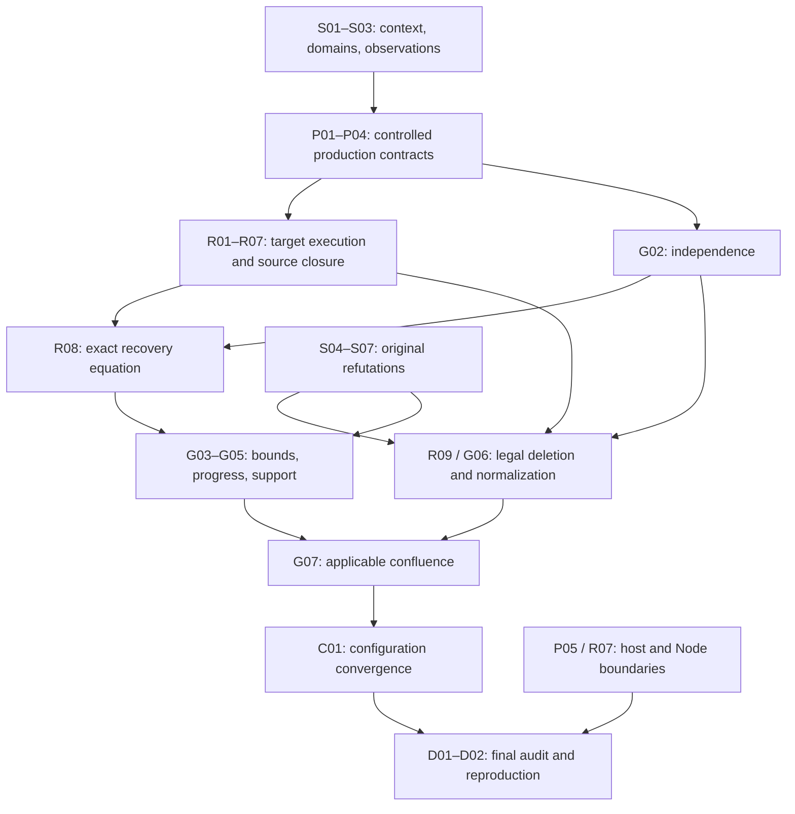

# 论文到代码剩余义务盘点

[English](paper-mapping-inventory.md) · [JSON](paper-mapping-inventory.json) · [原文台账](paper-coverage.md) · [里程碑](paper-refinement-roadmap.zh-CN.md)

由盘点 JSON 及既有台账／计划生成。编辑 JSON 后运行检查器；不得在本视图提升论文状态。

**基线 `2026-10-20.v1`** — 最终剩余义务盘点，不是新证明、完成百分比，也不替代原论文门槛。

这是对已审查范围的完整分配，不保证研究中不会发现新问题。R1–R4 保留为技术分类；使用稳定义务编号跟踪关闭。R1／R2 的范围内完成状态保留。

## 当前距离

- 原文审计：42 项定义已编码、17 项命题已证明、18 项部分完成、4 项已有反例；4 项整体连接义务仍开放。
- 本次剩余清单共 **31 个关闭单元，31 个仍开放**。各项已有证明和运行路径记录在下方。这不表示项目完成度为零：清单刻意只列尚未关闭的最终义务。
- 原文 18 项 partial 编号：28, 47, 55, 56, 57, 60, 61, 64, 65, 66, 67, 68, 69, 70, 73, 78, 79, 80.
- 原文 refuted 编号：62, 71, 75, 77. 修订合同验收不能让原文证明门槛通过。
- 剩余阶段：acceptance 2, composition 20, integration 4, specification 5.

阶段表示主要剩余工作：specification＝确定精确陈述；composition＝从实际来源推导组合定理；integration＝接通并约束生产路径；acceptance＝审查和复现完成后的证明链。阶段不是百分比。

目前没有可靠的整项目百分比或轮数。31 个单元是大小不同的剩余关闭义务，不是 31 轮编码；先处理高风险语义、访问边界和目标状态问题，再分别估算实现与验收工作。

原开发报告属于其记录的源码树。本盘点没有新增 Verus 验证，也不刷新该报告。下方审查输入哈希用于检测审计材料变化，不是证明证据。发布／平台安装与语义完成分开跟踪。

## 完成目标与保留成果

- **`original-audit`**: 按实际前提审计每项原陈述，保留反例和未解决原文解释；既有原文证明门槛保持不变。
- **`implementation-mapping`**: 在必需执行范围内完成明确原文或修订合同的生产映射；每项修订须标明改变条款及下游影响，不能静默缩小原目标。

只有列明的结论和验收条件全部满足才关闭单元。记录边界、选择修订或增加辅助引理本身不能算关闭；未解决子目标必须继续归属开放单元。修订实现定理与原论文审计结果保持区别。

- **R1 / `finite-strict-context/v1`**: 已完成范围内语义；S01–S03 跟踪整篇解释影响，不要求重做 R1。 [范围](r1-semantics.zh-CN.md)
- **R2 / `managed-production/v1`**: 已完成范围内生产精化；P04 将其复用到加强后的最终载体。 [范围](r2-acceptance.zh-CN.md)

## 关闭顺序与最大不确定性

依赖是关闭前提，不禁止利用已建立的局部合同并行实施。

优先消除或明确限定这些风险：[S01](#s01), [S02](#s02), [P01](#p01), [R01](#r01), [R08](#r08), [G02](#g02), [G04](#g04), [G07](#g07).

首要实施顺序是上下文／定义域审计及受控访问边界（S01／S02／P01），随后是实际目标状态对应（R01）。同时尽早核对源固定映射与目标重新执行的连接（R08）及独立性（G02），避免完整调度器写完后才暴露语义不匹配。一般进展与合流（G04／G07）仍是独立高风险结论，不能从局部测试预设成立。



图仅概括关系；精确无环关闭依赖在各单元及 JSON 中。

## 固定剩余单元

S／P／R／G／C／D 是盘点单元前缀。例如 R01 是恢复义务，不是既有里程碑 R1。分类合计为语义／审计 7 项、生产／边界 5 项、恢复 9 项、全局性质 7 项、配置 1 项、最终审查／复现 2 项。

| 编号 | 义务 | 当前阶段／风险 | 关闭依赖 |
| --- | --- | --- | --- |
| [S01](#s01) | 确定上下文模型并贯通解释 | specification / high | — |
| [S02](#s02) | 闭合严格定义域、约束范围与 Child 例外 | specification / high | [S01](#s01) |
| [S03](#s03) | 贯通完整函数观察与名称迁移 | composition / high | [S01](#s01), [S02](#s02) |
| [S04](#s04) | 闭合残留条目引理 62 的处理 | composition / medium | — |
| [S05](#s05) | 闭合定理 71 的完成性条款 | specification / medium | — |
| [S06](#s06) | 闭合支持良基引理 75 的处理 | specification / medium | — |
| [S07](#s07) | 闭合静止支持引理 77 的处理 | specification / medium | — |
| [P01](#p01) | 落实完整的受控效果边界 | integration / high | [S02](#s02) |
| [P02](#p02) | 组合完整的准入组件载体 | composition / high | [S02](#s02), [P01](#p01) |
| [P03](#p03) | 闭合别名、动态绑定与值观察 | composition / high | [S02](#s02), [P01](#p01) |
| [P04](#p04) | 闭合最终范围的生产步骤组合 | composition / medium | [S03](#s03), [P02](#p02), [P03](#p03) |
| [P05](#p05) | 审计并落实宿主与外部资源合同 | integration / high | [P01](#p01) |
| [R01](#r01) | 推导共享目标堆与跨调用输入 | composition / high | [P01](#p01), [P03](#p03), [S03](#s03) |
| [R02](#r02) | 执行完整的剩余 native 生命周期 | integration / high | [R01](#r01), [P02](#p02), [P04](#p04) |
| [R03](#r03) | 从生产者所有权推导完整选择 | composition / high | [P01](#p01), [P04](#p04) |
| [R04](#r04) | 组合 Child、consumer 与重复 Episode | composition / high | [R02](#r02), [R03](#r03), [S04](#s04) |
| [R05](#r05) | 迁移 Mixed／Fresh 的选定 Episode | composition / medium | [S03](#s03), [S04](#s04), [R03](#r03) |
| [R06](#r06) | 接通已准入异步落地与区间清理 | composition / high | [R02](#r02), [R03](#r03), [P05](#p05) |
| [R07](#r07) | 证明独立 Node 协议的恢复 | integration / high | [P03](#p03), [P05](#p05), [R03](#r03) |
| [R08](#r08) | 组合每个切点的精确恢复式 | composition / high | [R01](#r01), [R02](#r02), [R03](#r03), [R04](#r04), [R05](#r05), [R06](#r06), [R07](#r07), [G02](#g02) |
| [R09](#r09) | 独立闭合合法的 Episode 删除 | composition / high | [R02](#r02), [R04](#r04), [R05](#r05), [S04](#s04), [G02](#g02) |
| [G01](#g01) | 组合保持性与生命周期排序 | composition / medium | [P04](#p04), [S02](#s02) |
| [G02](#g02) | 从实际效果合同推导一般独立性 | composition / high | [P01](#p01), [P02](#p02), [P03](#p03), [S03](#s03) |
| [G03](#g03) | 产生完全发布与有限性证书 | composition / high | [P02](#p02), [G01](#g01) |
| [G04](#g04) | 证明动态进展并区分宿主活性 | composition / high | [G03](#g03), [G01](#g01), [R08](#r08), [S05](#s05), [R06](#r06) |
| [G05](#g05) | 组合修订支持关系与实际静止状态 | composition / medium | [S06](#s06), [S07](#s07), [G03](#g03) |
| [G06](#g06) | 构造一般合法交换与正规化 | composition / high | [S03](#s03), [S04](#s04), [G01](#g01), [G02](#g02), [R09](#r09) |
| [G07](#g07) | 闭合规范形与适用的合流 | composition / high | [G04](#g04), [G05](#g05), [G06](#g06) |
| [C01](#c01) | 把配置协调与 HMR 接到最终配置 | composition / high | [P04](#p04), [P05](#p05), [R08](#r08), [G05](#g05), [G07](#g07) |
| [D01](#d01) | 审查每个最终定理的生产前提 | acceptance / medium | [S01](#s01), [S02](#s02), [S03](#s03), [S04](#s04), [S05](#s05), [S06](#s06), [S07](#s07), [P01](#p01), [P02](#p02), [P03](#p03), [P04](#p04), [P05](#p05), [R08](#r08), [R09](#r09), [G01](#g01), [G07](#g07), [C01](#c01) |
| [D02](#d02) | 冻结并独立复现完整映射 | acceptance / medium | [D01](#d01) |

## 执行范围与无编号陈述

只覆盖编号条目会遗漏 §4.4 异步／失败／隔离／配置推理及 §5 协调／HMR 陈述。本盘点要求覆盖下列范围；不透明内部保留为明确审计义务，不隐含为已证明。

| 范围 | 论文位置 | 义务 |
| --- | --- | --- |
| 定义与原文命题 | §3–4; all 81 numbered entries | [S01](#s01), [S02](#s02), [S03](#s03), [S04](#s04), [S05](#s05), [S06](#s06), [S07](#s07), [G02](#g02), [G05](#g05), [G07](#g07), [D01](#d01), [D02](#d02) |
| 原生受管生产路径 | §4.2–4.3; §5.1 | [S02](#s02), [S03](#s03), [S04](#s04), [S06](#s06), [S07](#s07), [P01](#p01), [P02](#p02), [P03](#p03), [P04](#p04), [R01](#r01), [R02](#r02), [R03](#r03), [R04](#r04), [R06](#r06), [R08](#r08), [R09](#r09), [G01](#g01), [G02](#g02), [G03](#g03), [G04](#g04), [G05](#g05), [G06](#g06), [G07](#g07), [D01](#d01), [D02](#d02) |
| Mixed 固定名称解释器 | §4.2–4.3 | [S02](#s02), [S03](#s03), [S04](#s04), [P02](#p02), [R05](#r05), [R08](#r08), [R09](#r09), [G01](#g01), [G02](#g02), [G03](#g03), [G04](#g04), [G06](#g06), [G07](#g07), [D01](#d01), [D02](#d02) |
| Fresh 动态名称解释器 | §4.2–4.3 | [S02](#s02), [S03](#s03), [S04](#s04), [S06](#s06), [P02](#p02), [R05](#r05), [R08](#r08), [R09](#r09), [G01](#g01), [G02](#g02), [G03](#g03), [G04](#g04), [G06](#g06), [G07](#g07), [D01](#d01), [D02](#d02) |
| 已准入异步与分步清理 | §4.4 Asynchrony / Failure | [S05](#s05), [P05](#p05), [R06](#r06), [R08](#r08), [G01](#g01), [G04](#g04), [D01](#d01), [D02](#d02) |
| Node 协议与引用桥 | Implementation realization; §4.4 / §5.1, not a separate numbered theorem | [P03](#p03), [P04](#p04), [P05](#p05), [R07](#r07), [R08](#r08), [G01](#g01), [C01](#c01), [D01](#d01), [D02](#d02) |
| Loader、配置、隔离与 HMR | §4.4 Isolation / Configuration; §5.2; Definition 81 | [S07](#s07), [P03](#p03), [P04](#p04), [P05](#p05), [G05](#g05), [C01](#c01), [D01](#d01), [D02](#d02) |
| 普通适配器与外部资源边界 | §4.4; §5.1; acquisition/emission distinction | [P01](#p01), [P04](#p04), [P05](#p05), [R02](#r02), [R03](#r03), [R04](#r04), [R06](#r06), [R07](#r07), [G04](#g04), [C01](#c01), [D01](#d01), [D02](#d02) |

## 全部编号论文条目

原文状态及源码符号读取自原台账。首个证据链接是审计入口，不表示一个符号已经履行整个条目。每行除 D01／D02 外均有实质剩余义务。

| 编号／原陈述 | 原文审计 | 仍待闭合的实现连接 | 单元 |
| --- | --- | --- | --- |
| Definition 1: Twisted composition | `formalized` | 组合顺序必须与真实逆操作顺序一致。 [foundations.rs::compose](../crates/cordis-kernel/src/foundations.rs) | [P01](#p01) |
| Definition 2: Effect context | `formalized` | 用统一运行时解释实例化抽象状态。 [foundations.rs::Tracked](../crates/cordis-kernel/src/foundations.rs) | [P01](#p01) |
| Definition 3: Tracking | `formalized` | 把跟踪连接到实际发出并保留的效果。 [foundations.rs::track](../crates/cordis-kernel/src/foundations.rs) | [P01](#p01) |
| Theorem 4: Tracking projection | `proved` | 在真实执行边界复用投影定理。 [foundations.rs::track_projection](../crates/cordis-kernel/src/foundations.rs) | [P01](#p01) |
| Theorem 5: Tracking monoid homomorphism | `proved` | 在完整真实历史上实例化同态。 [foundations.rs::track_monoid](../crates/cordis-kernel/src/foundations.rs) | [P01](#p01) |
| Definition 6: Recovery | `formalized` | 固定恢复的观察及逆操作有定义含义。 [foundations.rs::recover](../crates/cordis-kernel/src/foundations.rs) | [P01](#p01), [R08](#r08) |
| Theorem 7: Tracking preserves recovery | `proved` | 把跟踪恢复定理与实际清理结果组合。 [foundations.rs::tracking_preserves_recovery](../crates/cordis-kernel/src/foundations.rs) | [P01](#p01), [R08](#r08) |
| Definition 8: Witnessed effect | `formalized` | 每个准入效果须提供实际返回逆操作的定律。 [foundations.rs::witnessed](../crates/cordis-kernel/src/foundations.rs) | [P01](#p01), [P05](#p05), [R03](#r03), [R08](#r08) |
| Definition 9: Effect composition | `formalized` | 使用真实异构逆操作顺序与保留载荷。 [foundations.rs::diamond](../crates/cordis-kernel/src/foundations.rs) | [P01](#p01), [R03](#r03), [R08](#r08) |
| Theorem 10: Effect monoid | `proved` | 复用代数证明，并单独审查生产实例化。 [foundations.rs::effect_monoid](../crates/cordis-kernel/src/foundations.rs) | [P01](#p01), [R08](#r08) |
| Theorem 11: Witness composition | `proved` | 从实际连续返回推导组合见证。 [foundations.rs::witness_composition](../crates/cordis-kernel/src/foundations.rs) | [P01](#p01), [R08](#r08) |
| Definition 12: Effect lifting | `formalized` | 提升同一真实状态与累积器，不能另建脱离执行的模型。 [foundations.rs::effect](../crates/cordis-kernel/src/foundations.rs) | [P01](#p01), [R08](#r08) |
| Theorem 13: Lift preserves composition | `proved` | 把提升后的组合连接到实际调用序列。 [foundations.rs::effect_homomorphism](../crates/cordis-kernel/src/foundations.rs) | [P01](#p01), [R08](#r08) |
| Theorem 14: Lifted forward projection | `proved` | 在失败与重试后保持投影关系。 [foundations.rs::effect_projection](../crates/cordis-kernel/src/foundations.rs) | [P01](#p01), [R08](#r08) |
| Theorem 15: Lifted recovery | `proved` | 审查累积映射恢复，而不只是队列为空。 [foundations.rs::lifted_recovery](../crates/cordis-kernel/src/foundations.rs) | [P01](#p01), [R08](#r08) |
| Theorem 16: Finite local temporal composability | `proved` | 在实际交错上实例化有限组合。 [foundations.rs::local_temporal_sequence](../crates/cordis-kernel/src/foundations.rs) | [P01](#p01), [R03](#r03), [R08](#r08) |
| Definition 17: Witnessed iterators | `formalized` | 覆盖完整准入迭代器载体及续体。 [history.rs::IteratorStep](../crates/cordis-kernel/src/history.rs) | [P01](#p01), [P02](#p02), [P05](#p05), [R06](#r06), [G03](#g03), [G04](#g04) |
| Definition 18: Iterator lifting | `formalized` | 区分有限迭代器解释与不透明 Future 终止。 [canonical.rs::advance](../crates/cordis-kernel/src/canonical.rs) | [P01](#p01), [P02](#p02), [P05](#p05), [R06](#r06), [G03](#g03), [G04](#g04) |
| Definition 19: Dependent coeffect context | `formalized` | 把依赖值连接到实际 provider 槽及载荷类型。 [contexts.rs::typed](../crates/cordis-kernel/src/contexts.rs) | [P03](#p03), [C01](#c01) |
| Definition 20: Get and set | `formalized` | 真实操作保留精确的缺失键及撤销定义域。 [contexts.rs::get](../crates/cordis-kernel/src/contexts.rs) | [P03](#p03) |
| Definition 21: Coeffect specification | `formalized` | 把声明关联到实际按 realm 解析的依赖。 [observation.rs::related_satisfaction](../crates/cordis-kernel/src/observation.rs) | [P03](#p03) |
| Definition 22: Coeffect satisfaction | `formalized` | 建立实际可用性，不能用载荷相等替代。 [observation.rs::related_satisfaction](../crates/cordis-kernel/src/observation.rs) | [P03](#p03) |
| Definition 23: Effect realizations | `formalized` | 把派生作用域与原地别名分别映射到实际堆。 [contexts.rs::derive_scope](../crates/cordis-kernel/src/contexts.rs) | [P03](#p03), [P05](#p05), [R01](#r01), [R07](#r07) |
| Definition 24: Isolated coeffect context | `formalized` | 在实际登记中迁移固定 realm 解释。 [contexts.rs::Isolated](../crates/cordis-kernel/src/contexts.rs) | [P03](#p03), [C01](#c01) |
| Definition 25: Get, set and isolate | `formalized` | 按相同解析键检查隔离及 provision 效果。 [contexts.rs::isolate](../crates/cordis-kernel/src/contexts.rs) | [P03](#p03) |
| Definition 26: Interception context | `formalized` | 把元数据解释连接到存储的 schema／拦截输入。 [contexts.rs::Metadata](../crates/cordis-kernel/src/contexts.rs) | [P03](#p03), [C01](#c01) |
| Definition 27: Get, set and intercept | `formalized` | 保持拦截组合及真实绑定归属。 [contexts.rs::intercepted_get](../crates/cordis-kernel/src/contexts.rs) | [P03](#p03) |
| Definition 28: Combined recursive context | `partial` | 处理递归模型读法，并保留 R1-CONTEXT 的区别。 [contexts.rs::FiniteLayer](../crates/cordis-kernel/src/contexts.rs) | [S01](#s01) |
| Definition 29: Operations and outcomes | `formalized` | 使用真实操作数、结果、定义域与捕获逆操作。 [mediated.rs::ValueYield](../crates/cordis-kernel/src/mediated.rs) | [S02](#s02), [P01](#p01), [P02](#p02), [P05](#p05), [R01](#r01), [R06](#r06) |
| Definition 30: Context-mediated iterator grammar | `formalized` | 覆盖全部准入构造及依赖续体。 [mediated.rs::Node](../crates/cordis-kernel/src/mediated.rs) | [S02](#s02), [P01](#p01), [P02](#p02), [R01](#r01), [R05](#r05) |
| Definition 31: Observation tests | `formalized` | 精确规定比较的实际观察与失败。 [observation.rs::test](../crates/cordis-kernel/src/observation.rs) | [S03](#s03) |
| Lemma 32: Coarsest observational equivalence | `proved` | 复用等价定理，不更换其测试族。 [observation.rs::observational_equivalence](../crates/cordis-kernel/src/observation.rs) | [S03](#s03) |
| Definition 33: Context equivalence | `formalized` | 区分服务观察、准入和完整状态等价。 [observation.rs::context_equal](../crates/cordis-kernel/src/observation.rs) | [S02](#s02), [S03](#s03), [P03](#p03) |
| Definition 34: Lifting relations | `formalized` | 关联输出、逆映射和续体，不只比较值。 [observation.rs::related_maps](../crates/cordis-kernel/src/observation.rs) | [S02](#s02), [S03](#s03), [G06](#g06), [G07](#g07) |
| Lemma 35: Partial equivalence of maps and iterators | `proved` | 在选定载体上实例化部分等价定律。 [observation.rs::map_partial_equivalence](../crates/cordis-kernel/src/observation.rs) | [S02](#s02), [S03](#s03) |
| Definition 36: Observational effect witness | `formalized` | 履行每个原语的观察恢复见证。 [observation.rs::witnessed_effect](../crates/cordis-kernel/src/observation.rs) | [S02](#s02), [P01](#p01), [G02](#g02) |
| Definition 37: Observational iterator witness | `formalized` | 推导完整载体上的迭代器见证成员资格。 [quotient.rs::bisimulation](../crates/cordis-kernel/src/quotient.rs) | [S02](#s02), [S03](#s03), [P01](#p01), [P02](#p02), [G02](#g02) |
| Lemma 38: Transport of effect laws to observations | `proved` | 把具体定律迁移到同一生产观察。 [observation.rs::witnessed_effect_composition](../crates/cordis-kernel/src/observation.rs) | [S02](#s02), [P01](#p01), [G02](#g02) |
| Lemma 39: Context-mediated admissibility | `proved` | 把语法可接受性连接到实际准入程序。 [mediated.rs::restricted_admissibility](../crates/cordis-kernel/src/mediated.rs) | [S02](#s02), [P01](#p01), [P02](#p02), [G02](#g02) |
| Definition 40: Reachable iterators and monoids | `formalized` | 包含全部语义可达阶段，不只已执行阶段。 [monoid.rs::reach](../crates/cordis-kernel/src/monoid.rs) | [S02](#s02), [P01](#p01), [P02](#p02), [G02](#g02) |
| Lemma 41: Generator closure laws | `proved` | 对实际支持操作族使用生成元闭包。 [monoid.rs::generator_commutation](../crates/cordis-kernel/src/monoid.rs) | [S02](#s02), [P01](#p01), [P02](#p02), [G02](#g02) |
| Definition 42: Iterator independence | `formalized` | 证明两个方向的逆定义域及续体稳定性。 [history.rs::independent_stages](../crates/cordis-kernel/src/history.rs) | [S02](#s02), [G02](#g02), [G06](#g06) |
| Theorem 43: Recovery in any inverse permutation | `proved` | 应用逆操作重排恢复前先建立其前提。 [permutation.rs::arbitrary_inverse_recovery](../crates/cordis-kernel/src/permutation.rs) | [S02](#s02), [R08](#r08), [G02](#g02) |
| Definition 44: Operation independence | `formalized` | 由实际操作定律推导共享键交换性。 [partial_independence.rs::value_independent](../crates/cordis-kernel/src/partial_independence.rs) | [S02](#s02), [P01](#p01), [P03](#p03), [G02](#g02) |
| Theorem 45: Distinct-key independence | `proved` | 名称不同不足以证明独立，它们可能指向同一分配。 [partial_independence.rs::distinct_nodes](../crates/cordis-kernel/src/partial_independence.rs) | [S02](#s02), [P01](#p01), [P03](#p03), [G02](#g02) |
| Definition 46: Witnessed coeffect | `formalized` | 为每种值类型提供适用的带见证操作库。 [partial_independence.rs::witnessed_keys](../crates/cordis-kernel/src/partial_independence.rs) | [S02](#s02), [P01](#p01), [P03](#p03), [G02](#g02) |
| Theorem 47: Interface compatibility implies independence | `partial` | 区分严格定义域独立性与原文总操作结论。 [partial_independence.rs::reachable_independence](../crates/cordis-kernel/src/partial_independence.rs) | [S02](#s02), [P03](#p03), [G02](#g02), [G06](#g06) |
| Definition 48: Components | `formalized` | 为最终载体证明实际父／根／Child 成员资格。 [program.rs::ProgramEpisode](../crates/cordis-kernel/src/program.rs) | [S01](#s01), [P02](#p02), [P04](#p04), [P05](#p05), [R03](#r03), [R04](#r04), [R07](#r07), [G03](#g03), [C01](#c01) |
| Definition 49: Fibers | `formalized` | 解释真实根、当前代码、表和逆操作函数。 [refinement.rs::Fiber](../crates/cordis-kernel/src/refinement.rs) | [S01](#s01), [S03](#s03), [P02](#p02), [P04](#p04), [R01](#r01), [R02](#r02), [G01](#g01), [G07](#g07) |
| Definition 50: Registry and publication | `formalized` | 保持 publication、预留及登记身份。 [semantics.rs::publishes](../crates/cordis-kernel/src/semantics.rs) | [S01](#s01), [P03](#p03), [P04](#p04), [R01](#r01), [R02](#r02), [R07](#r07), [G01](#g01) |
| Definition 51: All-fiber key-restricted projection | `formalized` | 观察所有已登记表，包含非 Active owner。 [projection.rs::project](../crates/cordis-kernel/src/projection.rs) | [P03](#p03), [P04](#p04), [R01](#r01), [R07](#r07), [G01](#g01) |
| Definition 52: Child creation inverse | `formalized` | 逆操作退休实际捕获的 Child；退休不等于移除。 [child_history.rs::retained](../crates/cordis-kernel/src/child_history.rs) | [S02](#s02), [S04](#s04), [S07](#s07), [P02](#p02), [R02](#r02), [R03](#r03), [R04](#r04), [R05](#r05), [R09](#r09), [G01](#g01), [G05](#g05), [C01](#c01) |
| Definition 53: Target and quiescence | `formalized` | 区分实际 target 身份与 committed 身份。 [semantics.rs::target](../crates/cordis-kernel/src/semantics.rs) | [P03](#p03), [P04](#p04), [R02](#r02), [R07](#r07), [G01](#g01), [G04](#g04) |
| Definition 54: Reliance | `formalized` | 推导保留的 consumer 绑定及真实 provider 释放守卫。 [refinement.rs::relied](../crates/cordis-kernel/src/refinement.rs) | [P04](#p04), [P05](#p05), [R02](#r02), [R03](#r03), [R04](#r04), [R06](#r06), [R07](#r07), [G01](#g01) |
| Definition 55: Confinement | `partial` | 补全 Writes 与 Reads，包含严格定义域和 Child 例外。 [semantics.rs::confined_write](../crates/cordis-kernel/src/semantics.rs) | [S01](#s01), [S02](#s02), [P01](#p01), [P02](#p02), [P03](#p03), [P05](#p05), [G02](#g02) |
| Definition 56: Context lift | `partial` | 把提升语言的解释连接到选定上下文模型。 [semantics.rs::child_lands](../crates/cordis-kernel/src/semantics.rs) | [S01](#s01), [S02](#s02), [P01](#p01), [P02](#p02), [P03](#p03), [G02](#g02) |
| Lemma 57: Lifted admissibility | `partial` | 使用完整载体成员资格，不能只用成功前缀安全性。 [preservation.rs::forward_preservation](../crates/cordis-kernel/src/preservation.rs) | [S01](#s01), [S02](#s02), [P01](#p01), [P02](#p02), [R06](#r06), [G02](#g02), [G03](#g03), [G04](#g04) |
| Definition 58: Execution and episode observations | `formalized` | 保留精确 Episode、固定映射及完整函数观察。 [child_history.rs::history](../crates/cordis-kernel/src/child_history.rs) | [S01](#s01), [S03](#s03), [S05](#s05), [P04](#p04), [P05](#p05), [R01](#r01), [R02](#r02), [R03](#r03), [R04](#r04), [R05](#r05), [R06](#r06), [R07](#r07), [R08](#r08), [R09](#r09), [G01](#g01), [G04](#g04), [G06](#g06), [G07](#g07) |
| Lemma 59: Rule frame facts | `proved` | 在每条纳入生产转换上组合已有 frame 事实。 [preservation.rs::installation_frame](../crates/cordis-kernel/src/preservation.rs) | [P04](#p04), [R02](#r02), [G01](#g01) |
| Lemma 60: Observational rule invariance | `partial` | 为选定完整观察关系证明规则迁移。 [quotient.rs::step_simulates](../crates/cordis-kernel/src/quotient.rs) | [S03](#s03), [G06](#g06), [G07](#g07) |
| Lemma 61: Name equivariance | `partial` | 一同重命名输入、存储引用及历史身份。 [alpha.rs::full_step_equivariant](../crates/cordis-kernel/src/alpha.rs) | [S03](#s03), [P03](#p03), [R01](#r01), [R05](#r05), [G06](#g06), [G07](#g07) |
| Lemma 62: Vestigial entries | `refuted` | 保留原反例，并接通带守卫替代结论的使用。 [semantics.rs::vestigial_parent_counterexample](../crates/cordis-kernel/src/semantics.rs) | [S04](#s04), [R04](#r04), [R09](#r09), [G06](#g06) |
| Definition 63: Well-formed registries | `formalized` | 把良构性绑定到实际源状态与后继状态。 [preservation.rs::well_formed](../crates/cordis-kernel/src/preservation.rs) | [P04](#p04), [G01](#g01) |
| Theorem 64: Preservation | `partial` | 组合完整已解释组件及扩展的保持性。 [preservation.rs::full_preservation](../crates/cordis-kernel/src/preservation.rs) | [P04](#p04), [G01](#g01) |
| Definition 65: Independence and entanglement | `partial` | 审计全部历史组件对及实际共享操作。 [canonical.rs::independent](../crates/cordis-kernel/src/canonical.rs) | [G02](#g02), [G06](#g06) |
| Lemma 66: Pairwise independence | `partial` | 推导成对独立性，不能仅从声明推断。 [partial_independence.rs::reachable_independence](../crates/cordis-kernel/src/partial_independence.rs) | [G02](#g02), [G06](#g06) |
| Lemma 67: Entangled steps | `partial` | 闭合交错中的纠缠效果及严格逆定义域。 [global.rs::control_no_deadlock](../crates/cordis-kernel/src/global.rs) | [R03](#r03), [R04](#r04), [R08](#r08), [G02](#g02), [G06](#g06) |
| Theorem 68: Global recovery exactness | `partial` | 对每个允许切点证明源固定映射的公式 (55)。 [canonical.rs::erase_execution](../crates/cordis-kernel/src/canonical.rs) | [P05](#p05), [R01](#r01), [R02](#r02), [R03](#r03), [R04](#r04), [R05](#r05), [R06](#r06), [R07](#r07), [R08](#r08), [R09](#r09), [G02](#g02) |
| Corollary 69: Terminal recovery | `partial` | 把公式 (56) 及 owner 空表连接到实际 Unload。 [canonical.rs::closed_owner_deletion](../crates/cordis-kernel/src/canonical.rs) | [S05](#s05), [P05](#p05), [R01](#r01), [R02](#r02), [R03](#r03), [R04](#r04), [R05](#r05), [R06](#r06), [R07](#r07), [R08](#r08), [R09](#r09), [G04](#g04) |
| Theorem 70: Lifecycle ordering | `partial` | 从实际轨迹推导 Episode 包含及 provider 生命周期。 [preservation.rs::execution_resource_safety](../crates/cordis-kernel/src/preservation.rs) | [P04](#p04), [P05](#p05), [R02](#r02), [R04](#r04), [R06](#r06), [R07](#r07), [G01](#g01) |
| Theorem 71: Resolution coherence | `refuted` | 保留解析一致性，修正错误的无条件完成条款。 [program_trace.rs::local_refinement](../crates/cordis-kernel/src/program_trace.rs) | [S05](#s05), [P04](#p04), [R06](#r06), [G04](#g04) |
| Definition 72: Provider precedence | `formalized` | 为无环／排名提供来源；分配顺序不是 provider 顺序。 [global.rs::predecessor](../crates/cordis-kernel/src/global.rs) | [S06](#s06), [G03](#g03), [G04](#g04), [G05](#g05) |
| Theorem 73: Progress and termination | `partial` | 在有来源的条件下推导动态无死锁与终止。 [termination.rs::finite_lifecycle_bound](../crates/cordis-kernel/src/termination.rs) | [S05](#s05), [P05](#p05), [R06](#r06), [G03](#g03), [G04](#g04), [G07](#g07) |
| Definition 74: Support equation | `formalized` | 使用与代码一致、区分出生来源的支持解释。 [global.rs::support_clause](../crates/cordis-kernel/src/global.rs) | [S06](#s06), [S07](#s07), [G05](#g05), [G07](#g07), [C01](#c01) |
| Lemma 75: Support well-foundedness | `refuted` | 保留反例；分别审计并关系排名与唯一性。 [global.rs::replacement_support_cycle](../crates/cordis-kernel/src/global.rs) | [S06](#s06), [G05](#g05), [G07](#g07) |
| Definition 76: Total provision | `formalized` | 组件完全发布强于已检查的 Active 快照。 [semantics.rs::total_active](../crates/cordis-kernel/src/semantics.rs) | [S07](#s07), [P02](#p02), [R09](#r09), [G03](#g03), [G05](#g05), [G07](#g07), [C01](#c01) |
| Lemma 77: Support at quiescence | `refuted` | 保留外部 Child 反例及修订的来源规则。 [child_history.rs::external_parent_support_counterexample](../crates/cordis-kernel/src/child_history.rs) | [S07](#s07), [G05](#g05), [G07](#g07), [C01](#c01) |
| Lemma 78: Transposition | `partial` | 包含所有输入依赖，构造合法交换及后缀。 [paper_counterexamples.rs::transposition_parent_counterexample](../crates/cordis-kernel/src/paper_counterexamples.rs) | [S03](#s03), [S04](#s04), [R05](#r05), [G02](#g02), [G06](#g06), [G07](#g07) |
| Lemma 79: Episode deletion | `partial` | 分别审计原删除前提与更广的恢复目标。 [canonical.rs::closed_owner_deletion](../crates/cordis-kernel/src/canonical.rs) | [S04](#s04), [R01](#r01), [R02](#r02), [R03](#r03), [R04](#r04), [R05](#r05), [R07](#r07), [R09](#r09), [G06](#g06), [G07](#g07) |
| Theorem 80: Canonical form and confluence | `partial` | 组合规范执行及任意符合条件调度的等价性。 [paper_counterexamples.rs::canonical_counterexample_quiet](../crates/cordis-kernel/src/paper_counterexamples.rs) | [S03](#s03), [S04](#s04), [S06](#s06), [S07](#s07), [R09](#r09), [G02](#g02), [G03](#g03), [G05](#g05), [G06](#g06), [G07](#g07), [C01](#c01) |
| Definition 81: Configuration entries | `formalized` | 区分六字段记录与协调／HMR 收敛陈述。 [configuration_entry.rs::Entry](../crates/cordis-kernel/src/configuration_entry.rs) | [S07](#s07), [P04](#p04), [P05](#p05), [G05](#g05), [C01](#c01) |

## 四项整体连接义务

这些在原台账保持 open；范围内 R1／R2 完成不会自动关闭它们。

| 义务 | 关闭条件 | 单元 |
| --- | --- | --- |
| `whole-lifecycle` (open) | 对实际恢复、排序、进展及适用合流使用统一声明解释，每条纳入路径的前提都有来源。 | [P02](#p02), [P04](#p04), [R01](#r01), [R02](#r02), [R03](#r03), [R04](#r04), [R05](#r05), [R06](#r06), [R07](#r07), [R08](#r08), [R09](#r09), [G01](#g01), [G02](#g02), [G03](#g03), [G04](#g04), [G05](#g05), [G06](#g06), [G07](#g07), [D01](#d01), [D02](#d02) |
| `corrected-specification` (open) | 为每项修订发布原条目处理结论及明确、一致贯通的实现合同，保留原反例。 | [S01](#s01), [S02](#s02), [S03](#s03), [S04](#s04), [S05](#s05), [S06](#s06), [S07](#s07), [G05](#g05), [G06](#g06), [G07](#g07), [D01](#d01) |
| `executable-simulation` (open) | 每个声称成立的操作及变换后执行均由原可执行路径产生，调用者前提已证明。 | [P01](#p01), [P02](#p02), [P03](#p03), [P04](#p04), [R01](#r01), [R02](#r02), [R05](#r05), [R06](#r06), [R07](#r07), [R08](#r08), [R09](#r09), [D01](#d01), [D02](#d02) |
| `host-boundary` (open) | 列全并落实宿主边界，证明实际声称的内部协议与资源合同，明确剩余环境义务。 | [P03](#p03), [P04](#p04), [P05](#p05), [R06](#r06), [R07](#r07), [G04](#g04), [C01](#c01), [D01](#d01), [D02](#d02) |

## 与既有 R3 验收包的关系

固定 R3-A／B／C／D 退出条件不变；语义、生产及独立性前提在依赖图中明确展示。

- **R3-A**: [R01](#r01), [R02](#r02)
- **R3-B**: [R03](#r03), [R04](#r04)
- **R3-C**: [R05](#r05), [R06](#r06), [R07](#r07)
- **R3-D**: [R08](#r08), [R09](#r09), [D01](#d01), [D02](#d02)

## 前提来源

`code_contract` 表示已有范围明确的合同，不表示每个最终调用者都已建立它；`undischarged` 仍是证明义务。环境来源不能吸收缺失的内部语义证明。

| 编号 | 前提／来源 | 类型 | 审查 |
| --- | --- | --- | --- |
| <a id="m01"></a>M01 | **统一的上下文与失败解释** — R1 已证明 finite-strict-context/v1；三项明确修订不等于原文无限制 Γ。 | `specification` | [context.rs::reified_representation](../crates/cordis-kernel/src/mixed_driver/context.rs); [typed_child_domain.rs::no_single_recovery_and_admission_relation](../crates/cordis-kernel/src/typed_child_domain.rs) |
| <a id="m02"></a>M02 | **原语恢复与声明访问范围** — 已有内置标量与类型化替换定律；仍需覆盖全部纳入保证的效果，并防止隐藏共享写入。 | `code_contract` | [effect.rs::commit_calculation](../crates/cordis-kernel/src/reversible_value/effect.rs); [semantics.rs::primitive_theory](../crates/cordis-kernel/src/reversible_value/managed/semantics.rs) |
| <a id="m03"></a>M03 | **真实来源与所有权历史** — 记录型 owner 保留实际调用、登记、释放与生产者证据；一般闭合选择仍须由这些证据推出。 | `code_contract` | [chain.rs::inverse_source](../crates/cordis-kernel/src/lifecycle_state/native/runtime/control_source/chain.rs); [producer_recovery.rs::recorded_census](../crates/cordis-kernel/src/reversible_value/managed/interleaving/history/lifecycle/producer_recovery.rs) |
| <a id="m04"></a>M04 | **目标身份与当前状态对应** — 实际分配收据建立 Bank 单射映射；受守卫标量基本操作在写入前检查实际版本化选择，typed 游标推导容量与新鲜 head 迁移，包含真实恢复后的后续调用。自动 root／Child 执行全程保持完整当前堆的所有权、一般绑定及完整引用迁移仍未解除。 | `undischarged` | [bank.rs::bind](../crates/cordis-kernel/src/reversible_value/managed/replay/bank.rs); [transport.rs::pair_step](../crates/cordis-kernel/src/reversible_value/managed/replay/transport.rs); [selection.rs::check_scalar_replay](../crates/cordis-kernel/src/reversible_value/managed/replay/selection.rs) |
| <a id="m05"></a>M05 | **独立性包含定义域与续体** — 严格语法结果需要具体共享键定律；声明本身不能证明交换性或回调纯度。 | `undischarged` | [dependent_independence.rs::grammar_independence](../crates/cordis-kernel/src/dependent_independence.rs); [paper_trace_independence.rs::strict_source_commutative_key](../crates/cordis-kernel/src/paper_trace_independence.rs) |
| <a id="m06"></a>M06 | **外部生产者与原始 Child 义务闭合** — 已有实际 census 与终态证据；跨选定 Episode 的完整闭合仍是待证明义务。 | `undischarged` | [foreign.rs::closed_from_owners](../crates/cordis-kernel/src/reversible_value/managed/interleaving/history/lifecycle/recovery/cut/foreign.rs); [completion.rs::native_child_endpoint](../crates/cordis-kernel/src/reversible_value/managed/interleaving/history/lifecycle/children/completion.rs) |
| <a id="m07"></a>M07 | **准入与最终完成分开** — 票据绑定真实准入并拒绝旧落地；中间调用可能改变操作定义域，发出票据不蕴含完成。 | `code_contract` | [typed_child_domain.rs::no_single_recovery_and_admission_relation](../crates/cordis-kernel/src/typed_child_domain.rs); [landing.rs::land_result](../crates/cordis-kernel/src/cleanup_queue/landing.rs) |
| <a id="m08"></a>M08 | **静止性前提有真实来源** — 无环先行关系、有限名称、迭代界与完全发布需要代码证书或精确的应用义务。 | `undischarged` | [global.rs::precedence_ranking](../crates/cordis-kernel/src/global.rs); [paper_invariants.rs::totality_is_not_a_current_state_test](../crates/cordis-kernel/src/paper_invariants.rs); [global.rs::control_no_deadlock](../crates/cordis-kernel/src/global.rs) |
| <a id="m09"></a>M09 | **宿主调度与最终响应** — 公平调度及不透明 Future 终止不是内核不变量；只在依赖它们的结论中明确列出。 | `environment` | [configuration_future.rs::poll_apply](../crates/cordis-kernel/src/configuration_future.rs); [completion.rs::complete_future](../crates/cordis-kernel/src/cleanup_queue/completion.rs); [attempt.rs::start](../crates/cordis/src/runtime/cleanup/attempt.rs); [attempt.rs::poll](../crates/cordis/src/runtime/cleanup/attempt.rs) |
| <a id="m10"></a>M10 | **外部效果与宿主表示真实性** — JS/Rust 回调效果、可变载荷内部、FFI 转换及文件系统真实性需要逐资源合同；确认消息不能替代证明。 | `environment` | [loader.rs::as_paper_entry](../crates/cordis/src/loader.rs); [cleanup_queue.rs::complete](../crates/cordis-kernel/src/cleanup_queue.rs) |
| <a id="m11"></a>M11 | **完整的固定函数字段观察** — 真实收据已有函数解释；不能把票据相同或更强的控制敏感关系默认为原文的任意输入观察。 | `undischarged` | [context.rs::function_correspondence](../crates/cordis-kernel/src/mixed_driver/context.rs); [strict_partial_quotient_boundary.rs::pure_table_self_relation_fails](../crates/cordis-kernel/src/strict_partial_quotient_boundary.rs) |
| <a id="m12"></a>M12 | **完整输入与历史名称一同迁移** — Fresh 封闭程序已有结构自然性；任意回调与字面外部名称不会自动继承该性质。 | `undischarged` | [external_inputs.rs::natural_execution_inputs](../crates/cordis-kernel/src/external_inputs.rs); [compaction.rs::compact](../crates/cordis-kernel/src/mixed_driver/fresh/compaction.rs) |
| <a id="m13"></a>M13 | **失败与容量属于明确的定义域** — 溢出、身份耗尽、失败前缀和清理重试保留为可观察结果；准入成功不等于总性。 | `code_contract` | [managed.rs::failed_report](../crates/cordis-kernel/src/reversible_value/managed.rs); [replay.rs::instantiate_controlled](../crates/cordis-kernel/src/reversible_value/managed/replay.rs) |
| <a id="m14"></a>M14 | **支持关系使用真实出生来源** — 外部插入与生命周期创建的子组件有区别；provider 无环不蕴含父子/provider 并关系良基。 | `undischarged` | [orchestration_support_cycle.rs::actual_execution](../crates/cordis-kernel/src/orchestration_support_cycle.rs); [child_history.rs::retained_protocol_quiet_support](../crates/cordis-kernel/src/child_history.rs) |
| <a id="m15"></a>M15 | **证据绑定检查范围与源码** — 清单一致性不是验证；既有开发及选定负控记录不能改称新鲜验收或整篇通过。 | `acceptance` | [inspected.rs::run_inspected](../crates/cordis-kernel/src/mixed_driver/fresh/inspected.rs) |

## 逐项关闭合同

<a id="s01"></a>

### S01 · 确定上下文模型并贯通解释

**状态:** `open` · `specification` · **风险:** `high`

**已有成果:** R1 已有非平凡的有限代码／收据模型，以及无限制集合／函数读法的已验证障碍。

**剩余结论:** 原文模型问题，以及采用严格修订后对整篇下游结论的影响，尚未闭合。

**关闭条件:**

1. 为每个最终定理固定上下文、载体和观察关系，不假设未经建立的递归类型等式。
2. 对第 28 项各项声称采用的读法给出精确审计结论；逐项区分修订后的下游陈述与原文。

**所需验收:** 审查对角线障碍与可居留的实现模型；拒绝把任意函数字段等同于票据的模型。

**前提来源:** [M01](#m01), [M11](#m11). **关闭依赖:** —.

**现有审查路径:** [recursive_context.rs::unrestricted_accumulator_obstruction](../crates/cordis-kernel/src/recursive_context.rs); [context.rs::reified_representation](../crates/cordis-kernel/src/mixed_driver/context.rs)

<a id="s02"></a>

### S02 · 闭合严格定义域、约束范围与 Child 例外

**状态:** `open` · `specification` · **风险:** `high`

**已有成果:** R1 在分开的准入与恢复观察下证明父／Child／续体成员资格；两种观察一般不能合并。 [原生操作合同表](native-operation-contracts.zh-CN.md)已列出真实读写／恢复入口、观察和边界义务。

**剩余结论:** 原文总定义域独立性与 Reads，包含外部名称缺失及有守卫的 Child 插入，仍需明确审计与替代陈述。

**关闭条件:**

1. 在整个声明载体上规定正向与逆向定义域，包含拒绝，不能只覆盖成功前缀。
2. 将修订后的读写与 Child 规则带入全部恢复、重排定理，不隐式把部分操作转成总操作。

**所需验收:** 保留表相同但 Child 定义域不同的见证，并核对实际插入守卫与所选解释。

**前提来源:** [M01](#m01), [M02](#m02), [M05](#m05), [M13](#m13). **关闭依赖:** [S01](#s01).

**现有审查路径:** [typed_child_domain.rs::no_single_recovery_and_admission_relation](../crates/cordis-kernel/src/typed_child_domain.rs); [guarded_components.rs::member_is_component](../crates/cordis-kernel/src/guarded_components.rs)

<a id="s03"></a>

### S03 · 贯通完整函数观察与名称迁移

**状态:** `open` · `composition` · **风险:** `high`

**已有成果:** 封闭数据论文合同已关联任意成对输入上的真实 root／current 数据函数及严格数据逆操作字；不可变存储／历史／未来引用使用单射分配投影。源／目标封闭组件逆操作字工作尚不是完整父／Child 函数定理。

**剩余结论:** 仍需组合完整父／Child 控制及逆操作函数，包含全部准入／失败定义域，并贯通显式严格公式 (54) 修订。原反例及 S01／S02 义务保留。

**关闭条件:**

1. 在任意允许测试输入上关联实际根、当前续体与累积逆操作，包含失败。
2. 构造存储值、已退休身份和未来输入的名称／引用迁移；明确审计得到的是公式 (54) 还是修订关系。

**所需验收:** 使用逆操作字不同而观察相关的真实执行；拒绝改变未来输入含义的字面名称复用。

**前提来源:** [M11](#m11), [M12](#m12). **关闭依赖:** [S01](#s01), [S02](#s02).

**现有审查路径:** [context.rs::function_correspondence](../crates/cordis-kernel/src/mixed_driver/context.rs); [strict_partial_quotient_boundary.rs::pure_table_self_relation_fails](../crates/cordis-kernel/src/strict_partial_quotient_boundary.rs); [external_inputs.rs::natural_execution_inputs](../crates/cordis-kernel/src/external_inputs.rs)

<a id="s04"></a>

### S04 · 闭合残留条目引理 62 的处理

**状态:** `open` · `composition` · **风险:** `medium`

**已有成果:** 原引理已有反例；已有带守卫擦除及条目保留结果。

**剩余结论:** 尚未完成面向全部下游结论的替代审计，也未接通每个删除／正规化调用者。

**关闭条件:**

1. 在替代陈述中列全父关系、provision 预留、历史逆操作和新鲜性例外。
2. 最终证明不再依赖错误的无条件规则，同时保持第 62 项 refuted。

**所需验收:** 保留可达反例，以及经过实际保留守卫的非空后缀迁移。

**前提来源:** [M12](#m12), [M14](#m14). **关闭依赖:** —.

**现有审查路径:** [deletion.rs::child_retirement_erases](../crates/cordis-kernel/src/deletion.rs); [typed_child_domain.rs::kernel_domain](../crates/cordis-kernel/src/typed_child_domain.rs)

<a id="s05"></a>

### S05 · 闭合定理 71 的完成性条款

**状态:** `open` · `specification` · **风险:** `medium`

**已有成果:** 总 Unit 组件给出了无条件 Episode 闭合的有限前缀反例。

**剩余结论:** 替代陈述必须区分实际结束事件、可扩展性，以及附加条件下的最终闭合。

**关闭条件:**

1. 保留已证明的解析一致性条款，明确修改哪条完成性陈述。
2. 把每处最终完成性使用追溯到进展及宿主响应前提，不能从有限前缀定理推出。

**所需验收:** 保留四步反例与任意合法延迟；区分未来可成功扩展与给定轨迹已经闭合。

**前提来源:** [M07](#m07), [M09](#m09). **关闭依赖:** —.

**现有审查路径:** [resolution_completion_counterexample.rs::actual_counterexample](../crates/cordis-kernel/src/resolution_completion_counterexample.rs); [resolution_completion_counterexample.rs::arbitrary_delay](../crates/cordis-kernel/src/resolution_completion_counterexample.rs)

<a id="s06"></a>

### S06 · 闭合支持良基引理 75 的处理

**状态:** `open` · `specification` · **风险:** `medium`

**已有成果:** 可达的总 Unit 案例中 provider 先行关系无环，父子／provider 并关系仍有环。

**剩余结论:** 需要确定并证明修订的支持定理，不能假设 provider 排名同时约束父边。

**关闭条件:**

1. 明确所需结论是支持解、唯一性还是真正的并关系排名，并在有来源的前提下证明。
2. 审计规范形证明中对错误良基推断的使用，同时保留原反例。

**所需验收:** 核对原文总组件见证，并在非平凡可达注册表上实例化修订定理。

**前提来源:** [M08](#m08), [M14](#m14). **关闭依赖:** —.

**现有审查路径:** [orchestration_support_cycle.rs::actual_execution](../crates/cordis-kernel/src/orchestration_support_cycle.rs); [global.rs::quiet_active_unique_by_precedence](../crates/cordis-kernel/src/global.rs)

<a id="s07"></a>

### S07 · 闭合静止支持引理 77 的处理

**状态:** `open` · `specification` · **风险:** `medium`

**已有成果:** 在已退休父组件下外部插入子组件可反驳原结论；已有区分出生来源的修订。

**剩余结论:** 一般支持／配置定理需使用真实出生来源区别，不能静默禁止合法外部插入。

**关闭条件:**

1. 给出外部与生命周期创建 fiber 的支持方程，并建立实际来源分类。
2. 把修订后的 quiet／Active 结论连接到父关系、provider 与配置观察。

**所需验收:** 保留五步反例，并覆盖实际外部插入与 Child 两条路径。

**前提来源:** [M14](#m14). **关闭依赖:** —.

**现有审查路径:** [child_history.rs::retained_protocol_quiet_support](../crates/cordis-kernel/src/child_history.rs); [completion.rs::native_child_endpoint](../crates/cordis-kernel/src/reversible_value/managed/interleaving/history/lifecycle/children/completion.rs)

<a id="p01"></a>

### P01 · 落实完整的受控效果边界

**状态:** `open` · `integration` · **风险:** `high`

**已有成果:** 原受保护解释器已支持混合封闭 scalar／typed 操作。closed::Value 排除隐藏载荷效果，并拒绝全部回调指令。封闭 owner 保留原生 Child 与数据逆操作；普通 Arc<T> 和回调仍属显式兼容边界。

**剩余结论:** 完整准入组件访问、公共命名空间的已验证生产者及全部入口读写范围／定义域审查仍需完成。更新恢复案例验收所选受管原语与协议安全，不宣称完整边界关闭。

**关闭条件:**

1. 列全纳入保证的资源读／写／恢复入口，确保每条具备所选读写范围、精确定义域和真实逆操作定律。
2. 保证路径须阻止或明确拒绝未跟踪别名和隐藏效果；新原语必须经受验证的扩展机制加入。

**所需验收:** 使用现有隐藏写入夹具；完整接口接通后补旁路／别名及替换逆操作的必要负控。

**前提来源:** [M02](#m02), [M13](#m13). **关闭依赖:** [S02](#s02).

**现有审查路径:** [effect.rs::commit_calculation](../crates/cordis-kernel/src/reversible_value/effect.rs); [controlled.rs::apply_controlled_effect](../crates/cordis-kernel/src/reversible_value/controlled.rs); [managed.rs::controlled_execution](../crates/cordis-kernel/src/reversible_value/managed.rs); [observation.rs::is_scalar_program](../crates/cordis-kernel/src/reversible_value/managed/replay/observation.rs); [effect.rs::prepare_instruction_observed](../crates/cordis-kernel/src/reversible_value/effect.rs); [typed.rs::apply](../crates/cordis-kernel/src/reversible_value/managed/replay/typed.rs)

<a id="p02"></a>

### P02 · 组合完整的准入组件载体

**状态:** `open` · `composition` · **风险:** `high`

**已有成果:** R1 覆盖封闭父／子组件；managed 函数已有标量／替换混合函数、实际结果和队列解释。

**剩余结论:** 统一准入载体仍须在任意允许输入上组合 provision、Child、真实续体及全部支持效果。

**关闭条件:**

1. 从已安装函数体和原语库推导根、续体与动态 Child 成员资格，不由调用者提供成员假设。
2. 把函数执行、完整发布和返回逆操作归属接到同一载体，保留精确失败定义域。

**所需验收:** 运行包含真实 Child、混合值、provision 和失败前缀的父组件；拒绝错误续体或逆操作。

**前提来源:** [M01](#m01), [M02](#m02), [M11](#m11), [M13](#m13). **关闭依赖:** [S02](#s02), [P01](#p01).

**现有审查路径:** [semantics.rs::component](../crates/cordis-kernel/src/reversible_value/managed/semantics.rs); [managed.rs::execute_call](../crates/cordis-kernel/src/reversible_value/managed.rs); [context.rs::root_component](../crates/cordis-kernel/src/mixed_driver/context.rs)

<a id="p03"></a>

### P03 · 闭合别名、动态绑定与值观察

**状态:** `open` · `composition` · **风险:** `high`

**已有成果:** 封闭重放已包含真实槽位别名追踪、CAS 替换、声明但未访问的槽、早／晚 provision 及多服务 publication 的共同 owner；仍区分 Begin 捕获 provider 与当前 target。

**剩余结论:** 仍需一般共享读写／恢复解释及完整组件证明组合；保留具名键投影的精确前提与显式别名扩展。

**关闭条件:**

1. 在别名创建、槽替换、撤销／重新发布及多版本 publication 中跟踪实际分配身份。
2. 满足前提时推出精确的具名键投影；否则明确别名扩展，不暗中禁止别名。

**所需验收:** 覆盖共享别名及相同值的新分配替换；拒绝目标存储被复制或错误接受旧版本。

**前提来源:** [M02](#m02), [M04](#m04), [M05](#m05), [M12](#m12). **关闭依赖:** [S02](#s02), [P01](#p01).

**现有审查路径:** [semantics.rs::alias_frame](../crates/cordis-kernel/src/reversible_value/managed/semantics.rs); [semantics.rs::single_key_projection](../crates/cordis-kernel/src/reversible_value/managed/semantics.rs); [history.rs::publication_retained](../crates/cordis-kernel/src/lifecycle_state/native/runtime/history.rs); [slot.rs::initial_selection](../crates/cordis-kernel/src/reversible_value/slot.rs); [host.rs::provide](../crates/cordis-kernel/src/reversible_value/managed/interleaving/history/lifecycle/host.rs); [execution.rs::provide](../crates/cordis-kernel/src/execution.rs); [binding.rs::prepare_mapped_scalar](../crates/cordis-kernel/src/reversible_value/managed/replay/binding.rs)

<a id="p04"></a>

### P04 · 闭合最终范围的生产步骤组合

**状态:** `open` · `composition` · **风险:** `medium`

**已有成果:** R2 managed-production/v1 已验收：实际参数、返回、队列来源、native／配置历史及 Node 协议步骤已有解释。

**剩余结论:** 加强后的受控 API 及最终恢复／调度全部路径，仍须共同实例化该解释，包含失败及扩展步骤。

**关闭条件:**

1. 逐项核对公开修改路径和状态字段的所有者及分类转换；精确列出覆盖范围，复用 R2 已完成工作。
2. 从实际调用构造完整适用生产轨迹；不得预设期望输出、伪造观察停顿或为独立 Journal 捏造全局顺序。

**所需验收:** 仅在保证载体变化处扩展既有 R2 源码绑定验收；检查遗漏生产者与伪造停顿的变异。

**前提来源:** [M03](#m03), [M07](#m07), [M11](#m11), [M13](#m13). **关闭依赖:** [S03](#s03), [P02](#p02), [P03](#p03).

**现有审查路径:** [classification.rs::classify_history](../crates/cordis-kernel/src/reversible_value/joint/classification.rs); [function.rs::run_function](../crates/cordis-kernel/src/reversible_value/managed/interleaving/history/lifecycle/function.rs); [configuration_source_history.rs::complete_projection](../crates/cordis-kernel/src/configuration_source_history.rs)

<a id="p05"></a>

### P05 · 审计并落实宿主与外部资源合同

**状态:** `open` · `integration` · **风险:** `high`

**已有成果:** 清理协议证明保留、新重试及旧回复拒绝；适配器测试覆盖回调、FFI、引用处理与持久化。

**剩余结论:** 仍须有完整边界清单及逐资源证据，区分外部恢复事实与被接受的宿主报告。

**关闭条件:**

1. 列全每项保证涉及的可信转换、回调、可变载荷内部、析构和外部效果，标明实际调用者及所需合同。
2. 落实受验证／不透明路径边界；内部义务由证明承担，不能把目标成功或所有权闭合转嫁给环境。

**所需验收:** 区分 FnOnce 已消耗失败、FnMut 保留重试及 Node 确认；展示一个真实资源适配器及其边界。

**前提来源:** [M09](#m09), [M10](#m10). **关闭依赖:** [P01](#p01).

**现有审查路径:** [cleanup_queue.rs::complete](../crates/cordis-kernel/src/cleanup_queue.rs); [completion.rs::complete_future](../crates/cordis-kernel/src/cleanup_queue/completion.rs); [loader.rs::as_paper_entry](../crates/cordis/src/loader.rs)

<a id="r01"></a>

### R01 · 推导共享目标堆与跨调用输入

**状态:** `open` · `composition` · **风险:** `high`

**已有成果:** 封闭数据 Session 已组合真实 scalar／typed 混合 root、历史恢复后继续执行、共享分配和 head 映射、声明别名、publication 完成及重复源插件身份。封闭组件捕获原数据／Child 逆操作字。一般完整函数组合与公共入口的来源命名空间生产仍开放。独立的 provider／consumer／一层 Child 交付不关闭 R01。

**剩余结论:** 仍需完整组件 root／current／inverse 对应、自动命名空间来源、登记失败身份保留及不变的 P01／P03／S03 依赖。通用性后置于具名更新恢复交付；不删除验收条件。

**关闭条件:**

1. 从实际来源构造单射的源／目标分配映射及首次输入选择，保留别名与历史引用。
2. 通过实际执行保持标量值／深度和 typed 值／head／revision 对应，推出每个保留成功操作的目标定义域。

**所需验收:** 覆盖重复调用、别名变化、未完成逆操作和版本恢复；拒绝虚构深度、复制源 revision 及假设目标成功。

**前提来源:** [M03](#m03), [M04](#m04), [M12](#m12), [M13](#m13). **关闭依赖:** [P01](#p01), [P03](#p03), [S03](#s03).

**现有审查路径:** [bank.rs::bind](../crates/cordis-kernel/src/reversible_value/managed/replay/bank.rs); [batch.rs::run_controlled](../crates/cordis-kernel/src/reversible_value/managed/replay/batch.rs); [transport.rs::pair_step](../crates/cordis-kernel/src/reversible_value/managed/replay/transport.rs); [bank.rs::mapping_injective](../crates/cordis-kernel/src/reversible_value/managed/replay/bank.rs); [inputs.rs::seed_following](../crates/cordis-kernel/src/reversible_value/managed/replay/inputs.rs); [joint.rs::allocate_following](../crates/cordis-kernel/src/reversible_value/joint.rs); [reversible_value.rs::new_in_following](../crates/cordis-kernel/src/reversible_value.rs); [payload.rs::new_in_following](../crates/cordis-kernel/src/reversible_value/payload.rs); [continuity.rs::check](../crates/cordis-kernel/src/reversible_value/managed/replay/continuity.rs); [inputs.rs::continues](../crates/cordis-kernel/src/reversible_value/managed/replay/inputs.rs); [payload_history.rs::continues_payload](../crates/cordis-kernel/src/reversible_value/managed/replay/inputs/payload_history.rs); [observation.rs::check_scalar_observations](../crates/cordis-kernel/src/reversible_value/managed/replay/observation.rs); [batch.rs::run_checked_scalar](../crates/cordis-kernel/src/reversible_value/managed/replay/batch.rs); [replay.rs::instantiate](../crates/cordis-kernel/src/reversible_value/managed/replay.rs); [selection.rs::check_scalar_replay](../crates/cordis-kernel/src/reversible_value/managed/replay/selection.rs); [bank.rs::find](../crates/cordis-kernel/src/reversible_value/managed/replay/bank.rs); [batch.rs::scalar_aliases](../crates/cordis-kernel/src/reversible_value/managed/replay/batch.rs); [binding.rs::prepare_mapped_scalar](../crates/cordis-kernel/src/reversible_value/managed/replay/binding.rs); [typed.rs::apply](../crates/cordis-kernel/src/reversible_value/managed/replay/typed.rs); [scalar.rs::land](../crates/cordis-kernel/src/reversible_value/managed/replay/scalar.rs); [effect.rs::prepare_instruction_observed](../crates/cordis-kernel/src/reversible_value/effect.rs); [native_effect.rs::prepare_instruction_at](../crates/cordis-kernel/src/reversible_value/native_effect.rs); [native_payload.rs::land](../crates/cordis-kernel/src/reversible_value/native_payload.rs); [payload.rs::apply_payload_captured_following](../crates/cordis-kernel/src/cleanup_groups/payload.rs); [restoration.rs::apply_captured_following](../crates/cordis-kernel/src/reversible_value/payload/restoration.rs); [payload.rs::same_head](../crates/cordis-kernel/src/reversible_value/payload.rs); [slot.rs::same_revision](../crates/cordis-kernel/src/reversible_value/slot.rs); [inputs.rs::duplicate](../crates/cordis-kernel/src/reversible_value/managed/replay/inputs.rs); [payload_history.rs::same_payload_before](../crates/cordis-kernel/src/reversible_value/managed/replay/inputs/payload_history.rs); [bank.rs::first_input](../crates/cordis-kernel/src/reversible_value/managed/replay/bank.rs); [selection.rs::check_payload_capture](../crates/cordis-kernel/src/reversible_value/managed/replay/selection.rs); [replay.rs::input_spec](../crates/cordis-kernel/src/reversible_value/managed/replay.rs); [protected.rs::acquire_exclusive](../crates/cordis-kernel/src/reversible_value/protected.rs); [protected.rs::acquire_exclusive](../crates/cordis-kernel/src/reversible_value/slot/protected.rs); [protected.rs::execution](../crates/cordis-kernel/src/reversible_value/managed/protected.rs); [protected.rs::check_source](../crates/cordis-kernel/src/reversible_value/managed/replay/protected.rs); [protected.rs::instantiate_protected](../crates/cordis-kernel/src/reversible_value/managed/replay/protected.rs); [batch.rs::run_exclusive](../crates/cordis-kernel/src/reversible_value/managed/replay/batch.rs); [batch.rs::exclusive_prefix](../crates/cordis-kernel/src/reversible_value/managed/replay/batch.rs); [managed.rs::run_function_with](../crates/cordis-kernel/src/reversible_value/managed.rs); [effect.rs::commit_calculation_in](../crates/cordis-kernel/src/reversible_value/effect.rs); [protected.rs::apply](../crates/cordis-kernel/src/reversible_value/payload/protected.rs); [protected_typed.rs::apply](../crates/cordis-kernel/src/reversible_value/managed/protected_typed.rs); [typed_protected.rs::check_initial_entry](../crates/cordis-kernel/src/reversible_value/managed/replay/typed_protected.rs); [batch.rs::run_exclusive_typed](../crates/cordis-kernel/src/reversible_value/managed/replay/batch.rs); [managed.rs::run_function_in](../crates/cordis-kernel/src/reversible_value/managed.rs); [restoration.rs::apply_captured_in](../crates/cordis-kernel/src/reversible_value/payload/restoration.rs); [typed_tracker.rs::prepare](../crates/cordis-kernel/src/reversible_value/managed/replay/typed_tracker.rs); [typed_tracker.rs::advance](../crates/cordis-kernel/src/reversible_value/managed/replay/typed_tracker.rs); [typed_correspondence.rs::compose](../crates/cordis-kernel/src/reversible_value/managed/replay/typed_correspondence.rs); [typed_correspondence.rs::certify](../crates/cordis-kernel/src/reversible_value/managed/replay/typed_correspondence.rs); [typed_correspondence.rs::inverse](../crates/cordis-kernel/src/reversible_value/managed/replay/typed_correspondence.rs); [batch.rs::typed_replay_matches](../crates/cordis-kernel/src/reversible_value/managed/replay/batch.rs); [batch.rs::typed_aliases](../crates/cordis-kernel/src/reversible_value/managed/replay/batch.rs)

<a id="r02"></a>

### R02 · 执行完整的剩余 native 生命周期

**状态:** `open` · `integration` · **风险:** `high`

**已有成果:** 已有 Kernel 控制重放及真实保留根调用，使用独立目标票据域和真实清理 owner。 检查型标量重放与普通 batch 共用 run_ordered；观察不一致时返回真实报告和清理所有者，不再启动后续调用。 现已贯通各原生宿主层，证明实际 Finish 保留已有发布项；原 root 执行保留 Begin 的值状态捕获，instantiate 将其导出给检查型 batch。选择拒绝保留已执行调用及其清理 owner。

**剩余结论:** 登记、Begin、调用、Finish、离开、清理／重试和 Unload 尚未组成一条完整的生产者驱动目标执行。

**关闭条件:**

1. 经原公开执行器调度全部保留事件，并重建实际 publication 载荷。
2. 从目标返回推导 action、work、Journal 和 inverse 映射，包含拒绝、容量及成功前缀所有权。

**所需验收:** 执行包含清理失败／重试及中间 Unload 的更新；仅控制重放或预先给定期望目标轨迹不能关闭本项。

**前提来源:** [M03](#m03), [M04](#m04), [M07](#m07), [M13](#m13). **关闭依赖:** [R01](#r01), [P02](#p02), [P04](#p04).

**现有审查路径:** [kernel_replay.rs::from_registration](../crates/cordis-kernel/src/kernel_replay.rs); [replay.rs::instantiate_controlled](../crates/cordis-kernel/src/reversible_value/managed/replay.rs); [cleanup.rs::unload_at](../crates/cordis-kernel/src/lifecycle_state/native/runtime/control_source/cleanup.rs); [batch.rs::run_ordered](../crates/cordis-kernel/src/reversible_value/managed/replay/batch.rs); [services.rs::finish_native_execution](../crates/cordis-kernel/src/lifecycle_state/services.rs); [native.rs::finish_native_execution](../crates/cordis-kernel/src/lifecycle_state/native.rs); [managed.rs::finish_managed_execution](../crates/cordis-kernel/src/lifecycle_state/native/managed.rs); [runtime.rs::finish_managed_execution](../crates/cordis-kernel/src/lifecycle_state/native/runtime.rs); [native.rs::finish](../crates/cordis-kernel/src/reversible_value/managed/interleaving/history/lifecycle/native.rs); [native.rs::run_recorded_root](../crates/cordis-kernel/src/reversible_value/managed/interleaving/history/lifecycle/native.rs); [selection.rs::preserve_providers](../crates/cordis-kernel/src/reversible_value/managed/replay/selection.rs)

<a id="r03"></a>

### R03 · 从生产者所有权推导完整选择

**状态:** `open` · `composition` · **风险:** `high`

**已有成果:** 已有生产者历史、census、区间前逆操作义务及匹配的真实释放证据。

**剩余结论:** 一般多 owner 闭合选择仍需自动覆盖全部外部效果、后续生产者和逆操作唯一消费。

**关闭条件:**

1. 从实际所有权历史导出选定效果集合及每项区间前未完成义务，包含已退休和破坏性生产者。
2. 证明完整创建／消费覆盖，不要求调用者提供完整 census 或期望恢复状态。

**所需验收:** 覆盖破坏性及已退休生产者、失败前缀和重复回复；拒绝遗漏必要生产者或重复消费。

**前提来源:** [M03](#m03), [M06](#m06). **关闭依赖:** [P01](#p01), [P04](#p04).

**现有审查路径:** [producer_recovery.rs::recorded_census](../crates/cordis-kernel/src/reversible_value/managed/interleaving/history/lifecycle/producer_recovery.rs); [origins.rs::available](../crates/cordis-kernel/src/reversible_value/managed/interleaving/sources/origins.rs); [foreign.rs::closed_from_owners](../crates/cordis-kernel/src/reversible_value/managed/interleaving/history/lifecycle/recovery/cut/foreign.rs)

<a id="r04"></a>

### R04 · 组合 Child、consumer 与重复 Episode

**状态:** `open` · `composition` · **风险:** `high`

**已有成果:** 真实 Child 出生、退休及自身 Unload 见证已在共同切点连接 managed 恢复；受限闭合区域案例包含 consumer。

**剩余结论:** 同一一般可执行选定区间仍须共同支持 owner 创建 Child、真实 consumer、重新激活及中间 owner Unload。

**关闭条件:**

1. 为每个原始逆操作推导 Child／consumer 闭合，并保留其他 owner 与后续 Episode。
2. 使用 Child 自身的实际终态证据，不从父组件排空或服务依赖推断所有权闭合。

**所需验收:** 在同一执行中组合动态 Child、consumer 清理失败、后续激活和独立保留组件。

**前提来源:** [M03](#m03), [M06](#m06), [M14](#m14). **关闭依赖:** [R02](#r02), [R03](#r03), [S04](#s04).

**现有审查路径:** [completion.rs::native_child_endpoint](../crates/cordis-kernel/src/reversible_value/managed/interleaving/history/lifecycle/children/completion.rs); [cut.rs::unload_recovers_with_children](../crates/cordis-kernel/src/reversible_value/managed/interleaving/history/lifecycle/recovery/cut.rs); [unload_census.rs::unload_census](../crates/cordis-kernel/src/reversible_value/managed/interleaving/history/lifecycle/unload_census.rs)

<a id="r05"></a>

### R05 · 迁移 Mixed／Fresh 的选定 Episode

**状态:** `open` · `composition` · **风险:** `medium`

**已有成果:** 已有封闭同步区域及 Fresh 压缩脚本完备性证明，也有实际重放案例。

**剩余结论:** 按 Episode 选择、Mixed 固定名称代码迁移及更一般跨区域共享仍需组合。

**关闭条件:**

1. 从实际脚本历史推出选定 Episode 计划，并迁移完整代码／输入／名称支撑。
2. 让原执行器运行计划，推导准入成立并保留真实逆操作字。

**所需验收:** 覆盖逻辑名称复用、已移除历史记录、provision consumer 和保留的失败前缀。

**前提来源:** [M03](#m03), [M06](#m06), [M12](#m12). **关闭依赖:** [S03](#s03), [S04](#s04), [R03](#r03).

**现有审查路径:** [compaction.rs::compact](../crates/cordis-kernel/src/mixed_driver/fresh/compaction.rs); [replay.rs::establish_replay](../crates/cordis-kernel/src/mixed_driver/fresh/replay.rs); [execution.rs::step](../crates/cordis-kernel/src/closed_region_deletion/execution.rs)

<a id="r06"></a>

### R06 · 接通已准入异步落地与区间清理

**状态:** `open` · `composition` · **风险:** `high`

**已有成果:** 实际准入／结果票据、落地 Divert 及旧回复拒绝已验证；有限清理历史保留失败工作。

**剩余结论:** 全部纳入范围的异步路径及允许的同时准入，仍需跨中间操作的恢复迁移。

**关闭条件:**

1. 把实际返回结果及逆操作绑定到选定源／目标调用，推出定义域保持或明确建模的拒绝。
2. 证明跨区间分步执行逆操作具有所声称的恢复观察；另行规定最终完成条件。

**所需验收:** 覆盖 pending 时目标变化、取消、旧回复、部分清理与重试，不假设 Future 必然返回。

**前提来源:** [M02](#m02), [M07](#m07), [M09](#m09), [M13](#m13). **关闭依赖:** [R02](#r02), [R03](#r03), [P05](#p05).

**现有审查路径:** [landing.rs::land_result](../crates/cordis-kernel/src/cleanup_queue/landing.rs); [async_completion.rs::await_completion](../crates/cordis-kernel/src/async_completion.rs); [completion.rs::complete_future](../crates/cordis-kernel/src/cleanup_queue/completion.rs)

<a id="r07"></a>

### R07 · 证明独立 Node 协议的恢复

**状态:** `open` · `integration` · **风险:** `high`

**已有成果:** 已有 Node 协议／引用轨迹、lease 清单、失败清理保留及旧回复测试。

**剩余结论:** 独立 Node 历史需要自身的剩余执行和恢复证明，native 标量恢复不能代替。

**关闭条件:**

1. 为动态 publication、别名、Child consumer 及重载代次构造实际协议／引用恢复。
2. JS 对象内部与外部回调效果保留精确合同；不能仅从 Succeeded 推出外部恢复。

**所需验收:** 使用真实 addon／Bridge 路径覆盖替换、清理失败、新重试及旧回复拒绝；区分协议定理与 JS 行为测试。

**前提来源:** [M03](#m03), [M06](#m06), [M07](#m07), [M10](#m10). **关闭依赖:** [P03](#p03), [P05](#p05), [R03](#r03).

**现有审查路径:** [node_runtime.rs::snapshot](../crates/cordis-kernel/src/node_runtime.rs); [node_runtime.rs::replace](../crates/cordis-kernel/src/node_runtime.rs); [node_runtime.rs::apply_episode_command](../crates/cordis-kernel/src/node_runtime.rs)

<a id="r08"></a>

### R08 · 组合每个切点的精确恢复式

**状态:** `open` · `composition` · **风险:** `high`

**已有成果:** 真实历史恢复、中间 native 观察及共同最终切点已在明确范围内建立。 真实 Bank 映射现可支持任意相关堆上的严格标量正向／逆向迁移；后续真实切点的状态关系仍是前提。 来源迁移已绑定实际保留的指令、分支和输出。 检查来源连续性现可构造有限的可组合来源词及其逆操作定义域证明；匹配的实际标量报告还能推出严格逆操作状态相等，但尚未组合一般式 (55)。 mapped_inverse 将检查后的实际目标分配与真实严格标量逆操作状态联系起来；这仍是已完成调用的局部结果，不是一般恢复式。

**剩余结论:** 仍需一个最终定理把实际逆操作有定义及观察连接到公式 (55) 的源固定映射，再把实际 Unload 接到 (56)。

**关闭条件:**

1. 对每个允许的选定检查点，推出真实累积逆操作定义域及起点上精确的外部映射组合。
2. 证明与实际清理结果的相等／观察对应；明确证明重算目标调用与源固定映射之间的任何等价。

**所需验收:** 在同一真实 Journal 检查中间切点与终态 Unload；拒绝假设逆操作成功或仅比较期望快照的定理。

**前提来源:** [M01](#m01), [M02](#m02), [M03](#m03), [M04](#m04), [M05](#m05), [M06](#m06), [M11](#m11). **关闭依赖:** [R01](#r01), [R02](#r02), [R03](#r03), [R04](#r04), [R05](#r05), [R06](#r06), [R07](#r07), [G02](#g02).

**现有审查路径:** [episode_replay.rs::restored_observation_from_source](../crates/cordis-kernel/src/mixed_driver/episode_replay.rs); [cut.rs::unload_recovers_from_source_history](../crates/cordis-kernel/src/reversible_value/managed/interleaving/history/lifecycle/recovery/cut.rs); [episode_replay.rs::recover_cut](../crates/cordis-kernel/src/mixed_driver/fresh/episode_replay.rs); [heap.rs::scalar_contract](../crates/cordis-kernel/src/reversible_value/managed/replay/bank/heap.rs); [heap.rs::captured_scalar_contract](../crates/cordis-kernel/src/reversible_value/managed/replay/bank/heap.rs); [continuity.rs::recovery](../crates/cordis-kernel/src/reversible_value/managed/replay/continuity.rs); [observation.rs::scalar_inverse](../crates/cordis-kernel/src/reversible_value/managed/replay/observation.rs); [selection.rs::mapped_inverse](../crates/cordis-kernel/src/reversible_value/managed/replay/selection.rs); [typed.rs::apply](../crates/cordis-kernel/src/reversible_value/managed/replay/typed.rs)

<a id="r09"></a>

### R09 · 独立闭合合法的 Episode 删除

**状态:** `open` · `composition` · **风险:** `high`

**已有成果:** 已有若干合法受限删除及真实控制重放；原引理 79 仍为 partial。

**剩余结论:** 原定理的完全发布、consumer 和无 Child Episode 条件，必须与更广的闭合区域恢复目标分别审计。

**关闭条件:**

1. 在精确选定删除条件下，通过原执行器构造每个保留步骤和完整后缀。
2. 精确规定删除／保留的名称、观察及 Episode。证明原陈述，或有明确依据且连接实现的修订删除定理；仅记录缺口不能关闭本项。

**所需验收:** 使用非空 Child／consumer 及历史名称案例；不得把固定映射等式等同于合法生命周期轨迹。

**前提来源:** [M03](#m03), [M04](#m04), [M06](#m06), [M12](#m12). **关闭依赖:** [R02](#r02), [R04](#r04), [R05](#r05), [S04](#s04), [G02](#g02).

**现有审查路径:** [deletion.rs::transport](../crates/cordis-kernel/src/lifecycle_state/native/runtime/history/deletion.rs); [execution.rs::step](../crates/cordis-kernel/src/closed_region_deletion/execution.rs); [foreign_child_deletion_example.rs::actual_closed_deletion](../crates/cordis-kernel/src/foreign_child_deletion_example.rs)

<a id="g01"></a>

### G01 · 组合保持性与生命周期排序

**状态:** `open` · `composition` · **风险:** `medium`

**已有成果:** Kernel 及既有 mixed／native 轨迹保持不变量、committed 视图与 provider 保留。

**剩余结论:** 最终完整组件解释与全部纳入扩展仍需统一的保持性／排序组合。

**关闭条件:**

1. 为每条纳入的实际转换及源解释证明良构性与读写 frame 不变量。
2. 从真实历史推出固定 provider 提交、Episode 包含顺序及受守卫释放，保留 target／committed 的区别。

**所需验收:** 覆盖目标变化、已退休仍注册 Child 及多版本资源；拒绝提前释放 provider。

**前提来源:** [M03](#m03), [M07](#m07), [M13](#m13). **关闭依赖:** [P04](#p04), [S02](#s02).

**现有审查路径:** [lifecycle_ordering.rs::committed_prefix](../crates/cordis-kernel/src/lifecycle_ordering.rs); [script.rs::run_script](../crates/cordis-kernel/src/mixed_driver/fresh/admitted/script.rs); [history.rs::owner_retained](../crates/cordis-kernel/src/lifecycle_state/native/runtime/history.rs)

<a id="g02"></a>

### G02 · 从实际效果合同推导一般独立性

**状态:** `open` · `composition` · **风险:** `high`

**已有成果:** 严格语法独立性及共享 provider 的 Iter 菱形／后缀迁移已证明。 已由 Bank 的源／目标分离实例化标量正向／逆向独立性，不再另行假设身份映射。

**剩余结论:** 实际一般组件族仍未完成组合，须包含全部参数、结果、逆操作、续体及动态 Child 身份。

**关闭条件:**

1. 从具体库与声明解析建立支持的共享键交换性，以及两个方向的 yield 稳定性。
2. 审计全部历史组件而不只是已调度调用；明确处理不兼容效果，不能假设普遍独立。

**所需验收:** 包含重叠别名、不同结果类型及依赖 Child 的续体；拒绝仅凭返回值定律推断纯度。

**前提来源:** [M02](#m02), [M05](#m05), [M11](#m11), [M12](#m12). **关闭依赖:** [P01](#p01), [P02](#p02), [P03](#p03), [S03](#s03).

**现有审查路径:** [dependent_independence.rs::grammar_independence](../crates/cordis-kernel/src/dependent_independence.rs); [mixed_observational_transport.rs::iteration_suffix](../crates/cordis-kernel/src/mixed_observational_transport.rs); [paper_trace_independence.rs::strict_source_commutative_key](../crates/cordis-kernel/src/paper_trace_independence.rs); [bank.rs::scalar_independence](../crates/cordis-kernel/src/reversible_value/managed/replay/bank.rs)

<a id="g03"></a>

### G03 · 产生完全发布与有限性证书

**状态:** `open` · `composition` · **风险:** `high`

**已有成果:** 已有有限单程序排名、分派定义域及实际 Active 完整发布。

**剩余结论:** 全部可达动态创建组件的界及组件级完全发布，不能从一次成功激活推出。

**关闭条件:**

1. 推导或明确接收可验证的应用证书，建立可达名称有限、迭代界与无环先行关系。
2. 把全输入组件完全发布连接到实际交错 Finish／Active 观察，区分容量与原语定义域失败。

**所需验收:** 使用动态 Child 创建及不完整发布反例；不能仅凭 Active 快照建立完全发布。

**前提来源:** [M08](#m08), [M13](#m13). **关闭依赖:** [P02](#p02), [G01](#g01).

**现有审查路径:** [paper_invariants.rs::totality_is_not_a_current_state_test](../crates/cordis-kernel/src/paper_invariants.rs); [replay.rs::source_call_at](../crates/cordis-kernel/src/mixed_driver/fresh/replay.rs); [terminal_replay.rs::terminal_replay](../crates/cordis-kernel/src/mixed_driver/fresh/terminal_replay.rs)

<a id="g04"></a>

### G04 · 证明动态进展并区分宿主活性

**状态:** `open` · `composition` · **风险:** `high`

**已有成果:** 已有固定注册表／控制结果及终止的单程序执行器；尚未声称一般动态宿主活性。

**剩余结论:** 一般无死锁与极大生命周期序列终止仍须处理严格定义域、Child 创建及真实逆操作可用性。

**关闭条件:**

1. 从有来源的界和实际定义域，推出每个允许非静止状态的可执行步骤及全局递减度量。
2. 另行规定宿主级最终推进条件，包含响应／公平性前提；保留合法不终止及失败情况。

**所需验收:** 保留有守卫 Child 阻塞见证及宿主永远 pending 边界；正向动态定理不得假设最终静止。

**前提来源:** [M07](#m07), [M08](#m08), [M09](#m09), [M13](#m13). **关闭依赖:** [G03](#g03), [G01](#g01), [R08](#r08), [S05](#s05), [R06](#r06).

**现有审查路径:** [global.rs::control_no_deadlock](../crates/cordis-kernel/src/global.rs); [terminal_replay.rs::terminal_replay](../crates/cordis-kernel/src/mixed_driver/fresh/terminal_replay.rs); [resolution_completion_counterexample.rs::arbitrary_delay](../crates/cordis-kernel/src/resolution_completion_counterexample.rs)

<a id="g05"></a>

### G05 · 组合修订支持关系与实际静止状态

**状态:** `open` · `composition` · **风险:** `medium`

**已有成果:** 区分出生来源的支持关系及替代静止控制唯一性避开了部分错误原推断。

**剩余结论:** 一般支持解及其与实际 Active 组件的关系，仍须提供给规范形与配置证明。

**关闭条件:**

1. 为实际来源注册表推导选定修订支持方程及所需唯一性／排名性质。
2. 组合完全发布及区分来源的父规则，在静止时识别被支持的存活集合。

**所需验收:** 同时覆盖已退休父下外部插入及生命周期 Child；不能把 provider 排名用于并关系。

**前提来源:** [M08](#m08), [M14](#m14). **关闭依赖:** [S06](#s06), [S07](#s07), [G03](#g03).

**现有审查路径:** [global.rs::quiet_active_unique_by_precedence](../crates/cordis-kernel/src/global.rs); [orchestration_support_cycle.rs::support_still_unique](../crates/cordis-kernel/src/orchestration_support_cycle.rs); [child_history.rs::retained_protocol_quiet_support](../crates/cordis-kernel/src/child_history.rs)

<a id="g06"></a>

### G06 · 构造一般合法交换与正规化

**状态:** `open` · `composition` · **风险:** `high`

**已有成果:** 已有多个规则对的带守卫局部菱形和有限后缀迁移，保留实际收据。

**剩余结论:** 最终组件类所需全部交换仍须组合，并保留完整外部输入及动态出生依赖。

**关闭条件:**

1. 为每个必要规则对推出两个目标步骤的定义域及收据／续体迁移。
2. 用真实递减度量及合法完整后缀构造任意符合条件有限轨迹的正规化。

**所需验收:** 保留父由前一步创建及 pending Child Remove 障碍；拒绝遗漏依赖守卫。

**前提来源:** [M05](#m05), [M11](#m11), [M12](#m12). **关闭依赖:** [S03](#s03), [S04](#s04), [G01](#g01), [G02](#g02), [R09](#r09).

**现有审查路径:** [administrative_orchestration.rs::suffix](../crates/cordis-kernel/src/administrative_orchestration.rs); [unload_orchestration.rs::restore_cross](../crates/cordis-kernel/src/unload_orchestration.rs); [mixed_observational_transport.rs::suffix_transport](../crates/cordis-kernel/src/mixed_observational_transport.rs)

<a id="g07"></a>

### G07 · 闭合规范形与适用的合流

**状态:** `open` · `composition` · **风险:** `high`

**已有成果:** 已有受限静止合流及单轨迹正规化；原文第 80 项仍为 partial。

**剩余结论:** 一般符合条件调度、实际动态出生及完整函数观察尚未由一个定理贯通。

**关闭条件:**

1. 构造规范执行，并在精确相同的迁移后外部输入下比较任意两条符合条件的源执行。
2. 证明选定完整观察关系，明确名称重命名及失败排除条件；分别审计原陈述与修订陈述。

**所需验收:** 使用含动态 Child 和共享 provider 的不同调度，并包含字面输入歧义；单个局部菱形不足以验收。

**前提来源:** [M05](#m05), [M08](#m08), [M11](#m11), [M12](#m12), [M14](#m14). **关闭依赖:** [G04](#g04), [G05](#g05), [G06](#g06).

**现有审查路径:** [providing_owner_examples.rs::actual_providing_deletion](../crates/cordis-kernel/src/providing_owner_examples.rs); [mixed_observational_transport.rs::iteration_suffix](../crates/cordis-kernel/src/mixed_observational_transport.rs); [external_inputs.rs::natural_execution_inputs](../crates/cordis-kernel/src/external_inputs.rs)

<a id="c01"></a>

### C01 · 把配置协调与 HMR 接到最终配置

**状态:** `open` · `composition` · **风险:** `high`

**已有成果:** R2 已证明结构配置／来源组合及真实更新／恢复工作流；定义 81 的记录已形式化。

**剩余结论:** 第 5 节的最终配置收敛及 HMR 推理，仍需全局结果及精确模块／工厂身份合同。

**关闭条件:**

1. 在明确条件下，把增量协调、group／include 展开及代码修订关联到同一最终声明配置的初次加载。
2. 区分结构状态收敛、对外输出、失败 fiber 与文件系统持久性；不能从序列化成功推出收敛。

**所需验收:** 比较真实更新／回滚／重载历史与全新加载，保留实际模块版本及明确的失败排除条件。

**前提来源:** [M08](#m08), [M10](#m10), [M12](#m12), [M14](#m14). **关闭依赖:** [P04](#p04), [P05](#p05), [R08](#r08), [G05](#g05), [G07](#g07).

**现有审查路径:** [configuration_source_history.rs::accepted_configuration](../crates/cordis-kernel/src/configuration_source_history.rs); [configuration_runtime.rs::replace_configuration](../crates/cordis-kernel/src/configuration_runtime.rs); [loader.rs::apply_prepared](../crates/cordis/src/loader.rs)

<a id="d01"></a>

### D01 · 审查每个最终定理的生产前提

**状态:** `open` · `acceptance` · **风险:** `medium`

**已有成果:** 原文台账、R1 修订、R2 验收及源码审查路径提供了大量审计基础。

**剩余结论:** 尚无完整的最终前提到调用者审计，闭合全部 81 项、无编号扩展／配置陈述及四项整体连接义务。

**关闭条件:**

1. 为每个最终 requires 指定已证明调用者不变量、受检应用证书或明确环境合同，并审查它们能共同成立。
2. 分别发布原文审计结论、修订陈述和实现范围；不得遗漏条目，也不得改标签把反例变成已证明。

**所需验收:** 审查实际公开路径及定理实例化，包含非空客户端；清单中符号存在不能作为验收。

**前提来源:** [M01](#m01), [M02](#m02), [M03](#m03), [M04](#m04), [M05](#m05), [M06](#m06), [M07](#m07), [M08](#m08), [M09](#m09), [M10](#m10), [M11](#m11), [M12](#m12), [M13](#m13), [M14](#m14), [M15](#m15). **关闭依赖:** [S01](#s01), [S02](#s02), [S03](#s03), [S04](#s04), [S05](#s05), [S06](#s06), [S07](#s07), [P01](#p01), [P02](#p02), [P03](#p03), [P04](#p04), [P05](#p05), [R08](#r08), [R09](#r09), [G01](#g01), [G07](#g07), [C01](#c01).

**现有审查路径:** [inspected.rs::run_inspected](../crates/cordis-kernel/src/mixed_driver/fresh/inspected.rs); [function.rs::run_function](../crates/cordis-kernel/src/reversible_value/managed/interleaving/history/lifecycle/function.rs)

<a id="d02"></a>

### D02 · 冻结并独立复现完整映射

**状态:** `open` · `acceptance` · **风险:** `medium`

**已有成果:** 已有绑定各自源码快照的全内核开发检查及选定严格负控。

**剩余结论:** 仍需最终同源码证据集，以及完整已验收映射的独立复现。

**关闭条件:**

1. 在最终源码执行所需全内核证明、贯通案例及选定语义负控，保留全部可信边界和失败标记。
2. 由独立干净环境按论文→合同→生产调用→结果复现，并另行报告打包／平台发布验收。

**所需验收:** 使用既有源码绑定记录器；超时、编译失败或旧哈希不能算负控成功。

**前提来源:** [M15](#m15). **关闭依赖:** [D01](#d01).

**现有审查路径:** [inspected.rs::run_inspected](../crates/cordis-kernel/src/mixed_driver/fresh/inspected.rs)

## 更新与检查基线

保留基线编号。拆分、增加或范围变化须记录日期、原因、受影响论文条目与依赖；不能靠重新编号已完成包隐藏增长。状态变更需要关闭证据，不能仅增加 verified 函数数。

```sh
python3 -B scripts/check-paper-mapping.py
python3 -B scripts/check-paper-mapping.py --write
python3 -B -m unittest discover -s scripts/tests -p 'test_check_paper_mapping.py'
```

默认检查器核对 81／81 行、四项整体义务、全部必需范围、精确双向分配、无环依赖、实际审查符号、中英文视图及审查输入哈希。`--write` 只生成视图，不刷新哈希或证明记录。输入变化后须审查受影响义务，并在审查后明确更新输入绑定。

检查通过只建立清单一致性及声明审查输入的新鲜性，不证明任何 Rust 合同，也不替代未改变的原文完成门槛：

```sh
python3 -B scripts/check-paper-coverage.py --require-complete
```

只要仍有 partial／refuted 原文条目或 open 整体义务，该原文门槛就仍会失败。
