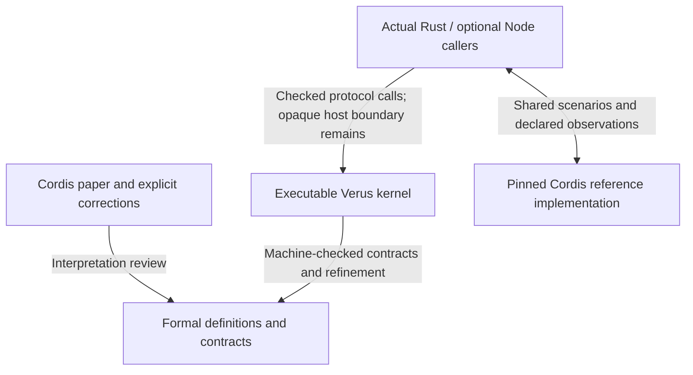

# Paper-to-code verification plan

English · [简体中文](verification-plan.zh-CN.md) · [Update recovery case](cases/update-recovery.md) · [Remaining paper obligations](paper-mapping-inventory.md)

**Planning baseline: 2026-10-23, implementation commit `82145ca`.** This document
records the next work sequence. Generated scenarios, test/proof mutation comparisons
and the proposed structural cleanup are planned work, not newly accepted results.
Existing results retain their original source-bound reports and scopes.

The goal is to make paper constraints useful in running software: a plugin author
can update a provider, understand a blocked cleanup, retry safely and inspect the
contract behind that behavior. The first delivery remains
`provider-consumer-one-child/v1`: one provider, one consumer and one level of Child,
with managed reversible data, explicit dependencies and fallible cleanup.
R01 and the complete paper-to-code mapping remain long-term commitments.

## Two complementary checks

The [Anthropic article](https://www.anthropic.com/research/formal-verification)
reports a Rust/Verus Python interpreter and 99.95% agreement with CPython over
more than 1.7 million generated programs. Its
[technical appendix](https://www-cdn.anthropic.com/files/4zrzovbb/website/6867eadf760258fa8b42a504600cd3c036d16358.pdf)
distinguishes the proof against formal semantics from empirical CPython agreement;
the stated interpreter theorem concerns results when execution returns. It also
reports that all seven injected bugs broke proofs, while five survived the random
tests. These are reported experiments, not independently reproduced results here.

We adopt the separation of evidence, without importing their coverage numbers or
termination claims into this project:

The diagram assigns evidence roles; each connection needs its own scoped evidence.
Verus checks the stated contracts of the kernel source also compiled by Cargo.
Review must still establish that our definitions represent the intended paper
clauses. Integration and differential tests check real callers and compatibility;
they do not prove arbitrary callbacks, FFI or external I/O. Compiler, verifier,
library and host assumptions remain in the [architecture boundary](architecture.md).

The paper, upstream implementation and revised failure policy can disagree.
Keep paper counterexamples and intentional implementation differences visible.
Agreement rates measure a specified generated distribution, not proof coverage
or the probability that an application is correct.

## Reuse the existing foundation

| Existing entry point | What it already supplies | Extension planned here |
| --- | --- | --- |
| [Update recovery case](cases/update-recovery.md) and [reproducer](../scripts/reproduce-update-recovery.py) | Actual native and ordinary Rust host paths, managed inverse failure, retained dependencies, explicit retry and source-bound proof selection | More generated histories around the same user guarantee |
| [Node differential runner](../scripts/check-node-compat.mjs) and [shared fixture](../tests/compat/differential-fixture.mjs) | Fixed scenarios against a pinned upstream, source/artifact hashes and exact observation comparison | A separate versioned scenario/observation format for generated cases; preserve existing exact fixtures |
| [Five update-recovery controls](../scripts/negative-controls.update-recovery.json) | Mutations of real implementations with strict proof rejection criteria | Execute the same mutations against relevant behavioral tests as well |
| [Admission contracts](progress-contracts.md) | Exact success conditions for selected real APIs | Check useful acceptance alongside rejection, so an always-reject implementation cannot pass the intended guarantee |
| [Paper inventory](paper-mapping-inventory.md) | Stable remaining obligations and their dependencies | Attach new evidence to existing units without declaring a bounded result to close a general obligation |

The new plan is the current bounded iteration under A07/A08/A13/A15 and F1/F4 in
the [adoption plan](adoption-plan.md). It does not introduce another R-series
milestone or replace the original ledger and its closure criteria.

## Guarantees to deliver and review

Each guarantee needs a paper clause or explicit implementation extension, an
actual call path, its complete contract and premises, fresh proof evidence, a
nonempty success/failure example and an appropriate negative control.

| User guarantee | Paper connection | Actual path and required evidence |
| --- | --- | --- |
| An old provider remains protected while its dependent cleanup is unresolved | Definition 54 and guarded L-Unload; current targets and episode-committed providers remain distinct under Definition 53 | `Kernel::begin_cleanup`, `LifecycleState` and `cleanup::update::failed_child_keeps_chain`; observe committed identities through failed cleanup and retry |
| Failed managed restoration retains the inverse and its payload | Witnessed effects and strict inverse domains; the domain restriction is the explicit R1-DOMAIN interpretation | `Inverse::restore_following`, `CleanupQueue` and `NativeRuntime::fail_managed_execution`; check both value and inverse depth, not an empty queue alone |
| Old or duplicate replies cannot finish a new cleanup attempt | Generation/ticket protocol is an implementation mechanism enforcing lifecycle order, not a separate numbered paper theorem | Actual action/restore tickets, `retry_execution` and receipt validation; cover retries and a new episode |
| A Child inverse retires its own Child and release follows real service dependencies | Definition 52 and Definition 54 | Atomic Child request/inverse creation, recorded parent episode, retirement and Unload; ownership alone does not establish a service dependency |
| A supported update can succeed after its failure cause is removed | Local admission and actual inverse contracts; scoped recovery evidence relevant to Theorems 68–70 | Real update, restore, retry and release calls; successful setup/release plus precise blocked outcomes, without claiming the complete recovery equation or global progress |

Failures caused by deliberately interfering raw resource access belong in a
separate test category. They check detection and retention, not the exclusion of
all environmental interference. Ordinary consumed `FnOnce` cleanup with `Drained`
must not be counted as successfully restored managed data.

Termination is a separate conclusion. Theorem 73 concerns its finite/bounded,
lifecycle-only model under its stated hypotheses. A host timeout is not a proof
that the abstract rules deadlock, and a successful finite test does not prove
that every Future, JavaScript callback or scheduler eventually completes.

## Architecture direction

Keep a shared verified lifecycle protocol and give each host a precise bridge.
`NativeRuntime` and `NodeRuntime` are verified Rust state owners; their names do
not mean that the kernel contains two language engines. Their different data,
publication and invocation responsibilities still require separate contracts.

| Layer | Responsibility and maintenance direction |
| --- | --- |
| Shared verified protocol | Keep committed bindings, generations, cleanup receipts, failure retention and release authority together. Reuse common contracts and preservation lemmas where their premises really coincide. |
| Native verified owner | Own managed values, retained inverse payloads and root/Child histories; establish the Native premises of the shared protocol from actual mutations. |
| Node verified owner | Own the represented publication, handle and invocation state; establish the Node premises separately. JS object contents and callback effects remain explicit boundaries. |
| Ordinary host and compatibility code | Execute callbacks, Futures and I/O, maintain transport/FFI associations and exercise real error handling. Tests validate these paths; forwarding to a proved function is not itself a proof of the wrapper. |
| Harness application | Own official workflow and application-specific Loader/HMR integration; consume runtime APIs without becoming a kernel dependency. |

Current source paths are Rust `Runtime` → shared `NativeDriver` → `NativeRuntime`
and Node facade → N-API adapter → `Driver` / `NodeDriver` → `NodeRuntime`.
Both connect to the shared lifecycle state. See the
[native owner](../crates/cordis-kernel/src/native_runtime.rs),
[Node owner](../crates/cordis-kernel/src/node_runtime.rs) and
[shared lifecycle state](../crates/cordis-kernel/src/lifecycle_state.rs).
Pure Rust use continues to require no Node runtime. Structural work should first
improve ownership and navigation within the existing crates; adding crates,
hosts or a temporal library is not a prerequisite for this iteration.

## Work sequence and exit criteria

All five extensions below are **planned**. Existing case/proof results above
remain the baseline. Dependencies identify the order of acceptance; they do not
require rerunning the full suite after each small edit.

| Order | Deliverable | Dependency | Exit criterion |
| --- | --- | --- | --- |
| 1. Freeze the guarantee and observations | Extend the existing case with a compact contract/evidence matrix: supported operations, API entry points, effect domain, observations, premises and exclusions | Existing case and paper review | Every advertised guarantee has an actual caller and proof/test distinction; unsupported behavior and legal success conditions are explicit |
| 2. Generate and shrink real Native scenarios | A seeded lifecycle scenario format, runner and reducer using production APIs | 1 | Reproduce the existing failure/retry case, exercise the required scenario families below, retain replayable minimal failures and demonstrate shrinking with a known failing control |
| 3. Compare the shared subset with Cordis | Node/native and pinned-upstream adapters for the same supported scenario description | 1; reuse 2's format and reducer | Run both implementations, retain raw traces, classify every outcome and report the denominator; no unexplained mismatch is accepted as compatibility |
| 4. Compare test and proof detection | A report for the five existing implementation mutations using the same mutated source for each pair of checks | 2; 3 for controls that exercise Node behavior | Fresh baseline, valid mutant compilation, targeted proof rejection and separately recorded behavioral result for every applicable control |
| 5. Consolidate contracts and review evidence | Factor repeated ownership/frame/source lemmas, clarify module responsibilities and update architecture navigation | 1–4 establish behavior and sensitivity baselines | Preserve supported behavior and public contract strength, update affected proof selectors and source links, then pass concentrated acceptance on the final source |

### Generated scenarios

Start with the existing provider/consumer/one-Child shape. Vary supported
registration/setup order, provider replacement, cleanup failure position,
interfering writes, explicit retry, stale/duplicate replies and final shutdown.
Include successful updates without failure and an update after recovery.
Add aliases and controlled asynchronous completion only after the corresponding
access and scheduling boundaries are explicit; these are extensions, not implicit
coverage of the first profile.

The runner must drive actual APIs and observe actual resources. A generator's
model may choose commands but must not manufacture the production history or
stand in for the executor. Separate well-formed admitted scenarios from deliberate
invalid-command/interference scenarios. Record rejection and unsupported cases
rather than silently filtering them out.

Store the seed, generator version, complete command sequence, input parameters,
explicit completion schedule where applicable, observation format and runtime
versions. Shrinking must preserve the failure predicate and necessary ownership,
dependency and fault setup. Save the reduced commands so reproduction does not
depend solely on an RNG seed or the latest generator version.

Required observations include API outcomes, target/committed provider identity,
owner/episode/attempt identity, publication visibility, cleanup/retry decisions,
retained resources and relevant causal ordering. Compare intermediate states as
well as endpoints. Reject a run that misses required scenario families or valid
successful operations, even if all generated rejections look safe.

### Compatibility accounting

The Node adapter is a separate host acceptance surface. It cannot inherit the
Native managed-data theorem merely by consuming the same scenario description.
Publish its supported subset and bridge premises. If an operation has no equivalent
public upstream API, record the limitation and keep its Native guarantee test.

Classify runs as matching, reviewed intentional difference, unsupported, or
unexplained mismatch/crash/timeout. Record attempted, supported and completed
counts and generation parameters; do not hide unsupported or timed-out runs in
an agreement percentage. Known differences need narrow predicates, rationale,
linked regression and review when their scope changes. Every unreviewed failure
blocks the corresponding compatibility claim.

Any mapping of runtime-local IDs must preserve creation, ownership, episode and
binding relationships. Keep raw traces and document permitted observational
projection. Do not sort away meaningful order, discard errors or merge generations
to obtain equality. Existing fixed differential fixtures keep their exact
comparison. Harness workflow acceptance remains separately recorded in the
companion application.

### Negative controls and maintainability

Reuse the five existing errors: failed report promoted to success, release receipt
bypassed, retained payload discarded, inverse depth ignored, and Child request
separated from its inverse. A proof rejection counts only after a fresh matching
positive proof and complete mutant compilation, at the intended contract.
Timeouts, resource limits and unrelated compiler/solver failures are inconclusive.
Behavioral results are recorded independently as detected, survived, not applicable
or inconclusive, with reasons. A proof-detected mutation surviving tests is useful
evidence of different coverage; it does not justify weakening either check.

Factor repeated lemmas only where the actual preconditions and state ownership
match. Keep executable operations and their contracts discoverable together;
separate common protocol reasoning from host-specific interpretation. Review
proof-check cost and change impact, not proof line counts as a success metric.
No `assume`, `admit`, `external_body`, removed guard or weakened observation may
substitute for a difficult proof or failing comparison.

## Acceptance and reporting

Implement related production changes and proofs first. Use compilation and
selected checks to resolve blockers, then finish the related scenario and mutation
support. At the integration boundary run
`python3 scripts/record-development.py --offline` once on the final source;
do not also run its underlying full workflow. Execute the new generated campaign
and paired mutation checks with their own source-bound records. Follow
[validation policy](validation.md) for repairs and refreshed evidence.

Every acceptance record must identify the scope, source/tool/upstream/artifact
hashes, exact commands, raw logs, supported scenarios, observed differences,
proof result, mutation result and remaining boundary. A seed alone is insufficient.
Changed sources do not inherit an earlier pass. New documentation alone does not
refresh proof or release evidence.

Track delivered guarantees, covered operation/failure families, reproducible
minimal failures, unresolved differences, mutation detection and independent
reproduction. A maintainer-run clean installation is not external review or
adoption. Proof obligation counts, random sample counts and compatibility ratios
must not be combined into a paper-completion percentage.

The iteration is complete when all five planned deliverables satisfy their exit
criteria for the declared scope and a reviewer can follow one continuous chain:
paper clause → real API → executable contract → checked proof → failing and
successful reproduction → rejected erroneous implementation. Release/platform
qualification and the full negative suite retain their separate gates/statuses.

## Retained long-term obligations

General shared-heap replay and function correspondence (R01/P01/P03/S03), complete
recovery at every cut (R08), legal episode deletion (R09), independence (G02),
global progress (G04), confluence (G07) and configuration convergence (C01) remain
in the [fixed inventory](paper-mapping-inventory.md). Closed verifiable values are
the selected route for strong generic value/effect guarantees; arbitrary `Arc<T>`
remains on an explicitly bounded ordinary path.

Node recovery (R07), opaque external resources and scheduler liveness retain
their own obligations. The bounded Native delivery does not require all of them
to be solved first, and cannot discharge them by omission. Extend one supported
effect/host surface at a time when its user value and premises are clear.
