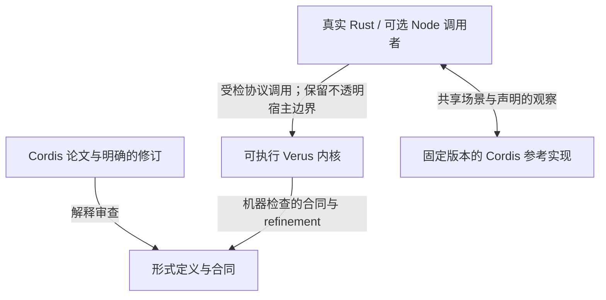

# 论文到代码的验证计划

[English](verification-plan.md) · 简体中文 · [更新恢复案例](cases/update-recovery.zh-CN.md) · [论文剩余义务](paper-mapping-inventory.zh-CN.md)

**更新：2026-11-05。** 活跃开发在 `main`，固定归档为
`codex/archive-before-refactor-2026-10-24`（`60bdd89`）。本轮受限范围的代码、
所有权审查地图、模块结构、生成器、缩减器、上游对照和配对负控入口已实现。
最终源码门槛为 `python3 -B scripts/check-lifecycle-campaign.py accept`；只有
匹配当前源码的通过记录才代表整体验收。入口见[审查地图](review-map.zh-CN.md)和
[复现说明](cases/generated-lifecycle.zh-CN.md)。整篇论文目标继续开放。
清理／回执所有权审计与 Node publication 命令组合已实施；首次激活、adoption、
其余 Node dispatch 和一般恢复结构另行推进。验证结果单独绑定实际检查的源码记录。

目标是让论文约束在真实运行中产生价值：插件作者可以更新 provider，理解清理为何
受阻，安全重试，并审查行为背后的合同。首个交付范围继续为
`provider-consumer-one-child/v1`：一个 provider、一个 consumer 和一层 Child，
使用受管可逆数据、显式依赖和可失败清理。R01 与完整论文到代码映射保留为长期目标。

## 两条互补的检查路径

[Anthropic 文章](https://www.anthropic.com/research/formal-verification)报告了一个
Rust/Verus Python 解释器，在超过 170 万个生成程序上与 CPython 的行为一致率为
99.95%。其[技术附录](https://www-cdn.anthropic.com/files/4zrzovbb/website/6867eadf760258fa8b42a504600cd3c036d16358.pdf)
区分了相对于形式语义的证明与相对于 CPython 的实测；给出的解释器定理约束执行
返回时的结果。附录还报告：七个注入错误全部使证明失败，其中五个未被随机测试发现。
这些是作者报告的实验，本项目没有独立复现。

我们借鉴证据分工，不将其实验覆盖数字或终止性结论移植为本项目的保证：

图中说明证据的分工，每条连接都需要对应范围的实际证据。
Verus 检查的内核源码也由 Cargo 编译运行。形式定义是否忠实表达论文条目，仍需审查。
集成测试与差分测试检查真实调用者和兼容行为，不证明任意 callback、FFI 或外部 I/O。
编译器、验证器、库和宿主前提继续见[架构边界](architecture.md)。

论文、上游实现与修订后的失败策略可能不一致。保留论文反例和有意行为差异。
一致率衡量指定生成分布上的观察，不能当作证明覆盖率或应用正确的概率。

## 复用已有基础

| 已有入口 | 已提供的能力 | 本轮计划扩展 |
| --- | --- | --- |
| [更新恢复案例](cases/update-recovery.zh-CN.md)与[复现脚本](../scripts/reproduce-update-recovery.py) | 真实 native 与普通 Rust 宿主路径、受管逆操作失败、依赖保留、显式重试及绑定源码的证明选择 | 围绕同一用户保证生成更多执行历史 |
| [Node 差分入口](../scripts/check-node-compat.mjs)与[共享 fixture](../tests/compat/differential-fixture.mjs) | 固定场景、固定上游、源码／制品哈希及精确观察比较 | 为生成场景增加独立版本化的场景与观察格式，保留现有精确 fixture |
| [五项更新恢复负控](../scripts/negative-controls.update-recovery.json) | 修改真实实现，并按严格条件判断证明拒绝 | 将同一变异实现也交给相关行为测试，记录两种检查各自发现的错误 |
| [准入合同](progress-contracts.zh-CN.md) | 部分真实 API 的精确成功条件 | 同时检查有效接受与错误拒绝，避免“所有请求都拒绝”也满足预期保证 |
| [论文清单](paper-mapping-inventory.zh-CN.md) | 固定剩余义务和依赖 | 将新证据关联到既有工作项，不用受限成果关闭一般义务 |

本计划是[采用计划](adoption-plan.zh-CN.md)中 A07/A08/A13/A15 与 F1/F4 的近期
受限迭代。不再增加一套 R 系列里程碑，也不替换原始 ledger 及其关闭条件。

## 要交付和审查的保证

每条保证需要论文条目或明确的实现扩展、实际调用链、完整合同及前提、新运行的证明
证据、非空的成功／失败案例，以及适当的错误实现负控。

| 用户保证 | 论文对应 | 真实路径与所需证据 |
| --- | --- | --- |
| 依赖者清理尚未解决时，旧 provider 仍受保护 | 定义 54 与 L-Unload 守卫；按定义 53 区分当前 target 和 Episode 已承诺的 provider | `Kernel::begin_cleanup`、`LifecycleState` 与 `cleanup::update::failed_child_keeps_chain`；观察失败与重试期间真实保留的身份 |
| 受管恢复失败保留逆操作及载荷 | 带见证效果与严格逆操作定义域；定义域限制属于明确的 R1-DOMAIN 解释 | `Inverse::restore_following`、`CleanupQueue` 和 `NativeRuntime::fail_managed_execution`；同时检查值与逆操作深度，不能只看队列为空 |
| 旧回复或重复回复不能结束新清理尝试 | 代次／票据是落实生命周期顺序的实现机制，不是论文中独立编号的定理 | 实际 action／restore 票据、`retry_execution` 和收据检查；覆盖重试与新 Episode |
| Child 逆操作退休其实际 Child，释放服从真实服务依赖 | 定义 52 与定义 54 | 原子创建 Child 请求与逆操作，记录父 Episode、退休与 Unload；不能用父子所有权替代服务依赖 |
| 故障原因移除后，受支持的更新能够成功 | 局部准入与实际逆操作合同；为定理 68–70 提供受限恢复证据 | 真实 update、restore、retry、release；检查成功启动／释放与准确阻塞结果，不宣称完整恢复等式或全局推进 |

故意通过原始资源句柄造成的干扰单独归类。这类案例检查干扰识别与失败保留，不证明
环境无法干扰。普通已消费 `FnOnce` 清理产生的 `Drained`，不得计作受管数据恢复成功。

终止性是另一条结论。定理 73 针对其前提下有限／有界、仅含生命周期步骤的模型。
宿主超时不能直接证明抽象规则死锁；一次有限执行成功，也不能证明所有 Future、
JavaScript callback 或调度器最终完成。

## 架构方向

保留共享的已验证生命周期协议，为每个宿主建立准确的连接合同。`NativeRuntime`
和 `NodeRuntime` 是经过验证的 Rust 状态所有者，不表示内核内含两套语言引擎。
两者的数据、publication 和调用管理职责不同，仍需各自的合同。

| 层次 | 职责与维护方向 |
| --- | --- |
| 共享验证协议 | 集中维护已承诺绑定、代次、清理收据、失败保留和释放权限；前提确实一致时复用合同与保持性引理 |
| Native 验证状态所有者 | 拥有受管值、保留的逆操作载荷、root／Child 历史；从实际修改建立共享协议所需的 Native 前提 |
| Node 验证状态所有者 | 拥有模型中表示的 publication、句柄与调用状态，单独建立 Node 前提；JS 对象内部及 callback 效果保留边界 |
| 普通宿主与兼容代码 | 执行 callback、Future、I/O，维护传输／FFI 对应并处理真实错误；测试验证这些路径，调用已证明函数不自动证明整个包装层 |
| Harness 应用 | 承担官方工作流及应用专用 Loader／HMR 集成；通过运行时 API 接入，不成为内核依赖 |

当前源码路径为 Rust `Runtime` → shared `NativeDriver` → `NativeRuntime`，
以及 Node facade → N-API adapter → `Driver`／`NodeDriver` → `NodeRuntime`。
两者连接共享生命周期状态。源码入口为
[Native 所有者](../crates/cordis-kernel/src/lifecycle_state/native/runtime.rs)、
[Node 所有者](../crates/cordis-kernel/src/node_runtime.rs)及
[共享生命周期状态](../crates/cordis-kernel/src/lifecycle_state.rs)。
纯 Rust 使用继续不依赖 Node 运行时。结构调整先改善现有 crate 内的所有权划分与导航；
增加 crate、宿主语言或时序逻辑库不是本轮前置条件。

## 将结构调整和删减纳入交付

项目应清楚表达一条链路：有用的行为 → 真实实现 → 明确合同 → 证明与可复现证据。
积累的实验、重复包装和按轮次追加的进度说明，不应掩盖这条主线。
结构整理在下一次功能扩展之前开始，不全部留到最后验收时处理。
既有案例和回归作为初始行为基线，生成场景随后扩大覆盖。

代码结构维护与论文到代码验证共同推进。已完成的文件搬迁改善了导航；后续工作
还要让修改权限、证明依赖和宿主边界更便于检查与调整。拆出目录本身不代表这些
目标已经完成。此后的行为改动应包含对应路径所需的结构整理，不必先重写整个仓库。

归档中的内核有 446 个源码文件，全部平铺在 `src/`；普通 Rust 宿主的 `runtime.rs`
有 5,195 行。这些数字包含合同、证明、注释和测试，说明导航负担，不直接说明证明冗余。

### 目标组织方式

初期保留现有 crate 边界；crate 内按状态所有权和职责组织，不按引入它的开发轮次组织。
下表描述目标分区；后面的已完成批次说明哪些部分已经落地：

| 区域 | 目标组织 | 应帮助审查者回答的问题 |
| --- | --- | --- |
| `cordis-kernel` 生命周期 | 将控制状态、已承诺绑定、动作和清理收拢为便于定位的领域 | 谁可以推进或释放 Episode，由哪个受检入口实施？ |
| `cordis-kernel` 效果 | 组织受管值、逆操作载荷、journal 与资源所有权 | 逆操作来自哪次真实修改，失败后保留什么？ |
| `cordis-kernel` 宿主状态 | Native 与 Node 状态所有者分别组织，复用共享协议合同 | 哪些宿主专有前提在这里建立，哪些仍是边界？ |
| `cordis-kernel` 语义与 refinement | 明确论文定义、实际实现连接、公共引理及依赖方向 | 这是原文命题、修订合同、条件定理还是已接入生产的保证？ |
| `cordis-driver` | 共享调度策略及 Native／Node 适配器，物理目录对应逻辑模块 | 普通 Rust 从哪里进入验证状态所有者？ |
| `cordis::runtime` | 拆分服务访问、setup、清理、轮询职责，明确公开导出 | 审查一次更新时能否只阅读相关子系统？ |
| Node 与可选插件集成 | FFI、传输、兼容策略和应用适配保持在共享内核权限之外 | 哪些能力需要 Node、外部进程或应用专有策略？ |
| 文档与检查入口 | 按任务组织简短入口，先呈现当前合同／案例，研究细节另列；每种验收范围有唯一权威命令 | 对外保证对应哪份源码、证明和复现？ |

可执行函数保留直接附着的合同。移动证明不能产生未经验证的第二份实现或假定的连接。
生产合同依赖的一般论文证明仍属于必要依赖。只有摸清依赖闭包并保留明确验证入口后，
才考虑研究专用 crate／目录。不能因为代码会被擦除，或没有运行时调用者，就认定证明可删。

### 保留、合并、分离或删除

| 内容 | 默认处理 | 从 `main` 删除前的依据 |
| --- | --- | --- |
| 生产状态、守卫、直接证明连接 | 保留，明确所有权与 API | 等价替代、调用方迁移，以及原有必要保证 |
| 重复包装、状态投影、辅助引理 | 合并到一份实现／合同 | 比较前提、结果和未修改状态；迁移运行、证明与测试调用者 |
| 探索模型、被替代的重放变体 | 单独分类，保留有价值研究 | 核对依赖闭包、ledger 引用和独有反例；仍对外声称的结果必须保留活跃验证目标 |
| 按轮次追加的进度文字、重复模块清单 | 归并为当前合同与精简研究索引 | 保留独有结论、未完成义务、论文修订与绑定源码的证据链接 |
| 重复脚本、fixture、过时实验 API 别名 | 职责被覆盖后合并或删除 | 保留不同故障场景、观察语义和严格验收；更新命令、CI 与打包输入 |
| 冻结报告、反例、不利比较 | 保留原始范围的证据 | 不把旧通过改写成新源码的结果，也不通过删除失败提高表面覆盖 |

每次删减在变更说明中记录旧路径、用途、剩余调用／引用、替代或归档位置、支持范围
变化及运行检查。既要搜索引用，也要检查语义差异，不能只依赖未使用代码提示。
不为保留旧布局而维护无价值的实验兼容别名；公开功能变化要同步支持范围与迁移说明。
删除不能悄悄把开放的论文义务变成完成，也不能削弱当前保证。

### 已完成的结构批次

| 原有组织／用途 | 当前路径或替代入口 | 范围与审查 |
| --- | --- | --- |
| Driver `src/native.rs`，已有的共享 Native 适配器 | `crates/cordis-driver/src/shared/native.rs` | 保持 `shared::native` API 与实现，不增加兼容包装 |
| 41 个通过 `#[path]` 连接的平铺内核文件，包括 `native_runtime.rs`、`cleanup_protocol.rs`、`cleanup_completion.rs` | `cordis-kernel` 下的 `src/lifecycle_state/`、`src/lifecycle_actions/`、`src/cleanup_queue/`；文件逐一对应已有逻辑模块名 | 模块身份、可执行／证明函数体和合同保持不变；迁移源码链接、审查绑定及严格负控诊断路径 |
| 普通宿主 `runtime.rs` 中的七个清理、回执与 effect 轮询方法 | `crates/cordis/src/runtime/cleanup.rs` | 保持函数体、锁／析构顺序与失败策略；只开放内部访问 |
| 选择同一严格负控执行器的 15 个脚本入口 | `python3 scripts/check-profile-controls.py PROFILE` | 保持固定错误集合、新正向基线、变异编译与精确证明拒绝；全量和 R2 验收仍保留各自范围 |

`python3 scripts/check-profile-controls.py --help` 列出可用 profile。
`python3 scripts/check-profile-controls.py update-recovery --check` 只核对选择和当前
源码锚点，**不运行证明，也不生成通过报告**。不加 `--check` 才运行对应严格检查。
[开发记录](development-report.json) 标明它实际验证的源码；移动文件不会刷新旧通过。
原始文件与被合并的包装脚本保留在固定归档中；本批未删除独有定理、反例或证据，
也未通过目录调整关闭任何论文义务。

第二批将剩余 212 个内核文件移至已有逻辑模块路径，移除剩余 214 个路径属性；
普通宿主再拆出 setup、服务句柄方法和轮询，该布局批次结束时 `runtime.rs` 为
3,139 行。该批函数体与合同保持不变。[审查地图](review-map.zh-CN.md)记录所有权分类和处置理由，独有研究
结果及冻结证据继续保留。

首个所有权批次补充[清理链路审计](review-map.zh-CN.md#清理所有权审计)，将普通 callback
尝试收拢到 `runtime/cleanup/attempt.rs`。两个 Rust 宿主统一传递包含结果及其自身
重试工厂的私有完成类型，保留各自策略、锁／析构顺序与受检队列调用。本批调整
内部所有权 API，内核合同保持不变。

[生成式生命周期案例](cases/generated-lifecycle.zh-CN.md)是下述 3–6 项的实现和
复现入口；清理策略的有意差异单独记录，不计作与上游一致。

### 后续结构工作

以下工作包在**已交付清理、句柄、Child、Episode／root 及 Native 控制子范围之外仍开放**。审查地图现已记录该路径的状态／合同
依赖及清理／句柄／Child／Episode／root／Native 控制所有权收拢，尚不等于整个仓库的修改入口清单或传递证明依赖审计。
它们延续首个受限迭代之后的维护工作，不撤销
此前迭代的历史验收，也不替代论文义务清单。

| 优先级／工作包 | 具体工作与位置 | 目的与退出条件 |
| --- | --- | --- |
| 首先：修改入口与证明依赖清单 | 沿五条保证追踪 `cordis::runtime`、`cordis-driver`、`LifecycleState`、`NativeRuntime`、`NodeRuntime`、清理 ledger 和受管值；记录选定状态的权威字段、全部修改入口、投影／缓存、宿主前提和所需定义／引理 | 审查者能确定谁修改相关状态、每个前提在哪里建立，以及一次改动影响哪些代码／证明。区分运行／构建依赖和验证依赖，未查明的连接明确保留。 |
| 随后：共享协议与合同边界 | 审查已有生命周期、动作和清理 API；每类状态由一个权威所有者维护，将重复决策接入对应受检入口。比较前提、结果和未修改状态后，才合并包装、投影或保持性引理。 | Native／Node 各自建立前提，复用适用的共享权限；其他入口不能绕过守卫，缓存不能脱离合同，替代合同不能变弱。保留 target／committed provider、attempt 身份及失败清理状态。 |
| 随后：普通宿主职责边界 | 在已有 setup／service／cleanup／poll 模块基础上，审查 `cordis/src/runtime/` 的状态所有者及 `runtime.rs` 剩余的 Child／清理状态；按所有者组织类型与方法，缩小内部接口。同样审查 driver 的策略、命令解析和宿主关联。 | 修改一条清理或句柄规则时，实现位置集中、接入点明确；保持锁／析构顺序、callback／错误行为和受支持 API。新增公开抽象须有调用者和具体用途。 |
| 然后：证明组织与冗余删减 | 根据依赖清单组织论文定义、可执行合同、真实历史连接及公共引理；审查重复投影、重放变体、包装和按轮次追加的文字。独有研究移出主阅读路径，保留活跃验证入口。 | 每条对外保证有一条持续维护的审查路径；合并记录语义等价与调用方迁移，删除记录处置依据；生产证明依赖、独有反例和未完成论文义务仍可追踪。 |
| 贯穿各批：可选依赖与审查检查 | 明确纯 Rust、Node 兼容和其他适配器实际需要的 crate／feature／构建依赖；Harness、语言和传输职责留在共享权限之外。复用现有文档、打包和验证入口，只为已确定边界增加必要的定向依赖检查。 | 纯 Rust 继续无需 Node；每条受影响保证都能定位代码、证明、复现与适用验证命令。接入新宿主不再复制生命周期策略，也不另建一套验收框架。 |

首份清单限定于已有 provider／consumer／一层 Child 的失败与重试链路。之后共享
协议和普通宿主可以分批整理；语义合并须等待对应依赖审计和合同比较。可选依赖
检查及审查链接随相关批次维护，无需先完成一般重放、任意宿主语义或全局活性。

### 当前所有权覆盖

以下选定路径已有实现。详细合同、来源检查、成本和保留前提集中在审查地图，
此处按职责导航，不再逐轮累积进度叙述。这些结果不关闭一般论文义务或更广的结构工作包。

| 领域 | 当前组织／保证 | 审查入口 |
| --- | --- | --- |
| 清理与当前票据 | 共用 callback attempt／报告处理；当前票据直接读取实际 ledger；生命周期、reservation 和资源完成共用一个受检回执守卫 | [清理](review-map.zh-CN.md#清理所有权审计)、[释放守卫](review-map.zh-CN.md#释放回执的单一守卫)、[票据](review-map.zh-CN.md#当前动作票据观察) |
| Episode、句柄与 Child 准入 | 私有关联／通知、原始请求／句柄／逆操作配对，以及外部控制对象保留 | [句柄](review-map.zh-CN.md#episode-与句柄所有权)、[Child](review-map.zh-CN.md#child-请求与完成所有权) |
| Root 与 Native 决策 | Root Future／票据由所有者保留；poll／retry／release 使用保留的控制来源 | [Root](review-map.zh-CN.md#episode-通知与-root-进度)、[控制](review-map.zh-CN.md#native-决策与控制所有权) |
| 执行、配置与作用域 | 派发／观察前检查实际 Journal 与活队列关联 | [来源](review-map.zh-CN.md#执行配置与作用域来源) |
| 调用与当前配置目标 | 实际 Native 分配、原载荷保留、借用目标 API 及完整批量预检 | [当前权限](review-map.zh-CN.md#调用与配置目标的来源) |
| Native Child 清理 | 从创建、Begin 到退休保留 work／本地注册 Journal，不再按数字重构清理对象 | [Child 来源](review-map.zh-CN.md#child-请求与清理来源) |
| Native 历史观察 | 工厂保留真实 Native 分配；typed 恢复输入提供 Native 记录前提；Driver 观察接口集中组织 | [历史快照](review-map.zh-CN.md#native-历史快照) |
| Node publication 命令 | 数字句柄与真实对象表写入共用受检归属／准入；回收组合 checked 清除和动态声明协调 | [Node 服务所有权](review-map.zh-CN.md#node-publication-命令的所有权) |

**集成边界：** 清理／回执所有权整理与 Node publication 命令组合已实现。
[审查地图](review-map.zh-CN.md#node-publication-命令的所有权) 记录实际修改入口、
保留策略及对象表调用路径。Node 本批还要求 `node-services` 严格负控通过。
冻结代码和审查输入后，集中运行一次开发记录、生成场景、上游对照、
配对负控及最终验收审计；只有全部记录对应同一最终源码才关闭本批，旧通过不能沿用。

下一个结构范围是首次激活／adoption 编排、其余 Node dispatch 边界及一般恢复的证明依赖图。
它们不阻塞本次 provider／consumer／一层 Child 的受限交付，也不改变论文剩余义务。
既有纯 Rust 产物构建和无默认 feature 检查继续检验可选宿主边界，不另建验收框架。

每个结构批次以审查路径和改动影响评估维护成本：一项代表性改动涉及哪些模块及
公开接口，需要保持哪些不变式／前提，需要哪些检查。记录调整前后的结果及剩余
耦合，不把文件数、行数或证明长度下降单独作为验收条件。命名、格式和不变式注释
围绕所修改合同改善，避免无关格式改动掩盖语义审查。

相关代码与证明一起修改，用编译及定向验证解决阻塞；保留已有回归，只为未覆盖的
行为或边界补测试，然后在集成边界集中运行相关场景、负控和完整开发验收。遵循
下文验收规则，不在每次移动文件后都运行全套检查。

### 归档与分支约定

归档是上述固定快照的本地 Git 分支；后续提交继续在 `main`，保持归档指针不动，
不改写归档历史。它包含受 Git 管理的源码和旧计划，不包含忽略的工具链、上游缓存及
`target` 产物；这些输入保留锁定信息和复现说明。创建分支不等于发布，也不刷新验证证据。

使用 `git show codex/archive-before-refactor-2026-10-24:<path>` 查看旧文件。
每批提交后可通过 `git diff codex/archive-before-refactor-2026-10-24..main` 对照。
远端同步与本地归档分别处理。

## 工作顺序与退出条件

下列受限交付物已有实现和审查入口。验收绑定源码：最终审计要求开发检查、生成
场景、上游对照及配对负控同时具备新记录。依赖规定验收顺序，不要求每次编辑都
运行完整检查，也不增加另一套论文里程碑编号体系。
本表记录**首个受限迭代**；其中结构项的完成仅对应上述布局和入口调整，剩余的
所有权、依赖及精简工作由后续结构工作包单独跟踪。

| 顺序／状态 | 交付物 | 依赖 | 退出条件 |
| --- | --- | --- | --- |
| 0. 归档 · 已完成 | 固定代码和旧计划，活跃开发留在 `main` | 当前工作区 | 归档指向 `60bdd89`，受管工作已保存，历史不改写 |
| 1. 范围与所有权 · 已实现 | 合同／证据矩阵，生产／证明／研究分类，待删减项及理由 | 归档与既有案例 | 每条保证有真实调用者、精确观察和前提；每个拟删项有替代或明确处置 |
| 2. 初步结构与入口 · 已实现 | 对齐物理／逻辑模块路径，拆分宿主职责，合并负控包装，整理审查导航 | 对应领域的第 1 项及已有回归 | 实现／合同保持，证明／负控锚点不丢失，调用者与打包已迁移；后续结构工作已单列 |
| 3. 生成与缩减 · 已实现 | 真实 Native 生命周期生成场景与缩减器 | 1 及 2 中相关接口稳定 | 原失败／重试案例复现，必需场景族覆盖，已知负控可缩减为可重放失败 |
| 4. Cordis 对照 · 已实现 | Node/native 与固定上游的共同受支持场景子集 | 1；复用 3 的格式／缩减器 | 原始轨迹、完整结果统计，不以未解释差异作为兼容通过 |
| 5. 测试／证明检测 · 已实现 | 五项既有实现变异的行为与证明对照 | 3；涉及 Node 时还依赖 4 | 新正向基线、有效变异编译、指定合同拒绝与独立行为结果 |
| 6. 整体验收 · 最终源码门槛 | 最终合同、源码、场景、负控与架构证据 | 1–5 | 同一最终源码通过适用的集中验收，审查者能复原完整保证链 |

### 生成场景

从既有 provider／consumer／一层 Child 结构开始。变化项包括受支持的注册／启动顺序、
provider 替换、清理失败位置、干扰写入、显式重试、旧／重复回复及最终关闭。
包含无故障更新和恢复后再次更新。别名与受控异步完成，须在对应访问和调度边界明确
后扩展，不能默认为第一版范围已经覆盖。

运行器必须调用真实 API、观察真实资源。生成器的模型可以选择命令，但不能代替
执行器或编造生产历史。区分满足前提的有效场景与故意无效命令／干扰场景。
拒绝和不支持必须留在报告中，不能静默过滤。

保存 seed、生成器版本、完整命令序列、输入参数、适用时的显式完成顺序、观察格式和
运行时版本。缩减必须保留失败判据及必要的所有权、依赖和故障设置。保存缩减后的
命令，使复现不只依赖随机种子或生成器最新版本。

必需观察包括 API 结果、target／committed provider 身份、owner／Episode／attempt
身份、publication 可见性、清理／重试决定、保留资源以及相关因果顺序。
比较中间状态与终态。即使所有拒绝都“安全”，缺少必需场景族或有效成功操作的运行也
不能通过验收。

### 兼容性统计

Node 适配器是另一项宿主验收面，不能仅因读取同一场景描述就继承 Native 受管数据
定理。明确其支持子集与连接前提。某操作如果没有对应的上游公开 API，应记录限制，
并保留其 Native 保证测试。

运行结果分为一致、经过审查的有意差异、不支持、未解释差异／崩溃／超时。
同时报告尝试数、支持数、完成数和生成参数，不能在一致率中隐藏不支持或超时。
已知差异需要范围精确的条件、原因、关联回归，以及范围变化后的重新审查。
每个未审查失败都会阻止对应兼容声明。

不同运行时的局部 ID 映射必须保持创建、所有权、Episode 与绑定关系。
保留原始轨迹并说明允许的观察投影；不能为了相等而排序掉有意义的顺序、丢弃错误或
合并代次。既有固定差分 fixture 保留原本的精确比较。Harness 工作流验收仍在配套
应用中单独记录。

### 负控与维护成本

复用既有五类错误：把失败报告当成功、绕过释放收据、丢弃保留载荷、忽略逆操作深度、
拆开 Child 请求与逆操作。证明拒绝必须以新运行的匹配正向证明、完整变异编译和
指定合同失败为前提。超时、资源限制或无关编译／求解失败属于无法判定。
行为结果独立记录为已发现、未发现、不适用或无法判定，并说明原因。
测试未发现而证明拒绝的变异可以体现覆盖差异，不能成为削弱任一检查的理由。

只有实际前提和状态所有权一致时才提取公共引理。让可执行操作与合同便于一起定位，
区分公共协议推理和宿主专有解释。衡量证明检查成本与变更影响，不把证明行数当成果。
不得通过 `assume`、`admit`、`external_body`、删除守卫或弱化观察绕过困难证明或
失败的比较。

## 验收与报告

先完成相关生产代码和证明，用编译与定向检查解决阻塞，再补齐关联的场景和负控支持。
到集成验收边界，在最终源码上运行一次
`python3 scripts/record-development.py --offline`，不要另外重复运行其底层全量
工作流。新生成场景批次及测试／证明对照负控使用各自绑定源码的记录。
修复与证据更新遵循[验证政策](validation.md)。

每份验收记录注明范围、源码／工具／上游／制品哈希、精确命令、原始日志、支持场景、
观察差异、证明结果、负控结果及剩余边界。只有 seed 不够。
改动后的源码不能继承旧通过结果；只新增计划文档也不会更新证明或发布证据。

跟踪已交付保证、覆盖的操作／故障族、可复现最小失败、未解释差异、负控检测和独立
复现。维护者自己在干净环境安装，不等于外部审查或采用。证明义务数、随机样本数、
兼容比例不能混合成整篇论文完成百分比。

当所有剩余工作在声明范围内均达到退出条件，且审查者能够贯通
“论文条目 → 真实 API → 可执行合同 → 已检查证明 → 失败和成功复现 → 被拒绝的错误实现”，
本轮才算完成。发布／平台资格和全量负控继续使用各自的验收门槛与状态。

## 保留的长期义务

一般共享堆重放与函数对应（R01/P01/P03/S03）、每个切面的完整恢复（R08）、合法
Episode 删除（R09）、独立性（G02）、全局推进（G04）、合流（G07）与配置收敛（C01）
继续在[固定清单](paper-mapping-inventory.zh-CN.md)中跟踪。
通用值／效果的强保证继续采用已选定的封闭可验证值路线，任意 `Arc<T>` 留在明确标注
边界的普通路径。

Node 恢复（R07）、不透明外部资源和宿主调度活性保留各自义务。
受限 Native 交付不必等它们全部完成，也不能通过省略它们来关闭整体目标。
每次扩展一个已明确用户价值与前提的效果或宿主范围。
