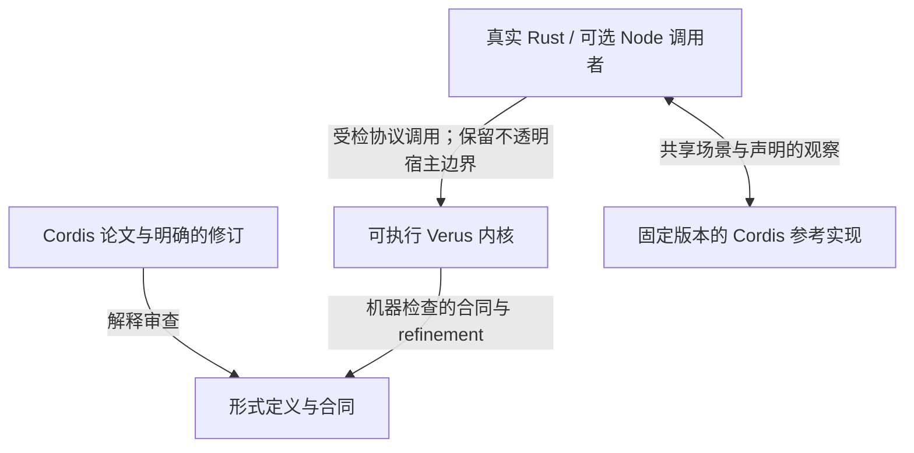

# 论文到代码的验证计划

[English](verification-plan.md) · 简体中文 · [更新恢复案例](cases/update-recovery.zh-CN.md) · [论文剩余义务](paper-mapping-inventory.zh-CN.md)

**规划基线：2026-10-23，实现提交 `82145ca`。** 本文记录后续工作顺序。
生成场景、测试与证明的错误检测对照、结构整理均是计划工作，不是新验收结果。
已有成果继续使用其原有范围与绑定源码的报告。

目标是让论文约束在真实运行中产生价值：插件作者可以更新 provider，理解清理为何
受阻，安全重试，并审查行为背后的合同。首个交付范围继续为
`provider-consumer-one-child/v1`：一个 provider、一个 consumer 和一层 Child，
使用受管可逆数据、显式依赖和可失败清理。R01 与完整论文到代码映射保留为长期目标。

## 两条互补的检查路径

[Anthropic 文章](https://www.anthropic.com/research/formal-verification)报告了一个
Rust/Verus Python 解释器，在超过 170 万个生成程序上与 CPython 的行为一致率为
99.95%。其[技术附录](https://www-cdn.anthropic.com/files/4zrzovbb/website/6867eadf760258fa8b42a504600cd3c036d16358.pdf)
区分了相对于形式语义的证明与相对于 CPython 的实测；给出的解释器定理约束执行
返回时的结果。附录还报告：七个注入错误全部使证明失败，其中五个未被随机测试发现。
这些是作者报告的实验，本项目没有独立复现。

我们借鉴证据分工，不将其实验覆盖数字或终止性结论移植为本项目的保证：

图中说明证据的分工，每条连接都需要对应范围的实际证据。
Verus 检查的内核源码也由 Cargo 编译运行。形式定义是否忠实表达论文条目，仍需审查。
集成测试与差分测试检查真实调用者和兼容行为，不证明任意 callback、FFI 或外部 I/O。
编译器、验证器、库和宿主前提继续见[架构边界](architecture.md)。

论文、上游实现与修订后的失败策略可能不一致。保留论文反例和有意行为差异。
一致率衡量指定生成分布上的观察，不能当作证明覆盖率或应用正确的概率。

## 复用已有基础

| 已有入口 | 已提供的能力 | 本轮计划扩展 |
| --- | --- | --- |
| [更新恢复案例](cases/update-recovery.zh-CN.md)与[复现脚本](../scripts/reproduce-update-recovery.py) | 真实 native 与普通 Rust 宿主路径、受管逆操作失败、依赖保留、显式重试及绑定源码的证明选择 | 围绕同一用户保证生成更多执行历史 |
| [Node 差分入口](../scripts/check-node-compat.mjs)与[共享 fixture](../tests/compat/differential-fixture.mjs) | 固定场景、固定上游、源码／制品哈希及精确观察比较 | 为生成场景增加独立版本化的场景与观察格式，保留现有精确 fixture |
| [五项更新恢复负控](../scripts/negative-controls.update-recovery.json) | 修改真实实现，并按严格条件判断证明拒绝 | 将同一变异实现也交给相关行为测试，记录两种检查各自发现的错误 |
| [准入合同](progress-contracts.zh-CN.md) | 部分真实 API 的精确成功条件 | 同时检查有效接受与错误拒绝，避免“所有请求都拒绝”也满足预期保证 |
| [论文清单](paper-mapping-inventory.zh-CN.md) | 固定剩余义务和依赖 | 将新证据关联到既有工作项，不用受限成果关闭一般义务 |

本计划是[采用计划](adoption-plan.zh-CN.md)中 A07/A08/A13/A15 与 F1/F4 的近期
受限迭代。不再增加一套 R 系列里程碑，也不替换原始 ledger 及其关闭条件。

## 要交付和审查的保证

每条保证需要论文条目或明确的实现扩展、实际调用链、完整合同及前提、新运行的证明
证据、非空的成功／失败案例，以及适当的错误实现负控。

| 用户保证 | 论文对应 | 真实路径与所需证据 |
| --- | --- | --- |
| 依赖者清理尚未解决时，旧 provider 仍受保护 | 定义 54 与 L-Unload 守卫；按定义 53 区分当前 target 和 Episode 已承诺的 provider | `Kernel::begin_cleanup`、`LifecycleState` 与 `cleanup::update::failed_child_keeps_chain`；观察失败与重试期间真实保留的身份 |
| 受管恢复失败保留逆操作及载荷 | 带见证效果与严格逆操作定义域；定义域限制属于明确的 R1-DOMAIN 解释 | `Inverse::restore_following`、`CleanupQueue` 和 `NativeRuntime::fail_managed_execution`；同时检查值与逆操作深度，不能只看队列为空 |
| 旧回复或重复回复不能结束新清理尝试 | 代次／票据是落实生命周期顺序的实现机制，不是论文中独立编号的定理 | 实际 action／restore 票据、`retry_execution` 和收据检查；覆盖重试与新 Episode |
| Child 逆操作退休其实际 Child，释放服从真实服务依赖 | 定义 52 与定义 54 | 原子创建 Child 请求与逆操作，记录父 Episode、退休与 Unload；不能用父子所有权替代服务依赖 |
| 故障原因移除后，受支持的更新能够成功 | 局部准入与实际逆操作合同；为定理 68–70 提供受限恢复证据 | 真实 update、restore、retry、release；检查成功启动／释放与准确阻塞结果，不宣称完整恢复等式或全局推进 |

故意通过原始资源句柄造成的干扰单独归类。这类案例检查干扰识别与失败保留，不证明
环境无法干扰。普通已消费 `FnOnce` 清理产生的 `Drained`，不得计作受管数据恢复成功。

终止性是另一条结论。定理 73 针对其前提下有限／有界、仅含生命周期步骤的模型。
宿主超时不能直接证明抽象规则死锁；一次有限执行成功，也不能证明所有 Future、
JavaScript callback 或调度器最终完成。

## 架构方向

保留共享的已验证生命周期协议，为每个宿主建立准确的连接合同。`NativeRuntime`
和 `NodeRuntime` 是经过验证的 Rust 状态所有者，不表示内核内含两套语言引擎。
两者的数据、publication 和调用管理职责不同，仍需各自的合同。

| 层次 | 职责与维护方向 |
| --- | --- |
| 共享验证协议 | 集中维护已承诺绑定、代次、清理收据、失败保留和释放权限；前提确实一致时复用合同与保持性引理 |
| Native 验证状态所有者 | 拥有受管值、保留的逆操作载荷、root／Child 历史；从实际修改建立共享协议所需的 Native 前提 |
| Node 验证状态所有者 | 拥有模型中表示的 publication、句柄与调用状态，单独建立 Node 前提；JS 对象内部及 callback 效果保留边界 |
| 普通宿主与兼容代码 | 执行 callback、Future、I/O，维护传输／FFI 对应并处理真实错误；测试验证这些路径，调用已证明函数不自动证明整个包装层 |
| Harness 应用 | 承担官方工作流及应用专用 Loader／HMR 集成；通过运行时 API 接入，不成为内核依赖 |

当前源码路径为 Rust `Runtime` → shared `NativeDriver` → `NativeRuntime`，
以及 Node facade → N-API adapter → `Driver`／`NodeDriver` → `NodeRuntime`。
两者连接共享生命周期状态。源码入口为
[Native 所有者](../crates/cordis-kernel/src/native_runtime.rs)、
[Node 所有者](../crates/cordis-kernel/src/node_runtime.rs)及
[共享生命周期状态](../crates/cordis-kernel/src/lifecycle_state.rs)。
纯 Rust 使用继续不依赖 Node 运行时。结构调整先改善现有 crate 内的所有权划分与导航；
增加 crate、宿主语言或时序逻辑库不是本轮前置条件。

## 工作顺序与退出条件

以下五项扩展均为**计划中**；上文已有案例和证明继续作为基线。
依赖规定验收顺序，不要求每次小改动都重跑完整检查。

| 顺序 | 交付物 | 依赖 | 退出条件 |
| --- | --- | --- | --- |
| 1. 固定保证与观察范围 | 在现有案例中完善简洁的合同／证据矩阵：支持操作、API、效果定义域、观察、前提与排除项 | 已有案例与论文审查 | 每条对外保证都有真实调用者，并区分证明／测试；不支持行为和合法成功条件明确 |
| 2. 生成并缩减真实 Native 场景 | 固定 seed 的生命周期场景格式、运行器与缩减器，调用生产 API | 1 | 复现原有失败／重试案例，覆盖下述必需场景族，保存可重放的最小失败，并用已知错误负控验证缩减有效 |
| 3. 与 Cordis 比较共享子集 | 为同一受支持场景描述提供 Node/native 与固定上游适配器 | 1；复用 2 的格式和缩减器 | 实际运行两端，保留原始轨迹，为每个结果分类并报告分母；不能把未解释差异作为兼容通过 |
| 4. 对照测试与证明的错误检测 | 对既有五项实现变异，用同一份变异源码分别运行相关行为检查与证明 | 2；涉及 Node 行为的负控还依赖 3 | 每个适用负控都有新正向基线、有效变异编译、目标合同拒绝及独立的行为结果 |
| 5. 整理合同和审查证据 | 复用重复的所有权／未修改状态／来源引理，明确模块职责，更新架构导航 | 1–4 建立行为和错误检测基线 | 保持受支持行为与公开合同强度，更新受影响的证明选择器和源码链接，最终源码通过集中验收 |

### 生成场景

从既有 provider／consumer／一层 Child 结构开始。变化项包括受支持的注册／启动顺序、
provider 替换、清理失败位置、干扰写入、显式重试、旧／重复回复及最终关闭。
包含无故障更新和恢复后再次更新。别名与受控异步完成，须在对应访问和调度边界明确
后扩展，不能默认为第一版范围已经覆盖。

运行器必须调用真实 API、观察真实资源。生成器的模型可以选择命令，但不能代替
执行器或编造生产历史。区分满足前提的有效场景与故意无效命令／干扰场景。
拒绝和不支持必须留在报告中，不能静默过滤。

保存 seed、生成器版本、完整命令序列、输入参数、适用时的显式完成顺序、观察格式和
运行时版本。缩减必须保留失败判据及必要的所有权、依赖和故障设置。保存缩减后的
命令，使复现不只依赖随机种子或生成器最新版本。

必需观察包括 API 结果、target／committed provider 身份、owner／Episode／attempt
身份、publication 可见性、清理／重试决定、保留资源以及相关因果顺序。
比较中间状态与终态。即使所有拒绝都“安全”，缺少必需场景族或有效成功操作的运行也
不能通过验收。

### 兼容性统计

Node 适配器是另一项宿主验收面，不能仅因读取同一场景描述就继承 Native 受管数据
定理。明确其支持子集与连接前提。某操作如果没有对应的上游公开 API，应记录限制，
并保留其 Native 保证测试。

运行结果分为一致、经过审查的有意差异、不支持、未解释差异／崩溃／超时。
同时报告尝试数、支持数、完成数和生成参数，不能在一致率中隐藏不支持或超时。
已知差异需要范围精确的条件、原因、关联回归，以及范围变化后的重新审查。
每个未审查失败都会阻止对应兼容声明。

不同运行时的局部 ID 映射必须保持创建、所有权、Episode 与绑定关系。
保留原始轨迹并说明允许的观察投影；不能为了相等而排序掉有意义的顺序、丢弃错误或
合并代次。既有固定差分 fixture 保留原本的精确比较。Harness 工作流验收仍在配套
应用中单独记录。

### 负控与维护成本

复用既有五类错误：把失败报告当成功、绕过释放收据、丢弃保留载荷、忽略逆操作深度、
拆开 Child 请求与逆操作。证明拒绝必须以新运行的匹配正向证明、完整变异编译和
指定合同失败为前提。超时、资源限制或无关编译／求解失败属于无法判定。
行为结果独立记录为已发现、未发现、不适用或无法判定，并说明原因。
测试未发现而证明拒绝的变异可以体现覆盖差异，不能成为削弱任一检查的理由。

只有实际前提和状态所有权一致时才提取公共引理。让可执行操作与合同便于一起定位，
区分公共协议推理和宿主专有解释。衡量证明检查成本与变更影响，不把证明行数当成果。
不得通过 `assume`、`admit`、`external_body`、删除守卫或弱化观察绕过困难证明或
失败的比较。

## 验收与报告

先完成相关生产代码和证明，用编译与定向检查解决阻塞，再补齐关联的场景和负控支持。
到集成验收边界，在最终源码上运行一次
`python3 scripts/record-development.py --offline`，不要另外重复运行其底层全量
工作流。新生成场景批次及测试／证明对照负控使用各自绑定源码的记录。
修复与证据更新遵循[验证政策](validation.md)。

每份验收记录注明范围、源码／工具／上游／制品哈希、精确命令、原始日志、支持场景、
观察差异、证明结果、负控结果及剩余边界。只有 seed 不够。
改动后的源码不能继承旧通过结果；只新增计划文档也不会更新证明或发布证据。

跟踪已交付保证、覆盖的操作／故障族、可复现最小失败、未解释差异、负控检测和独立
复现。维护者自己在干净环境安装，不等于外部审查或采用。证明义务数、随机样本数、
兼容比例不能混合成整篇论文完成百分比。

当五项交付在声明范围内均达到退出条件，且审查者能够贯通
“论文条目 → 真实 API → 可执行合同 → 已检查证明 → 失败和成功复现 → 被拒绝的错误实现”，
本轮才算完成。发布／平台资格和全量负控继续使用各自的验收门槛与状态。

## 保留的长期义务

一般共享堆重放与函数对应（R01/P01/P03/S03）、每个切面的完整恢复（R08）、合法
Episode 删除（R09）、独立性（G02）、全局推进（G04）、合流（G07）与配置收敛（C01）
继续在[固定清单](paper-mapping-inventory.zh-CN.md)中跟踪。
通用值／效果的强保证继续采用已选定的封闭可验证值路线，任意 `Arc<T>` 留在明确标注
边界的普通路径。

Node 恢复（R07）、不透明外部资源和宿主调度活性保留各自义务。
受限 Native 交付不必等它们全部完成，也不能通过省略它们来关闭整体目标。
每次扩展一个已明确用户价值与前提的效果或宿主范围。
